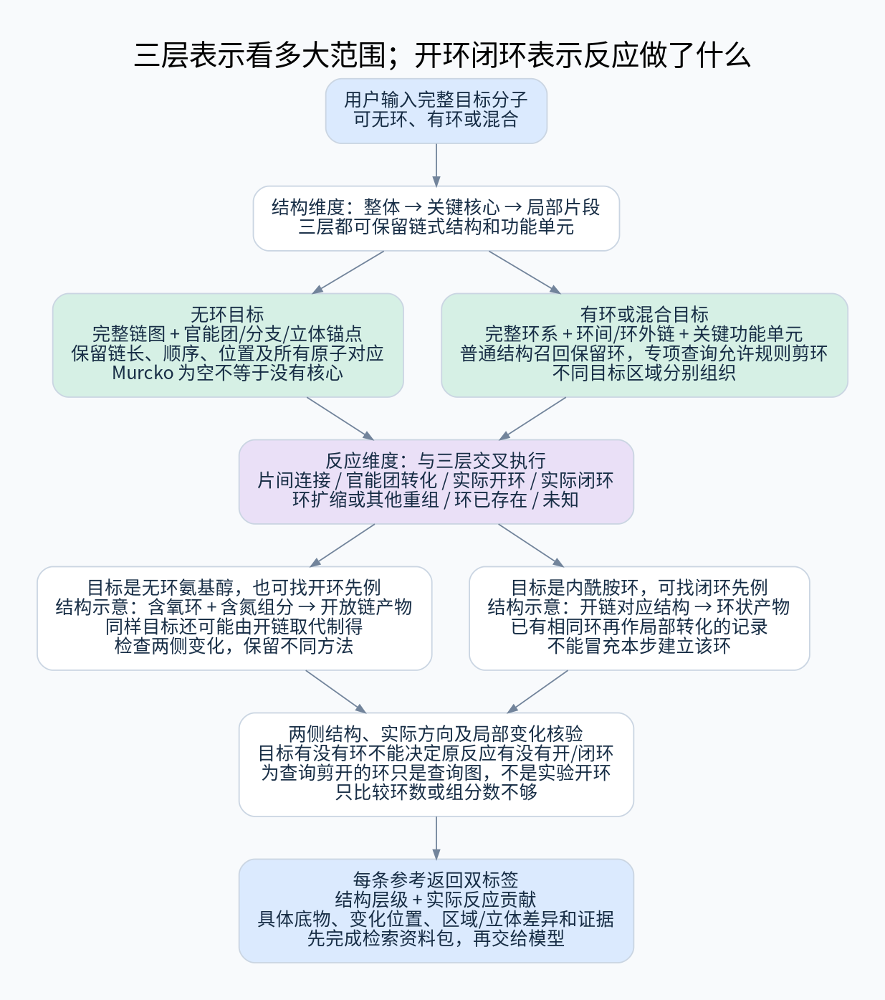

# 无环结构召回与已有反应驱动的开闭环分析

## 1. 默认流程：先召回实际反应，再识别环变化

三层继续表示整体、关键核心和局部片段的结构范围。开环、闭环、环重组、环保留是**候选反应分析后得到的贡献标签**，不再是默认预先枚举目标环变化位置的查询通道。

```text
目标结构 → 三层结构与支链查询 → 命中产物及其关联反应
    → 分析实际反应物—产物的变化
    → 将有据变化对应到目标区域
    → 按目标相关性、证据和方法多样性重排
    → 参考资料包 → 模型预测
```

默认不在来源反应出现前，对目标任意剪环、加环或构造开/闭环前体。环变化分析不只作用于支链命中，整体与核心命中的所有候选反应都参与。它是排序之前的化学判定，不是用结构相似度猜反应类型。



[高清 SVG](../diagrams/topology-search.svg)

## 2. 无环目标仍有非空的三层结构查询

| 层级 | 查询内容 |
|---|---|
| 整体 | 完整链图及带标签的化学相关形式，保留长度、分支、官能团顺序、位置和目标立体/同位素要求 |
| 核心 | 官能团、分支点、立体中心等锚点及其原有路径；核心不等于环，也不只取最长碳链 |
| 局部/支链 | 完整功能单元、局部连接邻域和带原始目标位置的结构片段 |

Murcko 为空只说明环骨架方法不适用，不跳过无环目标或执行空查询。纯烃采用明确的链长和分支信息；混合目标按不同区域选择环系与链视图。

普通目标分片只为组织实际存在的结构片段，不预先把某个目标键认定为应发生的开/闭环反应中心。通常保留完整环系。为扩大局部结构召回，可以用更小的真实目标子图，或显式放宽某些匹配属性，但必须标明部分结构关系；不将它补成虚拟前体再冒称有合成依据。

## 3. 反应分析怎样发现开环和闭环参考

对每个已召回产物，关联其不同实际反应，而不是只取一条最近、最高收率或任意记录。核对实验结果、组分实例、阶段与两侧对应后，识别目标相关区域的变化：

| 已有反应的事实 | 得到的标签与参考 |
|---|---|
| 相应底物环连接断开，产物为开放结构或其他拓扑 | 有据开环参考，指出开裂位置、其他变化及真实底物 |
| 产物环内的某些连接在反应前不存在，并与保留路径共同形成环 | 有据闭环参考，保留完整前体、配对组分及变化范围 |
| 同一环在前后已存在，只改外围基团或环上键型 | 环保留的修饰/转化；不计为闭环方法 |
| 开闭变化并存、环尺寸或连接方式改变 | 净拓扑重组参考，允许多个标签，不强行归为单一成环 |
| 只有产物、映射冲突或缺少必要组分 | 环变化未知/未评估，不能从产物环形状补出反应过程 |

规则用于**分类已观察记录的变化**，不是在无来源时制造目标前体。反应名称、环数、组分数量都不是单独的判定依据；芳构化/去芳构化或环上加氢也不自动代表环拓扑改变。只给起终结构的记录保持净变化说明，不推断微观机理。

## 4. 从来源变化映射到目标，不能超出证据

目标—参考产物匹配和参考产物—反应物映射共同确定证据的适用位置：

- 闭环中新形成的产物键，若完整位于目标对应区域，可投影为目标相关连接的方法线索。
- 开环时消失的键不在产物中；记录它在原底物中的端点及可映射到目标的保留原子，不伪造一根目标中实际存在的“待断键”。
- 若源变化发生在当前匹配之外、如远端保护环，返回“环变化与当前目标片段无直接对应”，不能因反应有开环标签就优先。
- 只有部分端点或局部环境匹配时，标部分支持/类比，明确未覆盖的环尺寸、位点、立体和其他官能团。
- 多来源、重复实例、对称映射或阶段不明时，沿用局部证据与争议规则；不为获得确定标签挑选最有利映射。

最终给模型的是“某个实际反应以这种环变化生成了与目标这一段相对应的结构”，不是“系统已经证明目标应在这里开环或闭环”。

## 5. 排序的核心：对目标有用的变化，而非有环标签

先确认实际结果及局部变化证据，再按目标关系分组比较：

1. 能直接解释目标相关连接/片段形成，或提供有来源的整体转化入口；
2. 变化方向、位点和局部环境相近，说明可参考范围及差异；
3. 仅共享支链或环片段，实际变化发生在别处；
4. 变化未知或未评估。

该顺序是任务内的相关性组织，不是“闭环永远比修饰重要”。目标也可能只差一个局部修饰；有据的修饰反应在其对应任务中可优先。相同目标保留开环、开链连接、闭环或环保留等不同来源策略，不能只按整体相似度或反应名混排。

同一产物的末端修饰记录不能占满候选：在共同预算内继续关联其他反应，并为不同有据构筑方式保留名额。没有映射的结构线索保留有限核查机会，不把未知当作确定无用。

## 6. 召回不足时怎样处理

**排序只能处理已召回的候选。**为减少方法遗漏，首轮保留三层查询，局部查询含连接环境和功能单元，而非只看完整支链；完整环核心查询和局部片段视图可以互补。只要结果分组真实，不要求所有方法的完整产物都与目标同骨架。

初轮不足时可以：

- 在预算内扩大相同实际产物的关联反应集合；
- 使用已定义、带标签的更小目标片段或邻域放宽查询；
- 在有实际来源后，围绕来源中的真实产物、反应物或局部变化补查相关记录，保留触发反应和方向。

这些补查不生成没有来源的目标开环/闭环前体，不把资料不完整描述为“目标没有成环/开环方法”。若将来需要无来源的环变换枚举，应作为单独的后续能力评估，不属于当前默认检索。

## 7. 与替换类比、单分子环化和统计衔接

单反应物替换继续只在已有反应锚定下评估。来源本身是开环或闭环时，核对其环尺寸、变化位置、前体端间路径和立体/区域差异；图回放生成的候选保持推定标签。替换模块不能绕过此约束去无来源地预测目标的环变化。

实际闭环记录中的前体可以是一个分子带两个相关位置；不要求两个独立底物。图表示检查中的“剪开环仍是一片双端口”用于验证连通性；实际前体以已召回来源反应为依据。

任务结果携带：结构层级、原始查询、来源反应、实际环变化标签、源变化位置、目标对应、证据范围和不完整状态。执行预算覆盖候选反应关联和分析；不再为预生成环变化位置设置任务配额。

分别统计结构命中的分子/反应数、已分析反应数、与目标相关的开/闭环方法数、仅其他位置环变化数、未知与未评估数。跨标签总数取真实实验并集，分析完成不等于结构召回完整。

## 8. 例子与验证边界

人工结构例子已显示：同一无环氨基醇产物可对应环开裂后的连接或开链取代；同一环产物可由闭环或既有环的局部转化得到；净环数相同也可能有环扩缩。这些例子支持**先看记录两侧，再判贡献**的流程。

[现有结构探针](../reviews/check_acyclic_and_ring_changes.py)和[结果](../reviews/acyclic_and_ring_change_checks.json)只验证图变化及连通性，没有测试真实分类器、排序或召回。查询剪环例只是表示反例，不作为新默认流程的候选生成实现。

初版仍需真实标注案例检验关联反应覆盖和目标相关性。无法证明三层结构查询能召回所有有价值环变化，尤其目标核心从未出现时；系统应报告覆盖范围与缺口，而非用无依据的环变换补齐结论。
