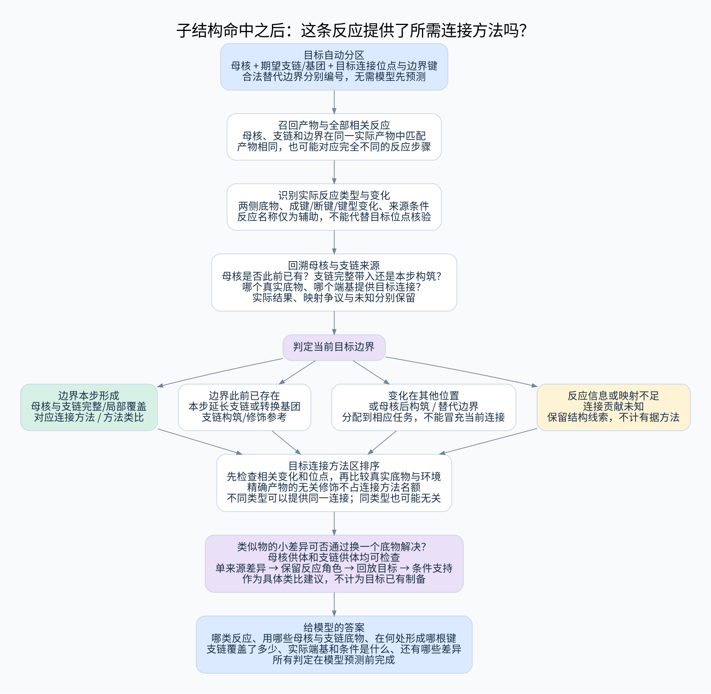

# 目标母核—支链连接方法判定

本文件把用户强调的“反应是否提供将期望支链/基团接到目标母核上的方法”定义为检索结果进入模型参考包前的必经判定。它与三层前置检索并列衔接，不要求模型先预测反应。

## 1. 每条反应必须回答的三个问题

1. 这条记录实际发生了什么转化，反应物和产物的哪些连接发生变化？
2. 变化是否作用于目标对应的母核、支链及连接位点？目标连接是在本步形成，还是早已存在？
3. 它能提供完整连接、局部连接类比、支链延长/基团转化、其他获得步骤中的哪一种参考？

产物结构匹配只产生候选。所有候选在返回前必须有上述判定结果；证据缺失时可以是“未知/未评估”，但不能因为命中完整产物就默认为连接方法。



[高清 SVG](../diagrams/attachment-methods.svg)

## 2. 自动定义目标连接单元

对每个规则产生的母核候选，记录：

```text
连接目标标识
  母核的目标原子集合
  期望支链/基团的目标原子集合
  两者之间的边界键集合与两端编号
  连接类型和目标位点、环关系、立体要求
  生成该分区的规则、目标位置与关系层级
```

一个分区中的母核和外侧原子互斥，联合连接的多个边界整体保留。头尾是具体位点而非画图方向。连接位点与相邻功能团纳入匹配，不仅比较孤立支链。

一个目标可有多个合法边界。例如 `Ar–O–CH2–CH2–NMe2` 可将 `Ar–O` 与后面的碳链作为一组，也可将 `Ar` 与含氧支链作为另一组。二者询问的是不同的待形成键，分别登记，不能默默互换。“Me”为甲基，“Ar”为示例芳基，不是具体目标输入格式。

分区由结构规则自动产生；可靠命中反应也可启发有出处的另一个边界，受候选预算限制。这一步组织检索问题，不承诺切割得到的图就是真实前体。

## 3. 判定反应类型：名称、图变化和底物角色分开

| 信息 | 判据 | 不能代替的判断 |
|---|---|---|
| 已观察的转化模式 | 反应两侧可靠对应的新成键、断键、键型/基团变化及位置 | 不能单凭新生成某官能团认定特定机理 |
| 反应类别/名称 | 有来源的标注，或审核规则同时符合实际底物、变化、必要条件 | 名称或某个催化剂不能证明连接的是当前目标位点 |
| 底物角色 | 哪个实际组分提供母核，哪个提供支链/小单元，各自的反应功能团和离去部分 | 产物片段不能直接当成完整反应物 |
| 分类支持状态 | 来源支持、规则推定、类别冲突、部分可判或未知 | 分类确定度不能替代原子映射和实验结果证据 |

初版可按实际记录识别取代/偶联/酰化/缩合/环化/氧化还原/保护与脱保护等粗粒度类别；命名反应只有在依据充分时赋名。不要求每条反应都有一个唯一名称；串联或多转化可有多个标签。

两个不同反应类别可能形成同一个目标连接；同一反应类别也可能在完全无关的位置发生。返回两者的差别，比只给一个“反应类型”字符串更有用。

## 4. 从匹配产物反查实际连接事件

1. 将母核、支链和边界同时匹配到同一个真实产物实例，保留完整匹配关系与支链精确/部分覆盖。
2. 用产物—反应物对应回溯两端和各相关原子的来源实例，保留离去基团、活化形式及完整配对组分。
3. 检查对应边界键在反应前是否已有、是否本步形成或只改变键型；核对其他必需变化和实际产物结果。
4. 检查母核在起始底物中是否已经存在，以及支链是作为完整片段接入、逐步延长、原位构筑，还是母核在已有支链附近形成。
5. 检查变化位点是否就是目标对应位点，而非同类基团在分子的另一处。对称映射、重复实例和多点连接遵守详细规范的全映射与局部争议规则。
6. 比较真实底物反应端、核心/支链邻域、其他官能团、保护、立体及所需条件，列出尚未覆盖的迁移差异。

定义性变化有争议或必要反应物缺失时，不能判为有据连接方法。结构命中仍保留，必要时提供来源段落供复核。此判定是检索后的必经流程，未知是合法结果，不是跳过判定。

## 5. 相对目标连接的分类与展示

| 目标相关性 | 判定范围 | 在资料包中的位置 |
|---|---|---|
| 对应边界形成，母核与所需支链均覆盖 | 有合格观察/制备记录，所需连接和位点有局部证据支持；核心来源、完整支链及必要变化可核对 | 对应连接方法优先参考，显示证据等级与底物端基差异 |
| 同边界类型的局部连接类比 | 已形成相应类型和方向的连接，但母核或支链仅局部相近 | 方法类比，突出未覆盖结构，不声称已合成目标 |
| 支链延长或目标基团转化 | 母核—支链边界已存在，本步改变支链内部或相关基团 | 延伸/修饰方法，可在相应步骤任务中优先，但不计“将整条支链接到母核” |
| 目标连接已存在，发生别处变化 | 该记录的主要变化不在当前边界或所需支链内 | 其他制备/获得资料，不占当前连接方法名额 |
| 先有支链，再构筑母核/环 | 核心并非完整作为底物保留，而在这一步构建 | 另一构筑方向，不能描述为现成母核上接支链 |
| 其他合法边界形成 | 支持同一目标的另一规则分区 | 另一个连接目标的参考，不记为当前边界成功 |
| 未知或未评估 | 实际结果、两侧结构、映射或分类依据不足 | 结构线索和待核实资料；未知不等于方法不存在 |

“对应连接方法”是局部转化的证据，不保证真实底物就是目标要求的前体，也不保证所有目标远端基团共存时能迁移。母核精确、支链精确、位点正确、边界事件成立、真实底物角色、所需其他变化及环境差异分别记录，不能压缩成一个相似度阈值。

同一分子中闭环、多边界同时连接以及多组分原位构筑保留自己的任务类型。不能因为母核和支链没有来自两个独立底物就否定已记录的其他构筑方法；也不能据一根边界新键宣称全部边界已经解决。

## 6. 同一个产物，四种不同贡献

假设目标为 `Ar–O–CH2–CH2–NMe2`，此处 `Ar` 取对甲氧基苯基。当前任务关注 `Ar–O` 与 `CH2–CH2–NMe2` 之间的 O–C 边界。

| 人工结构变化示意 | 当前任务的解释 |
|---|---|
| 芳酚片段与带适当离去基团的碳链组合，形成所需 O–C 边界 | 为把该碳链接到该含氧母核提供连接事件示例 |
| 已有 `Ar–O–CH2–CH2–NHMe`，只形成末端 N–Me | 支链内部延伸，所需 O–C 边界并非本步形成 |
| 已有目标侧链，仅将芳环另一处 OH 变成 OMe | 当前任务之外的修饰；即使最终产物完全相同，也不是本次连接方法 |
| 在芳基端形成 Ar–O，O–CH2 事先存在 | 支持另一分区的连接方式，不能记作当前 O–CH2 边界形成 |

这四个图例都使用同一产物，产物检索无法区分其贡献。[图结构探针](../reviews/check_attachment_methods.py)与[输出](../reviews/attachment_method_checks.json)验证了边界差异；反应是人工构造的示意，无实验来源、条件或可行性结论，不计作真实反应先例。探针不是反应分类器。

## 7. 结果对象、计数与排序

每条候选反应至少返回：

```text
连接目标标识与目标边界位置
反应类别/来源名称/图变化模式及分类支持状态
母核、支链和边界的匹配关系
母核来源底物、支链供体或各来源实例、实际反应端与配对组分
当前边界：形成 / 已有 / 键型变化 / 有争议 / 未评估
核心已有或本步构筑；支链完整接入或本步延长/转化
相对任务的贡献标签、实验结果、来源位置、所需条件与迁移缺口
```

分别统计：结构候选反应数、完成连接判定数、支持当前边界的方法记录数、方法类别数、不同构筑方式数、支链延伸/转化数、其他修饰数、未知及未评估数。按**连接目标 × 实际实验**汇总，保留不同映射分支但不虚增反应数量；一条反应可服务多个目标位置或边界，跨任务总数取唯一实验并集。

对应连接方法区先检查资格：合格实际结果、当前位点/边界事件、核心与支链覆盖、真实底物及局部证据。再在该区比较方法支持程度、底物环境和来源多样性。精确产物但只改另一基团的记录不能靠整体相似度挤占这个区；它仍可在整体制备或局部修饰区展示。

结构召回分页或预算若先截取了大量末端修饰反应，应在剩余预算内继续查看相关产物的其他反应/候选，并为有据方法分配代表名额。不能简单“取最相似的 N 个产物 → 各取一条反应 → 排名”；预算耗尽时返回“未发现支持当前连接的方法，检索未完成”，而非“没有方法”。

多样性按实际变化与底物类别组织，不按反应名称字符串重复计数。支链互补还要检查头、尾各自是否有对应引入方法及互相保留/共存证据，不能仅靠两个产品分别带有头尾来宣称获得了组合方法。

## 7.1 不完整结构对应中的单反应物替换机会

局部类比不能只作为模糊低优先级结果。若目标差异可投影到原反应的一个来源槽位，按 [单反应物替换规则](single_reactant_transfer.md)产生具体建议：原/拟替代底物、反应端是否保持、完整目标结构回放和条件支持。可改变母核来源或支链来源；同样适用于整体层中本步不形成当前边界的实际反应。

该候选进入独立的“可调整底物的反应类比”区，不冒充目标已报道连接方法，也不因远端一个基团不一致而直接舍弃。改变原中心角色、多个来源同时变或新增选择性问题时显式报告。

## 8. 验收要求与范围

- 同一产物的四种变化被分配到正确的相对任务类别。
- 反应名称相同但连接位点不同，不提供当前边界的直接支持。
- 边界已存在时，只有支链内部变化不得称完整支链接入。
- 同一目标的替代分区分别记录，不能通过移动边界夸大成功数。
- 对称映射、缺少反应物和局部争议返回有限支持或未知，不自动判为方法。
- 核心在本步生成、单分子成环、多组分构筑和多连接边界不得被二底物假设排除。
- 精确产物的无关修饰不能挤掉有相关连接变化的较近类似物；截断情况诚实返回。

目前交付为设计。细粒度分类、证据抽取及排序效果仍需真实标注反应验证。[RDKit 反应与查询语义](https://www.rdkit.org/docs/RDKit_Book.html)可支撑结构处理实现，但不会自动完成本文的目标相关性判定。

## 9. 与无环、开环和闭环的关系

母核表示关键连接核心，可以是链式功能单元；不要求有环。按 [拓扑变化规范](acyclic_and_topology_search.md)，开环时断原环键与引入支链可同时发生，闭环时两个端口可属于同一底物，且有些反应在已有支链附近构建核心。上述都可提供目标方法，不能被“两个现成分子接起来”这一个形式限制。环已存在而仅作局部修饰时，仍不得标成环方法。

## 10. 默认 Markush 家族的连接贡献

[家族查询](markush_queries.md)先返回具体分子的 R 分配和一致核心映射，再判断实际哪一个位点本步被引入、改变或保留。R 类别通过不等于与目标支链完全相同；差异可以支持单反应物替换类比，但不直接增加目标已合成计数。未限制的外围基团在具体反应中仍需检查活性/相容性。
