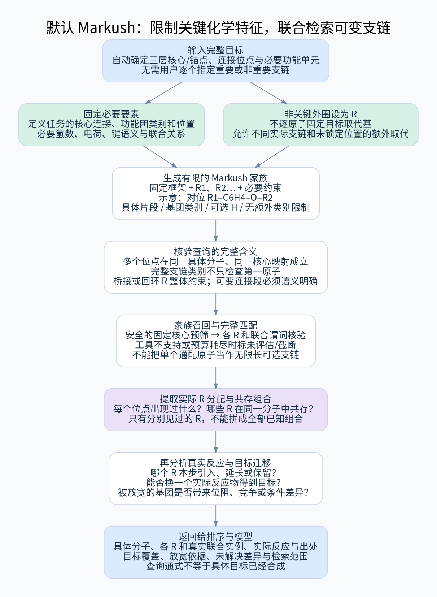

# 默认 Markush 家族查询与多支链联合检索

更新：2026-10-26。用户要求：子结构检索尽量采用 Markush 方式，保留重要官能团限制，对缺少明确重要性的外围支链不过度约束。本文件规定其默认语义；目前为设计，尚无完整 Markush 编译器或真实召回评测。

## 1. 默认方式与三个不同概念

三层结构范围继续保留，但默认用**固定结构要素 + 可变 R 位点 + 必要化学约束**表达每层查询，而非逐个寻找完全固定的连续片段。

| 概念 | 本系统如何使用 |
|---|---|
| 连续精确片段 | 无变量的特殊查询；用于完整目标身份、某些关键局部结构或已核验事实，不再是所有结构召回的唯一形式 |
| Markush 家族查询 | 在指定母核/链核心的多个位置容许不同支链或支链类别，联合检索具体分子，作为默认方式 |
| 分离锚点与可变连接段 | 固定多个重要结构单元及其连接关系，连接段在明确范围内变化；需要联合图约束，不靠 `.` 自动表达 |

Markush 查询中的固定部分可以分布在多个位置，不必全是一个完整的精确片段。但最终具体分子仍要同时满足核心、连接和各 R 条件；“不固定所有原子”不等于“从不同分子随意拼接”。

“检索所有支链”指检索范围内符合条件的**实际分子所带的支链及组合**，不是枚举全宇宙 R 基团，更不是将各位点独立出现过的 R 基取笛卡尔积后声称全部已合成。



[高清 SVG](../diagrams/markush-query.svg)

## 2. 自动生成家族，不要求用户指定哪些基团重要

从用户的完整目标与已审核的结构规则出发：

1. 为三层候选确定固定骨架、链锚点和连接位点；保持目标原子与位点对应。
2. 将核心外的完整连通部分及多个连接端点记录为具体目标支链。
3. 对需要维持任务定义的功能单元保留约束；其余位置生成可变 R 位点，并记录目标在该位置原来是什么。
4. 产生有限个家族：保持关键核心的宽家族、加入必要官能团类别的家族，以及用于定位单底物替换的定向家族。它们的限制、父子关系和触发依据明确可见。
5. 在同一实例中作全核心对应、多位点联合检查；返回具体支链分配，再关联实际反应。

完整目标身份查询可作为并行补充。结构召回的内部实现可先用固定核心作安全预筛，再应用 Markush 约束；不能因为后端只检索了固定核心就将未核验的结果称为家族命中。

## 3. 哪些限制保留，哪些放宽

| 属性类别 | 默认处理 | 例子和边界 |
|---|---|---|
| 定义当前结构任务的核心 | 固定元素、连接、必要键型和位点关系，扩展视图单列 | 环杂原子位置、链锚点之间原有连接、酰胺连接方向等 |
| 定义重要功能单元的属性 | 用完整官能团/邻接谓词约束，保留必要 H、价态和电荷信息 | OH 与醚 O、胺与酰胺 N 不能仅靠一个 O/N 原子判断 |
| 已有反应确定的反应端环境 | 命中实际反应后核验；来源驱动细化有标签 | 具体离去基团、活化状态、反应位点周围环境，不从目标无依据猜机理 |
| 非关键外围取代 | 默认可变 R，不复制目标的每个原子、H 数或取代细节 | 可允许链长、非关键取代或远端结构变化，但仍记录目标差异 |
| 可能影响反应但证据不充分 | 原则上作为结果比较与待核查属性，不自动全部硬锁 | 额外胺/OH、邻位拥挤、保护状态、配位结构等；必要的更具体家族独立生成 |
| 用户明确的完整目标要求 | 完整目标身份与最终建议核验保留，类比召回可有标签地放宽 | 目标立体/同位素要求不因 Markush 放宽而被宣称已满足 |

“影响小”是查询宽松策略，不是化学不活泼的结论。未有具体来源转化前，不输出通用基团活性排序。拿到真实反应后，按反应端、共轭/位阻、竞争位点和已有相容性证据重新比较；必要时补查更有针对性的家族，仍在模型调用前完成。

不统一移除保护基、卤素或所有远端杂原子。尤其邻位位阻、远端配位或新增竞争位点可能改变参考价值：它们可不限制首轮召回，但必须在反应相关性和替换类比中可见。

## 4. 家族查询的完整语义

每个家族至少携带以下内容，不能只存一个带 `*` 的字符串：

```text
家族标识、三层所属范围、目标位置及生成规则
固定结构或固定锚点；同一组分要求和连接关系
各 R 位点：母核端点、外接键、必须/可选/无要求
允许具体片段 / 基团类别 / 片段谓词 / 无额外类别限制
是否允许 H、额外取代、指定环约束、立体/电荷要求
联合约束：共享片段、多点闭合、位点关联或明确相等关系
目标真实支链分配（用于差异比较，不默认成为硬条件）
已支持语义、未支持语义、资源预算与枚举完整性
```

### 4.1 可选 H 与额外取代

`R = H 或烷基`、`R 必须为非 H 取代基`和“该位点不限制”是不同规则。SMARTS `*` 只匹配一个原子，不是任意长度侧链，也不能单独实现可有可无的整段取代。

默认不锁死未被指定为关键的其他取代位点，允许有效的额外取代并提取出来说明。只有任务需要明确取代数、环融合限制或禁止额外取代时才增加相应谓词；这些条件必须出现在查询摘要中。

### 4.2 全支链类别

“烷基、芳基、杂芳基、带指定功能团的链”等类别约束检查整个相应支链及连接方式，不能仅检查第一原子。类别定义要有版本与反例；例如碳起始的链内部含 O，并不因此属于限定的全碳烷基。

不必要的长度、分子量或元素种类上限默认不作为化学硬过滤。若为资源原因限制支链遍历或映射数量，结果标为未完成/未评估，不能当作化学不匹配。明确提出的基团类别或长度范围则正常作为查询语义。

### 4.3 多位点与多点连接

所有固定/必需 R 约束必须在一个具体分子的同一全核心映射下成立。可以有多个合法映射，保留等价类和歧义，不能为 R1 与 R2 分别选择互相冲突的最优对应。

外侧同一个连通部分若连接两个或更多核心位点，登记为联合支链/桥接块及端点列表，不能拆成几个可独立替换的 R。R 基回接核心形成环，必须按完整拓扑核验；这一检查不等于主动预测环变化位置。

重复使用同一个 R 标签是否要求相同片段、是否存在 R1/R2 条件依赖，需要显式约束；不能让显示标签或原子 map 编号隐含决定逻辑。

### 4.4 分离锚点和可变连接段

当重要固定片段分散时，可将其建成同一分子内的联合锚点任务，明确相对连接、允许的路径类型/长度及共享原子规则。固定片段单独命中不是联合命中；一个通用的点分 SMARTS 不保证位置关系。

首版只支持审核过的有限连接段语义。不能实现的可变路径、依赖 R、环闭合条件等返回“该语义未支持”，不静默移除条件。普通连通核心预筛可复用，但仍必须完成全查询核验。

## 5. 如何执行并取得真实 R 基分配

1. 验证家族表达式与支持能力，记录所有关键约束。若编译失败，保留原因。
2. 用固定结构或必要特征安全召回，确保预筛没有比 Markush 约束更严格。
3. 检查每个候选的具体组分、全核心映射与所有位点关系。
4. 沿连接端提取完整外侧结构或联合块，核对必需/可选 H、基团类别和跨位点约束。
5. 返回来源具体分子、匹配映射、各位点实际 R、额外取代和联合连接，以及与目标 R 的差异。
6. 关联真实反应，继续做母核—支链接入、局部转化、实际开/闭环及单反应物替换分析。

RDKit 支持部分通用基团查询，并且需要显式启用通用匹配；额外支链谓词也可用后检查完成。它不是无需配置即可执行任意专利 Markush 语言的完整引擎。[通用基团说明](https://www.rdkit.org/docs/RDKit_Book.html#generic-markush-queries-in-substructure-matching)与[整段支链检查示例](https://www.rdkit.org/docs/GettingStartedInPython.html#advanced-substructure-matching)。

R-group decomposition 用于整理具体命中分子的位点和支链，不替代召回和约束核验。不得仅枚举几个具体 R 组合后声称覆盖整个家族。

## 6. 三层中的默认应用

| 结构层 | 默认家族形式 | 返回的价值 |
|---|---|---|
| 整体结构/骨架 | 保持主要连接框架及关键功能单元，将非关键外围位点变为 R | 同框架的真实取代系列、能由一个来源底物差异解释的机会 |
| 核心/连接 | 保持核心和必要连接环境，多位点 R 同时可变；可生成只固定某个目标支链的定向家族 | 核心相同的全部已观察支链分配、头尾互补与真实共存 |
| 局部结构/片段 | 保留重要锚点或功能单元，其余部分作为 R 或已支持的可变连接段 | 更宽的局部方法参考，不要求整个连续片段都逐原子一致 |

宽家族用于发现实际取代空间；定向家族用于定位某个目标位点或单反应物替换。多个家族不直接取并集后混称精确命中，要保留每条记录满足了哪一份约束。

对于反应贡献，Markush 命中仍只是结构候选；必须检查真实反应是否本步引入相应 R、改变哪一个位点、是否仅在别处修饰。允许的 R 类别相同不意味着其反应端或条件可以互换。

## 7. “所有支链”的统计与证据

返回三个层次：

1. 每个核心位点实际出现过的 R 值、类别与具体分子/反应来源；
2. **同一个具体实例**中同时出现的 R 组合及其证据；
3. 目标 R 组合在当前检索范围中已有完整实例、仅部分匹配、分别有覆盖、未找到或尚未完成。

R1 见过甲/乙、R2 见过丙/丁，不表示四种组合全有制备先例。基于实际来源提出新的组合或替换只能进入推定区。

统计家族数、实际后端任务数、完整/截断状态、唯一具体分子/实验数、各位点 R 值数及真实联合组合数。宽家族每个命中分子只在唯一分子数中计一次；等价映射、多个位点和不同家族标签另外保留。部分扫描只称“已观察到的支链”，不声称穷尽所有取代可能。

## 8. 通式查询与通式文献记录分开

从明确目标自动生成 Markush 查询是本设计默认行为；它与“把一条未实例化的通式当成具体制备产物”不同。

若来源本身为通式，保留通式及 R 定义的结构范围信息。命中其表达范围不自动增加具体分子制备计数，必须有关联的具体实验实例。查询具体结构是否落入某份复杂通式、通式与通式之间的包含关系属于另一能力范围；未实现时明确标记，不用当前小型 R 查询示意冒充全面支持。

用户目标仍默认是完整具体分子；高级用户可输入家族查询作探索，但它不被描述为一个已经确定的合成目标。

## 9. 排序、预算和后续反应分析

默认以 Markush 家族召回，不先要求全部目标支链精确一致。排序再比较：关键功能单元/位点、目标 R 的精确或相关覆盖、差异是否集中到一个实际反应物、是否有对应引入方法和来源范围，以及额外竞争/位阻等差异。

所有 R 都放宽时命中可能很多；以固定核心、任务目标和真实反应方法贡献选择代表实例，并保留支链类型与构筑方式多样性。来源不足或预算截止时先显示范围，不静默把 R 改成原目标精确片段来缩小结果后声称家族查询完成。

Markush 家族共享既有任务/时间预算；不把家族、基团展开和通式枚举视为无限资源。后端未支持泛化条件时可使用安全宽预筛加完整谓词核验；核验无法完成则返回未评估。来源后再作条件相关筛选，不在未知转化时把所有潜在影响都固定成硬限制。

## 10. 示例与验收

示例家族为对位 `R1–C6H4–O–R2`：R1 允许 F/Cl/Br；R2 允许 C1–C3 饱和无环中性烷基；其他未锁定环位点可有额外取代。这只是演示多位点类别约束，**不表示三种卤素在反应中等价**。长度范围是本例显式条件，不是所有查询的默认限制。

[结构探针](../reviews/check_markush_queries.py)及[输出](../reviews/markush_query_checks.json)检查：

- RDKit 通用芳基条件显式启用前后的差异；
- 多个真实 R 组合可以由一个家族查询命中；
- 错误相对位置、分散于不同分子的片段不能通过联合查询；
- 支链首原子是碳而内部含 O 时，不能冒充所要求的烷基；
- 可选 H 和禁止额外取代须显式声明；默认不锁定其他环位置；
- 超出明确范围或基团类别的候选不通过对应约束。

该探针只处理一个演示家族和文档通用组例子，没有实现生产家族生成、复杂联合 R 编译、完整专利检索或反应相关性排序。所有实际方法与危害/条件判断仍需原先的证据流程。
