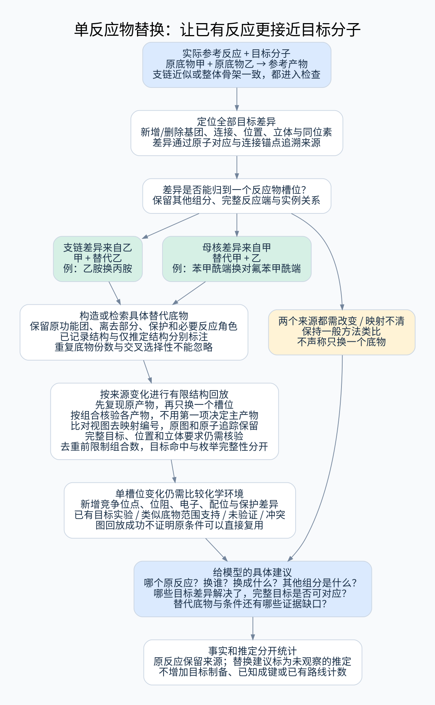

# 已有反应的单反应物替换类比

## 1. 目的及在系统中的位置

用户强调的情况是：已有反应得到的产物与目标只差局部结构，可能不必先制得该产物再修改它，而是在原反应中替换一个反应物，使相同转化直接构建目标。

```text
已有记录：实际反应物甲 + 实际反应物乙 → 参考产物
目标差异回溯到乙：甲 + 替代乙 → 目标结构候选
目标差异回溯到甲：替代甲 + 乙 → 目标结构候选
```

这是整体骨架层、核心/支链层均应识别的优先方法线索；也可为分片层提供具体底物调整建议。母核或支链哪一端可替换，由目标差异的原子来源决定，不能固定认为只能换支链供体。

本模块在结构召回和实际反应贡献判定之后、下游合成预测模型之前运行。它是**来源反应约束下的有限规则推定**，不是纯文献事实检索；生成的反应物和转化建议必须与原始记录分开保存。它不要求预测模型先提出反应，也不把推定建议写进“已有反应关系”图。



[高清 SVG](../diagrams/single-reactant-transfer.svg)

## 2. 两种具体情形

以下是人工结构示意，没有实验来源、条件或成功率结论。

| 已有结构示意 | 目标变化 | 替换建议的结构逻辑 |
|---|---|---|
| 苯甲酰氯 + 乙胺 → N-乙基苯甲酰胺 | N-乙基变为 N-丙基 | 苯甲酰端保留，将乙胺槽位换为丙胺 |
| 苯甲酰氯 + 乙胺 → N-乙基苯甲酰胺 | 芳环对位 H 变 F | 胺端保留，将苯甲酰氯槽位换为对氟苯甲酰氯 |

第一例从支链差异切入；第二例整体骨架一致，但改变的是提供芳基母核的反应物。模型应收到这两类具体建议，而不只得到“类似物差一个基团”。

## 3. 先识别差异，再追溯到来源

1. **锚定原反应**：必须有实际底物、产物、对应关系、实际变化及原始实验结果；未发生或未核实的计划反应不能成为阳性来源先例。
2. **对齐目标与参考产物**：在固定规则与目标位置下保留共同结构，明确新增/删除原子、连接/键型、取代位置、立体和同位素差异。不能仅靠总体相似度或“差一个官能团”的文字标签。
3. **回溯差异来源**：参考侧已存在的差异及其连接锚点投影到真实反应物实例；目标新增原子无法直接从旧 atom-map 得到来源，须根据其连接锚点和原转化的保留关系提出来源候选。多个来源可能时分别记录，不强行唯一归属。
4. **核对全局未解决差异**：是否所有差异都可由一个反应物槽位的调整解释？若同时涉及甲、乙或未记录的小单元来源，不标单反应物替换；同一反应物上多个局部改动仍是一个槽位替换，但不能称只差一个小基团。
5. **检查原反应贡献**：该反应即使不是目标母核—支链边界的形成步骤，也可能通过替换其一个底物得到完整目标；可作为整体层的反应替换建议。它仍不能伪装成原本未形成的边界的连接方法。

相同骨架不保证只有一个来源改变。反之，较大的支链变化也可能完全来自一个反应物；是否值得迁移需看反应角色、环境和证据，不以编辑原子数作唯一判断。

## 4. 怎样构造替代反应物

先保留原反应物中的反应功能团、离去部分、保护状态及定义原转化所必需的连接；将目标要求的局部结构投影到对应保留片段。不能把最终产物中的片段直接拿来当真实反应物，也不能把实际酰氯随意换成羧酸而不记录活化方式变化。

替代反应物有三种来源状态：

- 已在可核验资料中出现的具体分子，附该结构的制备/使用信息；
- 由来源约束规则构造的具体结构候选，明确尚无存在、可获得或反应支持；
- 对应关系或剩余端基未确定，只给出局部要求，不能交付为确定前体。

首版的“保持原反应角色”要求：成断键模式、主要底物角色、必要反应端及目标位点可对应；只对能够通过已审核规则处理的来源实例执行替换。改变中心功能团、离去基团体系或必需活化方式时，转为“反应条件/类别也需调整”的独立建议，而非简单替换。

对称映射和同结构多份参与必须按实例处理：明确是替换一种投料结构的所有来源份数，还是需要两种不同底物分别占据不同角色。原记录只有同一种底物自反应时，将其中一份换为另一种会引入交叉选择性问题，不能视为自动成立的单槽位微调。

这里的槽位是实际材料实例及其有据来源关系，不是映射算法临时增加的图副本。若几份映射副本指向同一投料材料，只修改其中一份可能对应新的混合投料设想；缺少明确归属时标为来源歧义，不能仅因修改了一个图对象就通过单底物替换判定。

## 5. 原转化的结构回放检查

对映射与模板足够明确的来源，使用来源锚定的变化规则进行有限图结构回放：

1. 原实际底物回放应能重现原产物的关键原子与变化；不能用一个过宽的通用模板掩盖源记录不一致。
2. 保持其余反应物结构与实例对应，替换一个明确槽位，枚举预算内的合法匹配，检查价态及产物有效性。
3. 在每个生成的产物组合内定位符合完整目标的具体产物，核验位置、立体和同位素要求；不能假定第一个产物就是目标或实验主产物，局部核心一致不能标全目标完成。
4. 跟踪未参与变换的原子和需要保留的其他结构，避免模板丢弃多余片段之后“恰好生成目标”的伪成功。
5. 多匹配/多产物或截断时保留范围；生成一个目标图不证明它是唯一或主要实验产物。等价图去重不消除其他反应位点、重复反应或副反应的可能性。

RDKit `RunReactants` 返回多组产物，每组代表一套生成结果。完整保留组合边界与产物索引，目标可以出现在组内任一位置；不同组的产物不能拼在一起证明一次共同生成。主/副产物角色依实际来源或明确推定范围，不能用模板中书写顺序决定。[反应执行接口](https://www.rdkit.org/docs/source/rdkit.Chem.rdChemReactions.html#rdkit.Chem.rdChemReactions.ChemicalReaction.RunReactants)

回放输入的 atom-map 编号可能残留在未被模板改动的产物片段。结构比对使用单独副本去掉这些编号，保留电荷、立体、同位素及材料策略；原始回放图、源原子引用和对应关系同时保留。不能直接比较带任意编号的 SMILES，也不能为消除编号差异而丢掉真正的立体或同位素差异。

每个候选最多核验 16 个原始产物组合；可向原生工具请求 17 个，其中多出的一个仅用于发现溢出。限制作用于去重和结构校验之前：重复组合、无效组合都消耗枚举额度。分别返回收到/核验组合数、有效结构结果数、枚举完整性、校验完整性和目标是否找到。产物组合数不等于内部搜索过的原子匹配数；原生搜索仍受工作进程的共同时间限制。组合截断且未找到目标时，仍属未完成评估，不判定迁移不可能；找到目标但其余组合未完成时仍保留不完整状态。

回放规则只采用可核查的变化，不直接采用“全部输入键减去主产物键”的差集。省略副产物造成的片段缺席不能被变成一组待断键；未映射离去片段的跨侧去向未知时，保留源边界和必要反应端，不随意构造或删除额外原子来得到目标。关键变化无法确定则不执行阳性替换回放。

回放通过只表示**在所用规则和匹配范围内结构可以对应**，不验证机理、速率、选择性或条件迁移。工具不支持或来源不足时标未评估，不用通用正向模型隐式填补事实。

技术实现可参考 [RDKit 的反应执行说明](https://www.rdkit.org/docs/GettingStartedInPython.html#chemical-reactions)，其输出需要结构校验；工具文档也提示过宽胺模板可能错误作用于酰胺 N，因此模板语义与反例不可省略。

## 6. “只替换一个”与“条件可直接沿用”分开判断

即使只改变一个槽位，也要报告：

- 改动是否靠近原反应端，是否改变电子、位阻、配位、离去基团或亲核/亲电角色相关环境；
- 是否新增胺、OH、卤素等可能竞争的位置或重复官能团；
- 是否增加立体/区域选择要求，是否改变保护、盐或组分状态；
- 原有敏感基团的共存/保留实例是否覆盖替代底物；
- 替代底物是否有记录，能否得到它是否仍未知。

条件支持独立标注：有目标对应的真实实验；有相同方法下较接近底物的适用范围证据；仅结构类比且条件未验证；有来源指出不适用/存在冲突。一次“用过该条件”不证明全部替换均适用，单个失败也不否定所有可能条件。

例如用乙二胺替代乙胺时，图回放可能生成期望的单酰化结构，却新增一个胺位点。应输出“单槽位替换，目标图可对应，重复酰化/选择性待核实”，不能直接说同样条件简单制得。

## 7. 输出等级与优先级

以下是不同证据维度，不是自动概率评分：

| 维度 | 状态 |
|---|---|
| 差异归因 | 一个反应物槽位 / 多个槽位 / 实例或来源歧义 |
| 原方法保持 | 角色及必要变化保持 / 中心条件需变 / 未确认 |
| 替代反应物 | 已记录具体结构 / 规则构造候选 / 结构未完整确定 |
| 图结构回放 | 完整目标可对应 / 仅局部对应 / 不符合 / 未评估或截断 |
| 条件迁移支持 | 真实目标记录 / 有类似底物范围支持 / 未验证 / 冲突 |

优先呈现“差异局限于一个槽位、原变化保持、完整目标可回放、必要角色与环境有较好证据”的候选，同时显示未解决项。明确已报道制得目标的反应仍作为直接事实单独优先；不能因为模板回放成功就把推定排成已验证路线。

对整体骨架和支链/核心结果都分配受控的替换类比名额；不因参考产物与目标不完全相同就一律退到低价值“相似分子”。不要求所有未知都排最后：保留有依据且结构清楚的推定入口，但显示它缺少哪类验证。

应返回：原反应 ID 和完整条件、原反应物及拟替代结构、目标差异和来源锚点、保留的其他组分、回放与条件状态、未解决前体要求。这些内容可直接供下游模型审查，而不是只返回一个相似度。

## 8. 与文献图、计数和预算的边界

该过程是围绕已检索反应的局部规则推定，区别于前置的事实召回和后续开放式合成预测。每项建议必须携带 `derived_from_reaction`、`proposal_not_observed`、规则版本、差异来源和预算状态。

它不增加目标制备命中、目标已观察成键或已有桥接关系数。原反应的实际产物仍可计为参考命中；推定建议另外统计“已评估替换候选数、单槽位数、完整目标回放数、有条件支持数、冲突或未知数”。重复的替代反应物组合去重，但保留所有支持来源和不同实例解释。

初始仅评估有配额的高相关来源反应，一次一个明确替换槽位，不递归把生成的反应当成新文献继续改。原型可分配最多 6 条来源、每条最多 2 个替代候选、每候选最多核验 16 个产物组合；这些为待调优的资源上限，计入共同时间预算。超限和未启用规则不表示不存在该类替换方法。

复杂多来源、条件系统改变、重复组分交叉反应或结构不能可靠投影时，返回一般方法类比和差异说明，交给模型继续分析，不冒充“单反应物简单替换”。

## 9. 示例校验与实现范围

[人工图回放脚本](../reviews/check_single_reactant_transfer.py)及[结果](../reviews/single_reactant_transfer_checks.json)检查原反应回放、换支链/母核供体、跨槽位差异、竞争位点、必要角色、取代位置，以及多产物顺序、映射编号和产物组合截断。

这些例子没有实验来源；未实现通用差异回溯、模板提取、替代底物检索或反应可行性预测。图回放成功只支持设计中的结构检查，不能作为真实先例计数。

## 10. 环变化来源的替换约束

来源涉及实际开环或闭环时，除一般反应端约束外，还须核对原环尺寸/连接、开裂位点、闭环端间路径及区域/立体要求。仅功能团匹配或净环数相同不足以认为原规则可迁移；图回放对这些约束不支持时返回未评估。分子有无环不决定是否允许替换，具体要求按 [环变化规范](acyclic_and_topology_search.md)执行。
