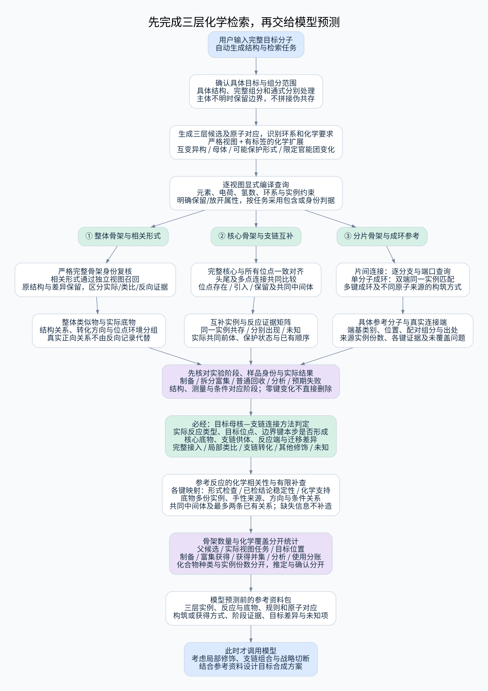
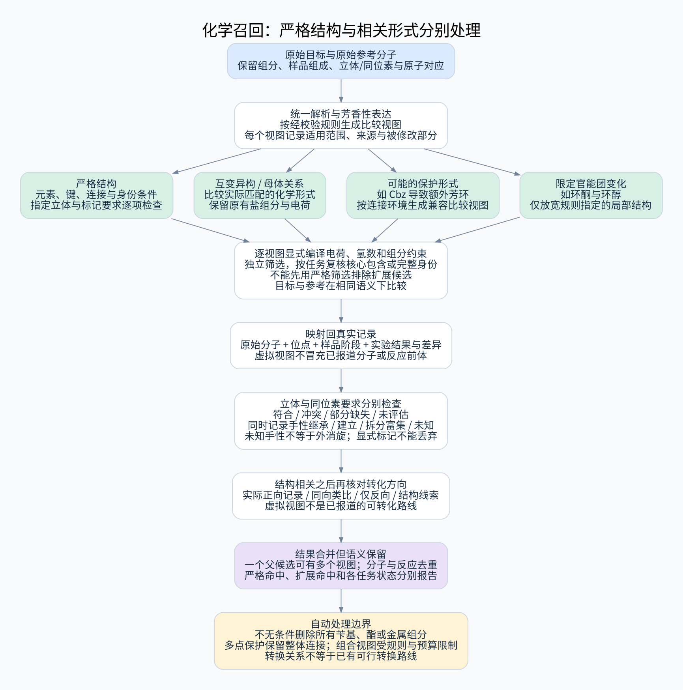
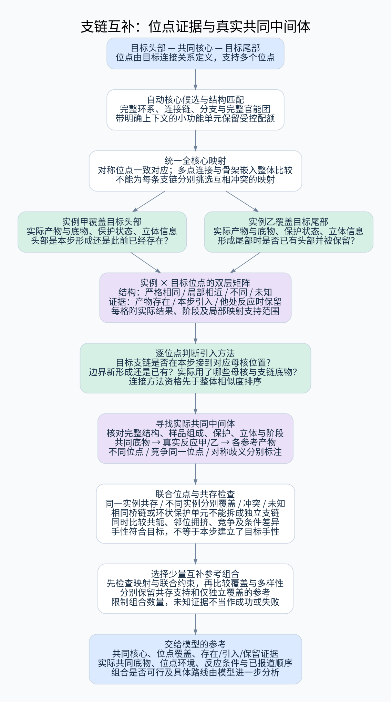
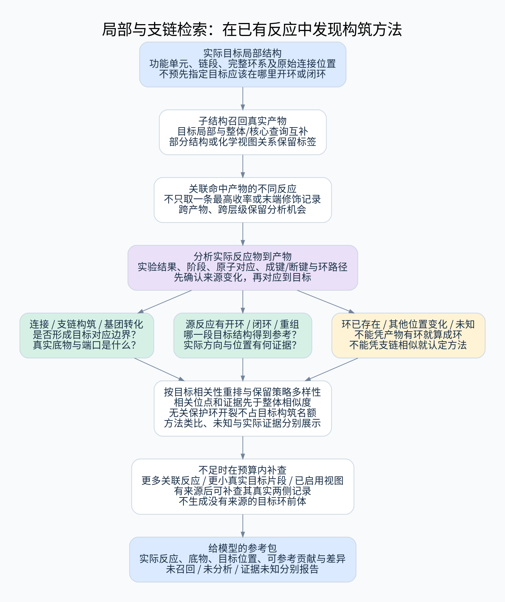
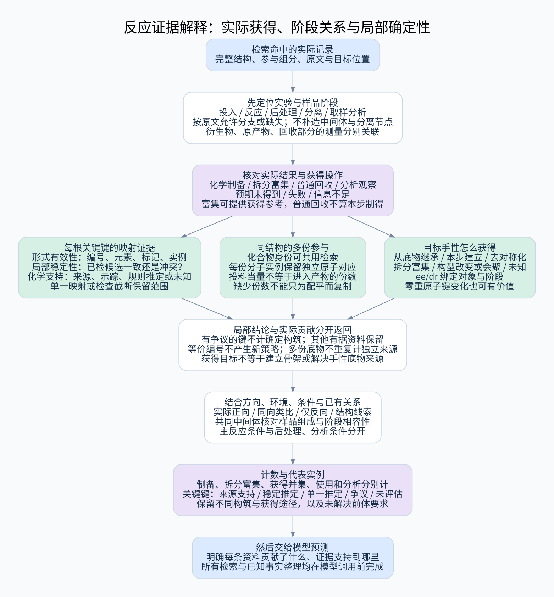

# 三层前置检索详细设计与化学规则

更新：2026-10-23。本版已纳入三轮化学研究，覆盖化学召回、反应相关性，以及局部映射证据、底物实例份数、手性获得方式和实验阶段。以下均为待实施设计。

本文件保留完整化学规则和原章节编号。入口与实施摘要见 [主计划](../plan.md)，证据语义见 [证据契约](../design/evidence_contract.md)，预算与首轮评测见 [调度约定](../design/scheduling_and_pilot.md)。这些文件描述同一个现行设计；发现矛盾视为设计缺陷，不靠选择文件优先级掩盖。

## 1. 定位与执行顺序

**用户输入要合成的完整目标分子，系统先执行子结构检索，找到可以参考的分子、合成这些分子所用的底物和反应，再把整理好的结果交给模型预测。**

```text
输入目标分子
    ↓
自动分析目标结构，生成三层骨架查询
    ↓
整体骨架一致 / 核心骨架一致 / 分片骨架一致
    ↓
统计骨架数量和命中情况，整理分子、底物、反应与结构差异
    ↓
形成合成参考资料包
    ↓
模型据此考虑官能团修饰、支链组合与战略切断
```

本模块不需要模型先预测断键、提出合成假设，也不需要用户选择核心。结构分解和候选切片来自可解释的化学结构规则。模型预测是本模块的下游。

以下仅规划检索逻辑、化学结构处理、结果组织和交付，不涉及存储结构、SQL、部署或迁移。

## 2. 三层检索分别解决什么问题

| 层级 | 寻找的参考结构 | 需要返回的信息 | 交给模型的作用 |
|---|---|---|---|
| ① 整体骨架一致 | 全部主要环系及连接关系一致，外围基团或取代状态不同的分子 | 类似物、与目标的具体差异、制备类似物的底物及反应 | 考虑是否可先得到类似物，再通过末端修饰得到目标 |
| ② 核心骨架一致 | 保留目标某个中心结构，头部、尾部或其他支链不同的分子 | 共同核心、各连接位点的支链、互补实例、相关底物和反应 | 参考不同实例的支链与合成方式，考虑如何组合为目标 |
| ③ 分片骨架一致 | 目标的局部片段对应已报道分子或其核心 | 切片位置、片段匹配、对应可参考分子的底物和反应、各分支覆盖情况 | 引导战略切断朝已有制备参考的片段和分子收敛 |

“整体骨架一致”提示可能存在较近的修饰路线，不自动保证只需一步简单修饰。“头尾互补”不自动等于两条反应可以直接拼接。“片段有合成报道”不等于该分子可以直接作为目标的前体。系统给出这些判断所需的结构和反应证据，由下游模型分析具体可行性。

## 3. 总体思路图



[查看高清 SVG](../diagrams/scaffold-search.svg)

三层任务均可独立执行；不因第一层已有命中就放弃第二、三层的补充线索。按计算预算调度，在交付模型前汇总已完成的结果及未完成状态。

完整目标的精确命中作为额外标记：分别列出直接制备、拆分/富集等有据获得记录，并保留三层参考结果；一条制备或获得记录不冒充完整合成路线。

## 4. 前置化学结构分析

### 4.1 统一结构表示与原子对应

解析完整目标，给原子和键分配稳定编号，识别元素、同位素、键型、芳香性、电荷、环、官能团及立体信息。所有核心、片段、支链和查询均能映射回目标原子。

保存实际输入和检索表示的对应关系。多组分输入先识别有机主体与其他组分；无法可靠确定主体时明确标记歧义，不静默把任意片段当目标。电荷、互变异构、立体放宽使用独立标记，不混为严格一致。

### 4.2 识别环系、连接链与官能团

- 将共享环原子的环按连通关系组成完整环系，稠合、桥连和螺接部分默认不任意拆开。
- 识别环系之间的连接链、分支点及潜在连接边界。
- 用可审阅规则识别酰胺、酯、胺、羟基、醚、腈等完整化学单元，处理重叠类别。
- 记录官能团连接方向、所在环位点、邻接环境和立体位置。

这一步不判断“用户关心什么”，而是为三层检索生成多个合理结构视图。

### 4.3 骨架表示的具体约定

默认用固定版本的 Murcko 全骨架作为有环分子的严格整体骨架候选，再附加环系、连接拓扑和外围差异描述。Murcko 保留环及环间连接结构，也可能保留特定环外双键原子，不等于只留下环原子。保护基或官能团状态可能改变 Murcko 身份，因此必须同时提供第 5.4 节的有标签扩展召回。

无环目标的严格整体表示使用完整重原子图，另生成链式核心候选：以官能团、分支点、带指定立体信息的中心为锚点，保留锚点间原有路径及完整化学单元；重复单元保留次数与连接顺序。第二层按限定锚点组合生成连通核心，第三层按规则连接边界切片。纯烃等没有足够锚点时，以完整碳链和有长度预算的链段处理，不任意删除所有末端。链式核心属于相关结构探索，不将它与完整分子身份混淆，禁止空图查询。

同一套表示规则同时作用于目标和参考分子。元素、键型等泛化作为另一个有标签的探索分支，不能将苯与吡啶直接称为严格同骨架。

### 4.4 化学检索视图与匹配关系



[查看高清 SVG](../diagrams/chemical-recall.svg)

所有结果保留两个相互独立的描述：**检索层级**（整体、核心、分片）和**匹配关系**（严格、互变异构、盐/质子化、保护形式、限定官能团变化）。同一原分子可以通过多个视图被找到，合并展示时保留全部来源标签。

| 视图 | 自动处理与边界 | 结果标签 |
|---|---|---|
| 严格结构 | 固定解析和芳香性规则，明确元素、键型、电荷及目标立体要求 | 严格匹配 |
| 互变异构 | 使用经过验证的互变异构感知匹配，保留实际匹配形式与原子对应；不只比较两边整分子的 canonical tautomer | 互变异构相关 |
| 盐/质子化 | 保留原始组分和电荷，生成规则允许的母体或质子化查询视图 | 母体或质子化相关；不等于原形式相同 |
| 保护形式 | 根据完整连接环境识别有限保护形式，对目标及参考生成兼容比较视图 | 可能的保护形式对应，记录被暂时忽略的部分 |
| 限定官能团变化 | 仅在规则明确的局部结构允许特定元素/键型变化，例如羰基与相应醇形式 | 指定官能团变化相关；不保证能够直接转化 |

芳香性与 Kekulé 表示统一属于表示规范化。互变异构、酸碱状态与保护形式之间不相互混同。永久带电结构、金属配位及有机金属组分不执行未经验证的中和或去组分；不支持的表示保留原始结构和明确状态。

原结构与比较视图分开保存。虚拟去保护、端口显示或键型放宽产生的结构只用于查询，不能被输出为已报道化合物、真实反应物或已验证中间体。

### 4.5 立体化学的默认规则

骨架级召回允许先获取连接结构相同的参考，随后将每个命中按目标的实际立体要求分组：

1. 所比较的指定中心/双键均符合；
2. 至少一处明确不一致，列出位置；
3. 一部分可确认，其余信息缺失；
4. 来源未记录立体信息，或当前工具不支持该类型。

完整目标的严格身份命中必须满足指定立体要求；不一致或未知不能冒充精确产物。目标本身未指定的中心标为“目标未约束”，不默认为必须外消旋。

未指定 SMILES 不能直接解释为外消旋体。外消旋、相对构型、混合物、ee/dr 及 E/Z 比例均保留来源说明和测量类型。比较底物与产物时使用原子对应和局部立体关系，不能仅凭 R/S 字母变化推断构型反转。轴手性等未通过当前工具验证的类型输出“未评估”。

### 4.6 视图生成与规则约束

每条规则至少记录：适用结构模式、上下文排除条件、生成的查询约束、目标原子对应、立体处理方式、规则版本和正反例。结构有效性、原子对应或立体处理无法保证时，不执行该条扩展。

同一候选首先保留严格视图，再按有配额的扩展规则生成视图；默认一次只应用一个化学扩展族。需要组合保护形式与互变异构等规则时，必须使用预先验证的有限组合，不对所有视图做笛卡尔积，也不反复修改同一局部直至失去化学约束。

各视图使用与其语义相容的筛选和匹配；不能先用严格指纹筛掉候选，再期待互变异构或去保护视图补回漏检。与参考结构的视图比较必须发生在兼容的召回路径上，不能仅在严格命中之后补做分类。

### 4.7 同位素要求与原始结构身份

显式指定的 13C、2H 等标记及其位置从输入开始保留，贯穿候选生成、视图变换、去重、匹配和原子对应。完整目标严格命中必须满足指定标记；未标记或标记位置不一致的结构只能作为有差异的参考，不能依靠普通骨架一致升级为精确目标。

同位素与立体要求分别比较。未指定同位素的目标不自动要求某种标记；来源明确带标记的参考仍保留该属性，不与未标记的真实化合物合并。交换位置上的氘需记录具体位置和来源描述，普通结构匹配不证明其在后续条件下稳定。

显式氢同位素可能不进入重原子统计，因此另记录“目标标记位点总数、严格对应数、冲突数、来源未知数”。若工具或规则不能处理某种标记，输出未评估，不能静默删除后报告严格匹配。

### 4.8 分子结构与样品状态分别描述

单个分子的结构、实际样品的立体组成、是否分离和所处阶段是不同信息。来源明确的外消旋、对映/非对映混合物、富集组分、溶液或原位状态与分子图一起保留；不能仅用一个未指定手性的 SMILES 代表全部这些状态。

当比较共同中间体或连续步骤时，除了分子结构，还检查与目标有关的已知样品组成及阶段关系。来源没有说明组成时标未知，不凭空将其判为纯对映体、外消旋体或可以直接转用的材料。

### 4.9 立体符合程度与手性获得方式

第 4.5 节回答结果是否符合目标；另按每个目标立体位置记录本条实例对手性要求的贡献：

| 获得方式 | 需要的依据 | 对后续规划的意义 |
|---|---|---|
| 从底物继承 | 底物已带相应立体信息，目标对应和已知组成支持保留关系 | 仍需获得该手性底物；本步不是该中心的建立依据 |
| 本步建立 | 结构变化与来源明确支持建立相应立体结果 | 可作为该位置的立体构筑参考 |
| 去对称化 | 输入等价位点/对称性及实际选择有来源支持 | 保留对称前体入口；不把所有新增立体标记解释为新成键 |
| 拆分/富集 | 原文说明拆分或富集，明确获得哪一部分及相应测量 | 可支持目标获得，但不增加对应中心的新成键计数 |
| 构型改变/立体会聚 | 对应关系、输入组成与过程说明支持该分类 | 与继承或单纯匹配分开；不只比较 R/S 字母 |
| 来源未知 | 输入、样品组成或过程说明不足 | 高 ee 产物本身不能补足来源信息 |

同一个分子的不同中心可以有不同来源，多标签可并存，不用一个标签覆盖全分子。未知输入立体结构不能被自动认定为前手性或外消旋；原子映射稳定也不能独立证明立体选择机理。

ee/dr、转化率、产物收率和回收率必须绑定测量对象、阶段及已知分母。来源不明时不比较成同一指标。经衍生化推得原产物 ee 时，还需保留第 10.7 节的分析关联。

### 4.10 具体目标、组分与通式的边界

解析成功不等于目标是明确的单一化合物。输入与参考分别检查具体性：

- **具体单分子**：进入全部三层；未指定立体的具体连接图允许检索，但记录哪些目标要求未指定。
- **明确盐/溶剂化物等组分关系**：保留完整形式身份任务，按审核规则另建主体视图；两者的身份和覆盖分开。
- **组分角色不明的组合**：可保留完整形式的身份/出处检索，暂停依赖主体判断的骨架任务并标输入歧义；不默认选最大有机片段或拼接分子。
- **含 R 位点、原子通配符或其他未解决查询特征的通式**：不作为明确完整目标或具体制备身份。可另存通式范围线索，但必须有来源具体实例才能增加具体分子制备命中。

内部生成的 SMARTS 与外部完整目标输入采用不同类型。一个含 `*` 的 SMILES 可能成功解析，它仍不应被误认为用户已给出明确原子身份。

每个连通核心匹配必须落在同一个真实产品/底物组分实例中；不得从两个组分分别取片段再合并为“目标核心共存”。多端口、头尾共存、单分子成环还须满足同一实例上的一致整体映射。

SMARTS 的 `.` 只表达查询片段间不指定连接，不能代替“同一分子中按特定位置相连”，也不能单靠它要求片段来自不同组分。查询编译器必须额外携带 `same_component`、目标位置及组分实例约束；反应多组分查询明确指定参与关系，不能套用分子级共存判据。

## 5. 第一层：整体骨架一致

### 5.1 自动生成与检索

1. 生成目标的完整骨架，保留全部主要环系及原有连接路径。
2. 以该骨架进行子结构召回，取回关联产物候选。
3. 对候选使用相同规则生成完整骨架，并检查骨架身份一致。
4. 只有包含核心、但多出额外环系或改变连接拓扑的候选，不归为严格整体骨架一致；可转入第二层。
5. 对骨架一致候选比较所有外围结构，避免将“都含一个苯环”的大量分子等同于“简单改一下就能得到目标”。

### 5.2 把差异转成模型可读的信息

对齐骨架后，把核心外的每个连通部分作为取代单元，记录其连接位点、连接键、片段结构与立体差异。多点连接的外围部分记录全部边界，不强行当作单一支链。

输出差异包括：

- 官能团类别或氧化态不同；
- 同一位置的保护/取代状态不同；
- 取代位置不同；
- 支链长度、连接方向或元素不同；
- 环系或立体要求存在额外差异。

这些是结构差异标签，不直接生成“做某一步一定能转化”的结论。若已有反应记录明确展示相应转化，单独列出该证据。

### 5.3 输出内容与排序

每个类似物返回：完整产物结构、目标与产物的原子对应、差异高亮、已报道反应、实际底物、可用条件及出处。

优先目标覆盖完整、差异集中且局部环境接近的记录，再考虑反应信息完整性与来源多样性。整体相似度可辅助，但不能代替对连接位置和差异的检查。不同收率类型及不同底物下的收率不直接作为统一“可迁移性”分数。

### 5.4 第一层的化学相关召回

严格整体骨架一致是主分组；同时执行独立扩展任务，捕获可能更接近目标合成需求的结构关系：

- **保护形式对应**：如 Cbz 增加额外芳环，原始 Murcko 身份可能不同；在验证的比较视图中检查主结构和对应位点是否一致，返回原始保护结构。
- **限定官能团变化**：如环己酮与环己醇的 Murcko 身份可能不同；允许规则指定的局部变化，保留主连接拓扑，列出实际差异。
- **互变异构或母体对应**：在相应语义下检索并单独标记，不计入严格身份。

保护形式识别使用受控规则集，例如特定连接方式下的 Boc、Cbz、Fmoc、苄基或硅基。苄基、酯等存在结构用途歧义，规则只标记“可能的保护形式”，不宣称确定用途；环状缩醛等多点保护必须保留全部连接关系，不能把两个位点分别删除。

从目标生成含保护形式的无穷枚举不是实现方式：对双方按验证规则生成比较视图，并通过这些视图直接召回，最后映射回真实参考结构。视图匹配本身不证明有保护/脱保护或氧化还原路线；只有实际反应记录支持时，才追加相应转化证据。

排序先区分关系类型与立体状态，再比较所需结构改变的范围及已有反应支持，不将较小图差异等同于低合成难度。第一层严格命中和扩展命中分别报告。

### 5.5 从参考分子向目标变化的方向证据

第一层每个结构差异还要回答：已有记录是否支持**参考分子 → 目标所需结构**的方向。例如目标是醇而参考是酮时，只有醇到酮的氧化记录，不是酮到醇的制备证据。

| 方向标签 | 判定要求 | 输出 |
|---|---|---|
| 实际同分子桥接 | 记录明确将这个实际参考分子转为目标；身份、方向及第 10.3 节正向结果条件成立 | 实际反应、全部必要组分、结构对应和出处 |
| 同类差异正向先例 | 其他相近底物上有目标所需方向的变化 | 类比反应及底物/位点/环境差异，不能称作直接桥接 |
| 仅反向记录 | 仅存在相反方向的记录 | 保留原方向，不反转为成功反应 |
| 结构差异线索 | 有结构关系，没有相应变化证据 | 标记尚无桥接依据 |
| 信息不足 | 身份、方向或实验结果无法确认 | 列明缺失项 |

方向标签与结果等级、立体/同位素状态并列保存。结构相似、正向类比、实际得到目标是不同信息，不能互相替代。

对排序靠前的少量参考，允许在总预算内补查最多两条**已经记录的有向反应关系**。中间体必须是相同的真实结构，保留盐、保护、立体、同位素及已知样品组成/阶段状态；仅在去保护视图或骨架视图中相同不能直接串联。所有配对组分和条件都随记录保留，存在所需的一个中间体不代表其他底物已获得。

一至两条记录连续对应时可标“已报道步骤连接”，仍显示分离/原位状态和步骤间条件差异。原位中间体跨不同实验不能无依据拼接；不补造缺失反应，不把局部链条称作完整路线。此补查是已有事实检索，发生在模型预测之前。

### 5.6 有出处的骨架编辑扩展

主流程的严格与化学相关视图保持既定身份语义。对于环大小变化、骨架原子插入/删除等关系，增设**后续、低配额、默认不启用**的骨架编辑扩展：只使用有真实反应来源并审核过的局部变化规则，记录方向、变化签名、适用环境和目标对应。

已通过产物匹配找到的骨架编辑反应可以正常展示，不依赖该扩展启用。扩展的用途是补充原本不能按同骨架/保持拓扑关系找到的参考；不任意增删原子，也不把生物电子等排替换视作可合成转换。未启用或不支持时报告范围边界，不阻塞前三层结果。

## 6. 第二层：核心骨架一致与头尾支链互补



[查看高清 SVG](../diagrams/core-branch-combination.svg)

### 6.1 如何自动生成核心候选

从目标的结构组织中生成候选，不遍历任意原子子集：

1. 每个完整环系；
2. 相邻环系及它们之间的原有连接结构；
3. 结构分支中心及保持连接关系的邻域；
4. 无环目标中的完整官能团与相邻连接片段。

核心扩展时闭合必要化学单元，不截断羰基、无意断环或把原本隔着 CH2 的两部分重新连接。结构去重但保留不同目标位置的出现记录。

过滤没有区分能力的小核心；优先覆盖较大、保留杂原子和有意义连接环境的候选。甲基、腈及小环等若带有明确目标连接上下文，可进入有配额的功能单元分支，不能按原子数一刀切删除。大小规则与例外均需正反例校验；达到候选上限时报告未展开候选，不声称枚举了全部可能骨架。

### 6.2 “头部”和“尾部”如何定义

头尾是核心周围的连接位点，不是图片左右两侧，也不是 SMILES 的先后顺序。

1. 给目标核心的边界位点编号，例如位点 1、位点 2、位点 3。
2. 将目标中这些位点连接的外侧结构提取为支链描述。
3. 参考分子匹配同一核心后，在相应位点提取支链。
4. 通过原子对应比较每个位点的结构、连接键和局部环境。

对称核心需考虑等价映射，以一致的位点对应比较目标和参考结构，避免任意将头尾交换后宣布互补。记录选用的映射和可能的歧义。

### 6.3 互补实例如何组合

设目标为“目标头部—共同核心—目标尾部”：

- 实例甲：目标头部—共同核心—不同尾部；
- 实例乙：不同头部—共同核心—目标尾部。

系统发现的是：两条实例分别覆盖目标不同支链。输出一组互补参考，并列出甲、乙各自的产物、底物、反应及支链来源，不把甲乙的分子图直接拼接成已验证路线。

对于三个及以上位点，生成“实例 × 目标位点”覆盖矩阵。位点状态分为：严格相同、局部环境相近、不同、无法对齐；局部相近不能计作严格支链覆盖。

优先选择能覆盖更多目标位点、重复较少的少量实例组合，可采用带上限的集合覆盖策略。保留多种组合，禁止枚举全部笛卡尔积。还要标注：

- 哪些位点在同一个已有分子中同时出现；
- 哪些仅分别出现在不同实例中；
- 现有反应是否实际引入了该支链，还是仅在另一位置发生修饰；
- 组合后可能新增哪些此前未共同出现的官能团环境。

### 6.4 交给模型什么

共同核心、位点编号、目标支链、各实例覆盖位点、支链差异、参考底物和反应。模型据此考虑如何引入、替换或组合支链；系统不预先要求模型给出反应假设。

### 6.5 把支链覆盖扩展为反应证据矩阵

在“实例 × 目标位点”的结构矩阵之外，增加三项可同时成立的证据：

| 证据 | 判定依据 | 不能推断的内容 |
|---|---|---|
| 产物中存在 | 已报告制得或有身份依据的实际观察产物中，支链与目标位点在一个完整匹配中对应；附结果等级 | 不能推断本步引入了该支链 |
| 本步引入 | 实际结果与第 10.5 节局部映射证据支持指定连接/结构在记录中形成；注明支持层级和范围 | 单一映射推定不能冒充来源确认，也不能保证其他支链存在时适用 |
| 其他位点反应时保留 | 该支链在已记录的反应前后均存在，且相关结构被保留 | 不能推广为所有底物和条件下都相容 |

每格同时保存实验结果、实际保护状态、其他潜在竞争位点、立体信息、条件和出处。实际产物已知但映射缺失时，仍可有“产物中存在”标签，后两项标未知；仅预期但未得到的产物只能显示结构线索，不添加上述阳性证据。不凭产物倒推反应过程。

组合时检查同一实例中的位点是否共享一致的全核心映射，不能对头部和尾部分别选最有利但互相冲突的映射。跨多个位点的同一支链、桥链或环状保护单元作为联合关系参与组合，不能拆成独立覆盖项。

输出组合状态：同一已报道分子中共存、不同实例分别覆盖、映射冲突、信息不足。用实际“引入/保留”记录给模型提供顺序线索，但不在检索阶段宣称头尾两步可以直接串联。多样性选择保留有共存支持和仅分别覆盖的不同参考组，避免未经验证的简单分数掩盖差异。

### 6.6 共同中间体与已有步骤关系

在已召回的参考实例中，按实际底物身份寻找共同中间体，组织如下关系：

```text
同一个已记录的实际底物
    ├─ 实际反应甲 → 含目标头部的参考产物
    └─ 实际反应乙 → 含目标尾部的参考产物
```

共同底物要求完整结构、保护形式、电荷/组分、已知立体和同位素身份一致。若任一方身份不完整，只能标为“可能相关中间体”；不能因共有核心或比较视图一致就合并节点。

每条关系保留完整反应组分与实验结果，标记它使用的是不同位点、同一竞争位点或对称性下无法区分的位置。上述两条分支不表示甲后可以接乙，也不表示该共同底物已有制备记录。

另有真实记录连接甲产物到进一步产物时，才附加已报道顺序。仅在原始连续实验中明确关联的原位中间体可作为该实验内部关系；还要检查已知样品立体组成和取用部分是否一致。其可分离性与跨实验转用性未知时单独标记。关系图仅组织有限已有记录，不预测缺失边。

### 6.7 核心在参考分子中的嵌入方式

除取代位点外，记录每个核心外连通部分：与核心的接触原子、边界键、附加路径、闭环关系，以及是否构成单点取代、跨接、稠合、螺接或桥接结构。类别依赖完整局部拓扑；不能只凭“两个接触点”就判为稠合。

例如甲苯与联苯中的核心苯环可有单点外接部分；萘中的该苯环还通过核心外路径构成另一环。它们都可能子图命中，但后一种不能被解释成普通尾部替换。

该标签参与差异说明与排序：需要额外骨架连接变化的候选仍可作为构筑参考保留，但不因核心原子覆盖高就升级为简单修饰参考。多点结构继续使用第 6.5 节的联合映射，不拆成独立支链。

### 6.8 母核—支链连接方法是必经判定

候选产物命中后，必须执行 [目标连接方法判定](attachment_methods.md)：依据两侧结构和实际变化识别反应类别，检查目标对应的母核、支链、位点和边界是否在本步连接，并追溯母核底物、支链供体及必要功能团。连接、支链内部延长/转化、边界保留而他处变化、核心构筑、替代边界和未知分别输出。

该步骤在模型预测之前完成；初版可以返回未知，但不能省略分类后直接把结构命中包装成方法。第 6.5 节的存在/引入/保留矩阵是判定依据之一，反应名称、产物相似度和孤立新键都不是充分判据。连接目标由自动结构分区产生，合理替代边界单独编号，无需用户指定或模型先预测。

以连接目标为单位，分别报告结构候选、已分析反应、有据方法、局部类比、支链修饰及未知。方法排序先检查相关位点和变化，再比较底物环境；纯外围修饰的精确产物不能占用当前连接方法区名额。资料不足的记录保留为结构线索，不误判成无价值或可用方法。

## 7. 第三层：分片骨架一致，支持战略切断



[查看高清 SVG](../diagrams/fragment-retrieval.svg)

### 7.1 预测前怎样产生切片

切片是检索用的结构分区，不是已经预测出的反应：

1. 从环系与连接链边界、支链连接位点、规则化的官能团连接边界产生候选切割键。
2. 采用少量单键切片，以及同时切两根候选键的受限二键切片方案；“二键”指切割数量，不指化学双键。
3. 每个方案保留切割键在目标中的编号、所有非空片段及原始连接位点。
4. 普通切片保留完整稠环、桥环或螺环；另按第 7.6 节执行成环相关检索，使完整环系保护规则不会排除所有环构筑参考。
5. 保留足够结构信息；无上下文的常见小片段降权，具有指定连接环境的小功能单元按第 6.1 节保留有限配额。

BRICS 等规则可作为边界候选来源，但不直接被解释为反应模板或可行断键。初始切片来自结构规则，因此可以在模型预测前完成。

### 7.2 查询片段与真实分子不是同一个东西

切割边界必须保留“连接端口”标记，分开维护两种表示：

- **查询片段**：保留内部原子、键和边界位置，允许边界外连接，用于寻找含对应局部结构的已报道产物。
- **具体参考分子**：命中反应中真正被制备的完整分子，可能有额外侧链、保护基、不同端基或离去基团。

不能将切片自动补氢后就称为目标的真实前体。也不能在检索时强制匹配用来画图的 dummy 原子，否则会误限候选。查询端口需编译成明确的可连接边界语义，并保留实际端基差异。

### 7.3 分层判断片段命中

| 片段结果 | 含义 | 输出重点 |
|---|---|---|
| 具体结构对应 | 某个有明确端基的片段候选与已报道分子一致 | 明确采用的端基、真实分子与制备反应 |
| 片段核心覆盖 | 已报道分子包含目标片段核心，但边界/外部结构不同 | 核心覆盖和端口差异，供模型转换为可用前体 |
| 仅较小子片段覆盖 | 只有进一步放宽后的局部结构有记录 | 放宽范围和未覆盖部分，不算完整片段已解决 |
| 无命中或未完成 | 当前条件下无参考或预算不足 | 区分无证据、超时和未执行 |

要显示“该分子有制备记录”，必须有关联产物反应；只有结构条目不计为制备先例。仅作为反应底物出现的分子可按第 10.1 节提供“使用参考”，不能计入制备命中；同一分子可能同时具有两类证据。

### 7.4 对整个切片方案评分

对一个切割方案，逐片检索并保留**全部分支**的结果。不能只因为其中一个苯环容易命中，就把整条切断方向排到最前。

比较维度包括：

1. 有制备参考的片段数 / 全部片段数，以及有合格获得参考的片段数 / 全部片段数分别报告；
2. 原子、键结构、连接端口及立体要求分别覆盖了多少（定义见第 8 节）；
3. 最弱分支的证据级别及未覆盖的大结构；
4. 端口的真实端基及有关使用实例；按片间连接或成环方案分别比较边界条件；
5. 切割数量与保持完整化学单元的程度；
6. 参考反应的可追溯性与路线线索完整度。

较优方案表示“这条切片方向有较多已有分子和制备信息可参考”，不表示模型已经证明它们能重新连接为目标。

### 7.5 连接端口的化学身份与使用证据

对每个目标切割端口，记录目标原子位置、原连接键与参考中的原子对应，以及参考分子该位置的实际端基：例如 C–H、C–Br、有机硼基团、胺或羧酸衍生物环境。官能团必须定位到该端口；分子其他位置有同类基团不算端口支持。

端口记录分为三个独立状态：

1. 仅内部片段结构相近，端基尚不对应或未知；
2. 端口具有某类已识别功能团，记录其完整局部环境；
3. 存在实际使用该端口发生连接的反应，附参与组分、配对端口、变化和出处。

第二项是结构识别，不直接称为“已可用于该目标连接”。第三项必须从可靠反应信息确认；如果目标结构中原子对应或使用位置有歧义，保留候选映射及未知原因。

例如两条芳基片段的 C–Br 与有机硼端基可带来不同连接方式参考，但不把这样的端基组合自动升格为可行反应；C–H 端也不被统一排除。不同反应体系下角色可能改变，不为每个原子永久指定亲核/亲电属性。

### 7.6 成环检索：片间连接与开环式查询并列

第三层明确支持三种结构任务：

| 任务 | 查询对象 | 关键约束 |
|---|---|---|
| 片间连接 | 两个或多个独立片段 | 逐片与逐端口返回参考，所有分支均有状态 |
| 单分子成环参考 | 一个连通结构上的两个或多个端口 | 两端须在同一参考分子的一致匹配中共存，记录端间路径、相对位置与立体状态 |
| 多键成环参考 | 具有明确局部成环特征、涉及多根键及键型变化的查询族 | 规则明确描述原子对应和允许的变化，不能只删键而保留所有原键型 |

大环内酰胺切开环内 C–N 后可能仍为一个连通片段。这样的结果合法，不能按“少于两个片段”丢弃。对单分子成环，片段命中数之外必须检查两个端口是否在同一实例中受到支持，不能用两条不同单端分子的记录冒充双端前体。

自动执行两条互补路径，均在模型调用前完成：

1. **规则路径**：根据目标完整环系和经校验的局部模式，生成有限开环/邻域查询。规则必须有结构适用范围、实际示例出处或经审阅的化学定义、变化签名、原子对应和预算；不任意拆环。产物无精确环系命中时，这条路径仍可独立执行。
2. **实例路径**：对已召回且有可靠两侧信息的反应识别实际成环变化，按目标环系位置投影并组织参考；由明确变化生成少量有出处的补充检索任务。

多键变化、环大小、端间路径、竞争位点、立体与保护状态均显式保存。对一锅/串联记录只识别可证明的净变化，不推断未记载中间体或单步机理。未支持的复杂重排或超出规则的环系统返回“该通道未评估”，不报告为“所有成环先例均不存在”。

片间连接、单分子成环和多键成环分别排序和计数，不以片段越多或单端命中越多表示方案越好。生成的开环图是查询对象，不能自动称为真实可用前体。

### 7.7 按原子来源保留不同构筑方式

对可靠映射的命中反应，将目标相关产物原子对应到实际投入组分，记录新成键、断键、原有连接的键型变化及已知小单元来源。例如酰胺产物可以通过不同构筑方式产生，不能仅凭官能团名称就将全部实例解释为新形成酰胺 C–N 键。

原子来源状态包括：记录明确支持的来源、基于原子映射推定的来源、多个等价来源、缺失来源。图映射不是机理或同位素交换的实验证明；等价原子、缺失水/试剂和可能的交换过程不能被强行分配唯一来源。按第 10.5 节分别检查形式有效性、局部结论稳定性和化学支持，不用整条反应的单个分数代替它们。

多组分反应以**完整参与组分集合**作为一个参考实例，不能拆为若干被误认为可独立运行的两组分反应。供给一个原子的水、气体或其他试剂即使不符合常规“底物片段”大小，也要保留已知贡献；原始组分角色与“原子供体”标签可以并存，不能仅因它被记为试剂就删除，也不能凭未验证映射重写其角色。

按“实际变化组合 + 目标位置 + 原子来源分区 + 配对组分类别及来源实例份数”组织构筑方式，映射不充分时保留未知。等价编号映射先归并，不把同一反应的映射争议当作多条独立构筑先例。参考配额在不同构筑方式间保留多样性，而不是只按产物官能团或一根新键去重。

在有限预算内可用可靠记录的变化和来源分区产生新的切片参考任务；任务须回指来源，发生在模型调用前，且不能通过机械删键制造未验证前体。这条路径与结构规则候选并行，避免常规切割规则覆盖不了已报道的另一类构筑方式。

### 7.8 化合物身份、分子实例、投料与来源份数

同一种底物可以有多份分子共同进入一个产物。检索按结构去重不影响反应内的实例关系，必须区分：

| 对象 | 含义 | 处理方式 |
|---|---|---|
| 化合物身份 | 相同真实结构的化合物 | 可共用检索及结构结果 |
| 反应内分子实例 | 反应图中一份参与结构及其原子对应 | 每份保留独立实例标识，不能因 SMILES 相同折叠原子来源 |
| 实际投料量/当量 | 原文记载的实验数量 | 原样保留；两当量可能只是一份组分过量使用 |
| 产物来源份数 | 为目标相关产物提供原子的分子份数 | 记录支持或映射推定，明确证据类型与歧义 |

例如两个相同醛分子参与构筑时，化合物种类数可为 1，而来源分子实例数为 2。相同结构只查一次，匹配到目标的不同片段位置分别记录，并由实例约束核对能否同时对应。

来源省略份数时，报告“来源份数需核对”。可保留有来源依据的候选解释，但不能仅为配平就复制底物、虚构投料当量，或一律将缺少副产物的记录判为无效。实例标识描述的是反应结构中的分子份额，不是现实样品里每个分子的逐个编号。

来源份数与反应原子映射一起进入第 10.5 节的核查。以集合记录组分身份时，另保留实例及份数；完整反应表示不能把需要的重复组分变成只出现一次的简单集合。

## 8. 骨架有多少、多少命中：统一统计口径

### 8.1 候选、检索视图与目标位置分别计数

统计对象是本轮生成的有效逻辑候选，不是所有理论骨架。一个核心通过严格、保护形式或互变异构视图执行多次，仍是一个父候选；每个实际视图/表达式单独有执行状态。不同切片方案及其片段、不同目标位置另行记录。

去重键包含层级、候选结构与原始查询语义；相同候选在目标多处出现可共用检索，但不得合并它们的位置约束。采用不同端口关系或联合位点约束的查询不能仅因内部 SMILES 相同就去重。

| 指标 | 定义 |
|---|---|
| 候选骨架数 | 每层按原始候选结构与语义去重后的逻辑候选数 |
| 目标位置数 | 候选对应目标中的不同位置记录数 |
| 视图/任务数 | 严格及已启用扩展所生成的实际检索任务数 |
| 执行/完成数 | 分别按父候选和任务报告；父候选完成要求本轮启用的子任务已完成 |
| 制备命中候选数 | 至少有一条实际化学制备记录使相应产物获得，身份与结果可对应（见第 10.3、10.6 节）；严格与扩展分别统计 |
| 拆分/富集获得候选数 | 有来源说明取得目标所需组成的实例；不混作新成键或立体中心建立 |
| 获得命中候选数 | 制备与合格拆分/富集获得等实际获得记录的父候选并集；普通未变起始物回收不增加该数 |
| 使用命中候选数 | 至少找到一个实际投入/参与的合格底物记录；保留实验结果，使用过不等于连接成功 |
| 分析观察候选数 | 至少有身份可对应的分析检测记录；未报告制得时不并入制备命中 |
| 其他结果记录数 | 相对查询结构的仅预期、未观察到、失败/分解和信息不足分别计数；另有实际产物时按其自身身份与结果重新分类 |
| 确认无制备命中数 | 当前声明范围内全部已启用的制备相关任务完成且无制备命中的父候选数 |
| 制备状态待定数 | 尚无制备命中，且至少一个制备相关任务未执行、超时、失败、截断或因能力不足未完成的父候选数 |
| 分子/反应数 | 按实际身份、证据角色和实验关系去重；反应内重复分子实例与份数单独报告，不随结构去重丢失 |

“获得命中”并集同样区分已命中、完成但未找到合格记录、执行待定；制备状态继续单独使用下述分账。仅有拆分/富集记录时可以获得命中、没有反应制备命中；不得把有价值的获得途径隐藏在“没有合成反应”的摘要里。

实验结果与执行状态独立：任务完整执行后只有分析、失败或预期记录，可以确认“当前范围未找到合格制备记录”，同时保留这些参考；不得解释为该结构无法合成。来源信息不足的记录有自己的未知标签，不让已执行完的任务无限停留在执行待定。

父候选的制备状态满足：`候选数 = 制备命中数 + 确认无制备命中数 + 制备状态待定数`。使用参考采用另一套对应状态，不能把“只有使用参考”写成“有制备先例”。两类证据可在一个分子上同时出现，分别计数并另报并集。使用任务超时不改变已完成的制备状态，但会影响父候选整体任务完成状态。

有一条合格记录即可确定“至少有命中”，即使其他任务未完成；但分子/反应总量可能仅为下界，父候选也不因此变成已完成。严格子任务全量无命中、扩展子任务仍待定时，可报告“严格无命中，扩展待定”。未启用的规则范围也要披露，不能被声称已穷尽。

全量完成时才给出最终制备命中率。示例：8 个核心候选，5 个有制备命中、2 个完成但无制备命中、1 个待定，应显示“5/8 已命中，1 个待定”；不能因其中一个候选有使用记录就把它计入那 5 个制备命中。

计数和模型参考包须遵守 [证据契约](../design/evidence_contract.md)：结构关系、实验结果、化学贡献和执行状态为独立维度；每个阳性计数有可追溯的合格见证。同一事实的未解冲突不能挑选阳性陈述计数，独立实验的失败也不抹去已有成功实例。汇总绑定本轮范围与版本，补查改变范围时重新标识。

### 8.2 结构、反应和目标要求的覆盖

| 覆盖指标 | 分母与计算规则 |
|---|---|
| 原子结构覆盖 | 实际匹配映射到目标的重原子并集 / 目标重原子数；严格与扩展分别计算 |
| 键结构覆盖 | 在同一个实际匹配中两端及键条件同时对应的目标键并集 / 目标重原子间键数；不能仅因两端原子分别被覆盖而计入 |
| 端口参考覆盖 | 当前核心/切片方案定义的端口总数中，有真实位置、端基或使用实例的数量；三种证据分别显示 |
| 连接变化支持 | 对每个已枚举关键键记录形成/保留/其他变化/未知，以及来源支持、已检映射稳定推定、单一映射推定、有争议、未评估；分组计数，不把推定当作来源确认 |
| 立体要求覆盖 | 目标各项要求是否符合，以及继承/本步建立/拆分富集等贡献分别记录；来源未知不能填作已解决手性来源，无要求时显示“不适用” |
| 同位素要求覆盖 | 显式标记位点的对应、冲突及来源已知程度；包含目标显式指定的氢同位素，不依赖重原子覆盖 |

跨多个实例取并集时显示“分布式覆盖”；另报单个实例能达到的覆盖，避免把分别出现误读为共存。分别显示制备、拆分/富集获得、分析观察、实际使用的覆盖及其并集；仅预期或身份不确定的结构另列为查询线索，不增加实际观察的覆盖。

以联苯为例，两个苯环分别命中可覆盖全部原子，但不覆盖环间连接键；即使该键结构出现，也要另检查实际形成记录。虚拟视图被删除的原子不计入原始目标的严格覆盖；扩展允许的键型差异保留差异标签，不变成严格键覆盖。

核心层额外报告位点的“存在/引入/保留”覆盖及联合位点共存状态；分片层额外报告每个方案的全部分支、端口和最弱分支。单分子成环还需报告双端是否在同一个匹配中出现。

### 8.3 参考质量附加统计

分别统计实际同分子桥接、同方向类比、仅反向及尚无方向证据；共同中间体的完整身份关系数；有比较实验支持的条件依赖数；不同构筑方式及原子来源分区数。来源不足、未知映射或计算截断均保留原因，不填为零证据或零难度。

另报来源化合物种类数、来源分子实例数及份数未知项；同一个实例与等价映射不得重复计算。零键编辑的拆分、富集等获得记录计入相应操作标签，不增加构筑计数。阶段不明确或分析衍生物与原产物关联不充分时，测量证据不跨结构转移。

“形成变化支持”还须关联第 10.3 节的实际结果：明确未得到目标产物的计划反应不能计为已观察成键。仅分析检测或混合物中的结果按其等级展示；底物使用命中也不自动增加连接成功数。

同一个结构有多个条件、多个结果或多个来源时，结构去重、实验记录去重与构筑方式分组分别进行；不能按同一个净反应将相互不同的选择性结果覆盖掉。所有质量指标独立呈现，不合成未经校准的成功概率。

## 9. 子结构查询与结果解释

三层查询都以明确的结构包含关系召回，并根据所在层的语义复核：

- 第一层严格分组检查完整骨架身份，扩展分组按其明确的化学关系规则复核；
- 第二层对齐核心并分解位点支链；
- 第三层检查片段内部结构、边界和整个切片方案的覆盖。

SMARTS 用来描述原子、键、环、氢数等条件。`*` 仅表示一个任意原子，不代表任意长或可有可无的侧链。不同位点的相对关系通过连接图表达，不能用不相连的官能团存在条件替代。

预筛必须对当前查询视图语义安全，随后做对应的精确匹配与原子映射。互变异构、保护形式和限定键变化不能全部沿用严格筛选。Morgan 相似度用于辅助排序，不作为严格子结构召回的硬门槛。立体要求按第 4.5 节逐项比较。

查询过宽时可生成更具体的邻域子任务，或根据预算截断并说明。收窄子任务完成不能表示原宽泛任务已完整执行；原任务如被暂停仍保留截断状态。无结果时按已启用规则产生扩展子任务，保留原查询、关系类型及变化记录，不把扩展结果标成原条件命中。

### 9.1 以已有反应位置为参照比较化学环境

结构召回完成后，对参考中可靠识别的反应位置及其目标对应区域，计算可解释的环境差异；没有可靠中心时，仍可描述连接端环境，但不凭空认定转化类型。整个过程不需要模型先预测反应。

| 特征组 | 比较内容 | 使用边界 |
|---|---|---|
| 环与共轭环境 | 芳环/杂环类型，杂原子和取代基的相对位置，原有共轭路径 | 不用固定一阶邻域代替整个相关电子环境 |
| 位阻相关结构 | 邻位取代、局部支化、环刚性、端口周围可确定的连接结构 | 是结构线索，不直接输出活化能或速率 |
| 配位/定向环境 | 可识别相关基团及其到反应位点的关系 | 不因有 N/O 等元素就断言发生配位或定向 |
| 转化相关背景 | 已记录的反应类别、底物类别、竞争位点及保护状态 | 只在已确认范围内选择比较特征，未知类别使用一般差异描述 |

例如间硝基与对硝基氯苯可共享 C–Cl 的近邻图，但硝基相对位置不同，不能因此报告“反应环境一致”。输出特征、差异位置和参照记录，不在检索阶段预测新的区域选择性。

初版使用规则特征和分组。量化描述符或三维比较可在小规模候选中后续验证；不得未经任务校准作为跨所有反应类型的硬过滤。计算失败时标未知，不把不确定性解释为不相容。

### 9.2 排序与代表实例选择

先核对实验结果和身份，再在关系类别内比较方向支持、目标位点/环境差异、已知条件依赖和未解决要求。拆分/富集按已知获得途径单独展示；分析观察、失败/反向等资料也有独立参考位置，均不能冒充“本步化学构筑的正向先例”。

第一层优先展示结构差异与已有方向证据；第二层兼顾支链共存和共同中间体；第三层兼顾分支、端口、成环及多组分构筑。跨层保留不同构筑策略的配额，避免高频单一策略淹没其他已有依据的入口。

相同结构的不同条件/选择性记录可并排展示；不简单只保留最高收率。有限的全碳季碳中心、连续立体中心、螺中心和桥头连接等查询配额帮助覆盖局部构筑问题，但不将这些结构先验判为难或不可合成。

### 9.3 查询编译的强制语义契约

普通分子解析与查询编译是两步。不得直接将 `MolFromSmiles` 的结果当作已经包含电荷、氢数等全部限制的严格查询；工具对未指定查询属性可能采用更宽语义。

| 任务 | 必须明确的判据 |
|---|---|
| 完整分子身份 | 比较全组分策略下的完整图、元素/同位素、连接与键型、电荷、已指定立体和已知材料状态；单向子结构匹配不能代替身份 |
| 核心包含 | 保留被选内部原子和键的元素、芳香性、电荷及明确同位素条件；边界允许额外取代，不能自动复制切片补氢形成的 H 数限制 |
| 保留官能团 | 在核心包含基础上显式约束定义该单元的氢数、连接数、邻接和电荷，例如酚 OH 与醚 O 分开 |
| 环系要求 | 普通子图命中之外，复核完整环系、额外稠合/桥接与相对取代；一条苯环 SMARTS 不自动禁止额外环 |
| 化学扩展 | 单独编译已启用视图的条件；从严格查询删去限制时记录规则和被改变属性 |

例如 `[C]-[C]-[OX2H1+0]` 显式要求该氧中性且带 H，可排除相应醚和醇盐；这是氧条件示意，不代表其他原子条件已构成完整严格查询。每个查询输出“保留的属性、放开的属性、附加后过滤及实际匹配参数”，图形预览、高亮与执行共用这份语义。

局部切片若删去立体定义所需邻接，不能沿用原手性标签后宣称该中心已严格匹配，应在完整参考结构的原子对应上复核，无法复核时返回未评估。所有严格/扩展视图都需正例和反例，预筛不得改变最终匹配语义。

## 10. 参考反应和底物如何整理

每个命中结构返回原始反应、来源角色及实验结果依据；只有满足第 10.3 节定义的实例才标为制备命中。实际底物和全部必要组分与记录一同返回。

```text
参考实例
  来源层级与候选骨架 / 切片方案
  目标位置与命中原子对应
  实际参考分子与来源原始角色：产品 / 底物 / 试剂等
  另附原子供体判断及其证据类型，不覆盖原始角色
  实验结果：报告制得、分离/表征状态、分析检测、预期、失败或未知
  对应反应物 / 产物 / 已知组分角色
  原始反应及可用条件、收率、出处
  与目标的核心、支链或端口差异
  匹配关系、规则来源、原子对应、立体及同位素状态
  转化方向标签、反应位置的电子/位阻相关差异
  共同中间体与已报道步骤关系（如有）
  端口实际端基、配对端口与使用位置
  支链存在 / 引入 / 保留证据
  分子图变化与获得操作分别标记
  各关键键的映射形式检查、局部稳定性、化学支持与争议范围
  原子来源分区、重复分子实例、投料量和来源份数（含证据类型）
  目标各立体位置的获得方式和测量对象
  反应/后处理/分离/取样分析阶段及结构关联
  关键条件摘要及依赖证据等级
  记录是单步 / 多步 / 一锅 / 未知
  缺失字段与解释边界
```

反应类型与相对目标的连接方法分析是结构召回后的必经判定，规则见第 6.8 节。对当前边界的形成/已有、支链延长、核心构筑或其他修饰作明确归类；映射缺失或局部有争议时仍返回有据结构资料，并标连接贡献未知。未知不阻塞资料交付，但不得占用有据连接方法的标签或计数。

一条产物反应仅表示一个已报道步骤；若进一步返回底物自身的制备记录，另附关系与来源，不把零散步骤自动拼成完整路线。

### 10.1 制备记录与使用记录双通道

制备通道查询实际产物及其合成记录，回答“这个分子怎样制得”。使用通道按相同目标核心或端口结构匹配真实底物，并返回该底物参与的反应，回答“这个分子怎样被使用”。两者均可在模型预测前独立执行，使用通道不以已有制备命中为前提。

使用通道核对记录角色及实际操作：明确作为底物投入/参与时可标为使用实例，失败尝试也保留结果；仅出现在计划反应中但未实施的组分不算实际使用。仅有溶剂/试剂标签不能自动当作底物，但应保留第 7.7 节所述的已知原子供体与必要组分。角色或使用位置不确定时单独标记。原子未进入产物不自动等于无参与；出现在反应字符串中也不自动证明指定连接成功。

有使用记录不能证明可采购或有完整制备路线。底物参考、实际产物、配对组分及出处应一起返回，使模型能看到该结构与哪个反应位置有关。

### 10.2 已有反应的变化解释与资料质量

先核对实际结果和第 10.7 节的实验阶段，再按第 10.5 节分别验证映射的形式、局部稳定性与化学支持，提取新成键、断键和键型变化。仅计划反应中的图变化不计为实际形成证据。缺失组分、重复来源份数、对称性或交换歧义只影响相应结论，不用单一可靠分覆盖整条反应。部分可确认时仅标记该区域。

对记录组织“核心构筑/成环、片段连接、官能团转化、末端修饰、变化未知”等标签；标签依赖目标对应位置，可以并存。每层选取不同类型的代表记录，避免高频脱保护、成盐等记录占满参考配额。

一锅、多步或串联记录保留原始步数/段落组织；只有起终结构时展示净变化，不将净变化拆成虚构单步或补造中间体。收率与 ee/dr 等数值保留测量类型、产品归属和出处，不混算；缺失不填零。重复来源保留溯源但不计作独立复现。

连接贡献判定对每条候选反应必须给出结果或未知状态；细粒度命名和高成本映射复核可渐进增强。任何阶段都不能只因产物命中，就声称该记录提供目标支链接入方法。

### 10.3 产物证据等级、失败与选择性结果



[查看高清 SVG](../diagrams/reaction-reference-quality.svg)

判定单位是“一个实际实验记录中的某个产物”，不对整个分子永久赋予成功或失败标签。记录以下独立属性：是否被来源明确报告制得、是否分离、身份确认方式、收率/纯度/选择性测量、是否仅预期、实际观察结果、证据原文与位置。

| 情况 | 检索标签与计数 | 用法 |
|---|---|---|
| 明确报告由化学制备获得，身份可与查询对应 | 制备命中；分离、表征和测量完整度另列 | 可作为相应来源报告的制备先例，不强制所有记录提供同一套表征 |
| 明确通过拆分/富集取得所需组成 | 获得命中，注明操作和取用部分；无新成键时不算构筑 | 给模型提供获得目标的不同途径，不能改写成建立了手性中心 |
| 仅回收未改变的起始物，无新的获得贡献 | 普通回收资料；不作为本步制备或富集成功 | 保留使用、回收和已知稳定性信息，不虚构从其他前体制得目标 |
| 仅分析检测到或定量检测到 | 分析观察命中，单列身份确认程度；未明确报告制得时不计主制备数 | 保留潜在形成线索，不能说已分离获得 |
| 仅列为预期产物，未实施或未观察到 | 预期/未观察到，非正向制备 | 可用于解释研究目标或失败情况 |
| 明确失败、分解或得到其他产物 | 将目标未得到和实际其他产物分别记录 | 提供带条件的边界证据，不永久否定该结构或反应类型 |
| 只有产物字段、来源陈述不足或冲突 | 结果信息不足 | 保留结构命中，不猜测成功与失败 |

这些属性不是简单互斥的高低分：报告制得与分析证据可以同时存在；检测到多种产物时分别记录主产物、副产物和已知比例。副产物若被明确报告制得且身份对应当前查询，同样可以计为它自身的制备命中，不能因其不是原实验的预期产物而排除。只有一个质谱信号且身份未确认，不能当作指定区域/立体异构体已经得到。

缺失收率不等于失败，零收率与缺失分开；不设置跨所有反应通用的“达到某收率才算命中”阈值。来源陈述相互冲突时保留冲突及各自出处，不静默挑选最有利结论。

反应未成功但底物确实投入，可计使用记录；不能计作该位置已有成功连接实例。失败和副产物仅支持记录条件下的观察，不能被推广为普遍不相容；没有失败资料也不能计算虚假的成功概率。

### 10.4 条件与选择性依赖

从真实记录提取催化剂/配体、活化或预处理、光照、电化学、反应器类型，以及来源强调的加料、浓度等摘要。记录条件是化学参考的一部分，不在此阶段生成新条件。

每项条件关系标为：

- **本例使用**：单条实验中有明确记载；不说明其必不可少；
- **来源声称重要**：保留陈述、适用范围和来源，未有对照时明确注明；
- **有对照支持影响**：链接可比较实验及其结构、其他条件和结果差异；同时变更多项时不单独归因于一个因素；
- **未记录/不能判断**：不以默认值补齐。

同一底物在不同条件下的不同位点或立体结果分别保留。跨论文或不同底物的结果不是自动成立的因果对照；相关性与机制推断均标注来源范围。

去重采用真实来源/实验关系，结构与净变化分组只用于组织；不能因此删除不同配方、反应器或失败结果，也不能把反应器/光电条件改变当作与参考选择性无关的小差异。

### 10.5 关键键的映射证据：形式、稳定性与化学支持

为目标相关区域保留独立的三项检查：

| 检查 | 具体内容 | 能说明什么 |
|---|---|---|
| 形式有效性 | 实例内编号合法、重复底物实例不共用原子、元素及明确同位素对应相容、映射没有非法一对多冲突 | 说明表示自洽，不证明反应机理正确 |
| 局部结论稳定性 | 在预算内已检查的候选映射中，各关键键的形成/保留/改变结论是否一致 | 说明本次检查范围内对映射选择是否敏感，不是穷尽证明 |
| 化学来源支持 | 原文、示踪或明确反应证据、经审核解释对具体对应的支持及范围 | 区分来源支持、规则推定和未知；多个算法一致不等于实验确认 |

先按保持组分实例约束、明确同位素、立体与化学等价性的方式归并纯编号差异，再比较投影到**同一目标键**的结论。来源组分不同、标记不同或会改变目标位点解释的映射不能随意视为等价。

输出每根关键键的变化类型、支持类型、检查过的映射/等价类数量、检查范围、是否截断、冲突示例及来源。只有单一映射可用时明确标“单一映射推定”；已检候选一致则标“已检映射稳定推定”；有未解决反例则标“有争议”。来源支持能排除特定候选时保留排除依据，不静默抹掉冲突。

不同映射仅在部分键上有争议时，保留其他局部的一致结论；参考分子、实际实验和出处继续返回。争议键不计入确定构筑证据，也不能将每套映射单独计成不同真实构筑方式。最少断键/最低图编辑代价只作为工具选择依据之一，不能替代化学支持。

### 10.6 零重原子键变化与目标获得操作

每条实际记录同时描述两个维度：

- **分子/样品变化**：连接、键型、立体、同位素、组分形式及来源明确的组成变化；
- **获得操作**：化学制备、拆分/富集、普通回收、形式转换、分析衍生化或操作未知。

不以重原子键编辑为零过滤记录。明确的拆分富集、构型变化或标记交换可能对目标有用，但需要相应原文或测量支持；结构未变本身不能推断发生了拆分或富集。

普通回收未改变的起始物保留为回收/使用资料，不作为“本步从其他前体制得目标”。若来源明确说明回收部分的目标组成得到富集，则计入对应获得记录，并注明回收部分而非已转化产物的 ee、回收率或转化率。低/高数值的含义依赖测量对象与分母，不跨这些类别直接排名。

所有获得操作都保留前体要求：继承手性的反应仍需有该手性底物，拆分/富集仍需有相应混合物。来源支持的结果可增加获得或目标构型符合计数；没有新成键或本步立体建立证据时，不增加这两类贡献计数，也不宣称路线已闭合。

### 10.7 按实验阶段绑定结构、条件与分析

在来源支持范围内建立阶段关系，可有缺失、分支和部分取样：

```text
实际投入物与样品组成
    → 反应阶段已观察结构 / 状态未知
    → 淬灭或后处理中发生的已记录化学变化（如有）
    → 分离获得的结构与样品组成
    → 取样后分析衍生物（如有）
```

上述顺序是描述框架，不能要求所有实验按此完成。实际在分离前取样、直接原位分析或没有分离的情况，按原文连接到对应阶段，不伪造分离节点或机理中间体。

每项条件、试剂、测量和结构附实验/阶段标识、原文位置及关联依据：

1. 主要反应、活化、后处理、分离和分析衍生化使用的试剂分别对应；分析催化剂不能自动归入主反应条件。
2. 后处理确有水解、释放游离形式等变化时，说明最终产物在哪个阶段得到；只有起终记录时维持净变化，不推断中间状态。
3. ee/dr 等测量标明对象是原产物、回收底物、混合物还是分析衍生物。用衍生物推算原产物性质时保留原文的转换/标定关系；没有关联依据不能搬用数值。
4. 衍生物、捕获产物和内标按真实角色返回。若衍生物本身符合另一个查询且有制备依据，可作为其自身参考，仍保留分析用途和证据等级，不一概删除。
5. 原位、溶液中存在、分离与跨实验转用的状态分别记录。共同中间体和已有步骤桥接也要验证所取阶段与样品组成相容；未知时不连成确定可转用关系。

图中出现一个结构或一个最终谱图，不能单独证明它在全部前置阶段都存在。阶段证据不足时保留未知，不让解释模块补出原文未报告的过程。

## 11. 给模型的统一参考资料包

模型调用前，先完成以下整理：

1. **目标结构与统计总览**：候选与任务数，严格/扩展、制备/拆分富集/获得并集/分析/使用分账，化合物种类与反应内实例份数、执行状态。
2. **整体骨架参考**：关系类型、实际结果等级、所需方向的桥接/类比/反向标签、环境与立体/同位素差异。
3. **核心与支链参考**：一致映射与骨架嵌入方式、位点存在/引入/保留矩阵、共存状态、共同中间体及真实步骤关系。
4. **分片与成环参考**：切割/闭环位置、全部分支/端口、实际端基、双端共存、原子来源分区、重复底物实例和各关键键的证据稳定性。
5. **条件、手性与获得方式**：按阶段对应条件和测量，区分继承/建立/拆分富集，保留实际对照、取用样品及来源范围。
6. **未覆盖部分**：结构/连接缺口、映射争议、来源份数未知、未解决的手性来源、阶段关联不足、未共同出现的支链及未完成任务。

模型据此分别考虑：

- 能否从整体类似物经局部修饰得到目标；
- 能否借鉴不同实例的支链引入方式组合成目标；
- 哪些战略切断能使前体更接近已有制备记录的分子。

模型得到的是结构与反应参考，不是先由模型提出假设才允许启动检索。后续可以扩展预测后的专项检索，但不作为本模块首版前提或主线。

## 12. 自动化调度与模块边界

模块依次为：目标解析 → 三层候选生成 → 查询调度与匹配 → 实验结果/身份核对 → 位置环境、方向和原子来源分析 → 有限的已有反应关系补查 → 计数、分层排序与模型输入打包。

候选生成使用确定性规则与有限预算。分别控制核心候选、严格与扩展视图、组合规则深度、普通/成环切片、关键小单元、使用资料、每个候选结果、互补组合和总时间。各通道有明确配额，不能让宽泛扩展或使用实例耗尽严格制备检索预算；成环也有独立入口与配额，不能因无精确环骨架命中而永不执行。补查另设优先实例数、最多两条实际反应关系的深度和关系总数限制；共同中间体、原子来源支持的构筑方式及明确局部关键结构各有小配额。骨架编辑扩展按第 5.6 节默认关闭。映射候选及等价类检查另设预算，报告局部结论与截断；不为追求整体可靠标签无界枚举。所有新增任务都记录触发实例、父任务和预算消耗，避免无界递归。具体默认值由代表性样本校准。

系统默认不要求用户参与中间步骤；目标结构无法解析、组分角色实在不明确等输入问题应返回可解释错误或歧义状态，而非凭空选择。

首版优先保留不同结构策略的多样性，每层分配结果配额；合并重复分子/反应时保留全部层级和对应位置，使模型既看到少量代表实例，也能知道未展示结果的数量与状态。

每轮执行顺序为：

1. 验证目标，登记三层父候选、原子位置及启用规则范围。
2. 调度严格制备、受控化学扩展、必要使用资料和成环规则任务；均来自结构与规则，不依赖模型。
3. 核对实验阶段、实际结果、样品身份和角色，保留重复来源实例；分开检查映射形式、局部稳定性及化学支持，再描述变化、手性来源、获得操作和条件关系。
4. 在预算内检索已有正向桥接和共同中间体关系，按可靠记录补充构筑方式；不生成不存在的反应边。
5. 检查全核心映射、多端口和联合位点约束，形成三层结果与覆盖。
6. 以总预算结束本轮，标记任务状态、关系类型、实验结果及证据范围，打包后才调用模型。

规则触发失败、映射无效、表达式不支持、超时和无记录采用不同原因码。需要新增人工审核的化学规则时，当前目标可返回已覆盖范围及缺口，不通过交互要求用户替系统选择核心。

本轮候选顺序、预算调度、分层代表结果和首轮人工评测，按 [调度与评测约定](../design/scheduling_and_pilot.md)执行；[原型配置](../design/pilot_profile.json)是未实测的起点，不宣称最优或完整覆盖。

## 13. 实施计划与验收

| 阶段 | 工作 | 验收 |
|---|---|---|
| P0 语义与规则 | 定义三层候选、样品/阶段、实例份数、映射证据、获得操作及计数 | 分子身份、实际结果、获得贡献及执行状态清晰区分 |
| P1 最小参考闭环 | 严格/化学召回、目标要求、反应类型与相对目标的连接贡献判定 | 每条反应有方法类别或未知状态；不能用产物命中代替连接方法 |
| P2 核心与资料证据 | 局部映射证据、位点矩阵、手性获得、阶段条件、共同中间体与有限桥接 | 映射争议不变成确定构筑；继承、拆分与本步建立分开 |
| P3 分片与成环 | 普通/成环规则、真实端口、原子来源、多组分及重复实例 | 实例份数与目标位置保留，等价映射不虚增策略，未知不强行补配平 |
| P4 统计与模型交付 | 制备/获得/分析/使用分账、各键证据和目标要求贡献、阶段关联与任务状态 | 获得目标不等于建立骨架或手性；每项结论强度与来源可复核 |
| P5 质量提升 | 专门类别规则、可选描述符、受限骨架编辑、效用评测与预算优化 | 验证实际参考收益，新增范围独立标记，不靠泛化堆高命中数 |

### 13.1 化学验收案例

| 案例 | 期望行为 |
|---|---|
| 仅有共同苯环，完整连接关系不同 | 不误入严格整体骨架组 |
| 苯胺与 Cbz 保护形式 | 严格身份可不同；保护视图可独立找到参考，保留实际保护基及关系标签 |
| 环己酮与环己醇 | 限定官能团变化分支可比较；不冒充严格骨架同一或已验证可互换 |
| 2-吡啶酮与 2-羟基吡啶 | 对应查询语义下可补充召回，保留实际形式和原子对应 |
| 同构型、反构型、未记录构型 | 结构召回后分组；未指定不等同外消旋，严格目标身份不混入冲突者 |
| 盐、永久带电与有机金属组分 | 原始组分与电荷保留；不适用规则不强制去盐或中和 |
| 苄基既可能是保护也可能是必要支链 | 扩展只作可能关系，实际结构不被永久删改 |
| 对称核心、对位/间位、多点桥接 | 单个结果采用一致全核心映射；联合支链不拆成互相矛盾的独立覆盖 |
| 甲有头部、乙有尾部 | 区分产物存在、本步引入、他处反应时保留；分别覆盖不冒充共存 |
| 目标端口附近无 Br，但其他位置有 Br | 不能将其他位点的官能团计为该连接端支持 |
| 只有底物使用记录 | 返回使用参考，不增加制备命中数，不证明可采购 |
| 大环开一个环内键，仍是一段带双端口结构 | 保留该查询；双端必须在同一实例的一致匹配中共存 |
| 成环涉及多根键和键型变化 | 采用明确规则族；没有规则时显示未评估，不盲目删键补氢 |
| 两个苯环分别覆盖联苯 | 原子覆盖可为 100%，连接键的结构/形成证据仍单列缺口 |
| 一个切片分支无参考 | 整体显示部分覆盖；高频小片段不能掩盖最弱分支 |
| 甲基、腈、小环带指定连接上下文 | 允许有配额的功能单元任务，不按尺寸一律删除 |
| 无环、多官能团链和重复单元 | 明确锚点、路径与次数；无有效简化时保留原图，不执行空查询 |
| 同一产物多个反应、串联/一锅与映射缺失 | 返回实际记录与角色；缺失步骤不补造，变化不可靠时显示未知 |
| 同候选有严格无命中、扩展超时、使用命中 | 三种状态分别显示，不能合并为完整无命中或制备命中 |
| 同一核心多处出现、跨层/视图重复命中 | 保存不同位置，父候选与实际分子/反应去重，重复来源不增加独立证据 |
| 端口一阶邻域相同、间/对位取代不同 | 完整相对环境差异保留，不输出通用等反应性结论 |
| 目标醇与参考酮只有反向氧化记录 | 标仅反向；不能作为还原的实际正向先例 |
| 一至两条记录中间体仅核心相似 | 不串联为实际同分子桥接，全部共反应组分保留 |
| 两个衍生物来自同一真实底物或不同保护形式 | 前者可组织共同中间体分支，后者需明确关系不能直接合并 |
| 同一个产物官能团由不同原子来源构建 | 保留新成键/键型变化和组分分区，不固定为传统切割方式 |
| 试剂提供一个关键原子、等价原子来源不唯一 | 保留供体角色，映射推定与实验支持分开，歧义返回未知 |
| 明确制得、仅分析检测、预期但未观察到 | 分别计制备、分析与其他结果，不用产物字段决定成功 |
| 原实验未得到预期产物，但分离得到匹配查询的副产物 | 该副产物可计其自身制备命中；原预期结构仍标未得到 |
| 失败记录中底物实际投入 | 可计实际使用，不能计正向连接成功或永久不可行 |
| 同结构不同条件导致不同选择性 | 保留全部实验/条件关联，不按净反应合并到最高收率 |
| 单实验使用某配体与有对照证明其影响 | 分别标本例使用、来源声称或有对照支持，不越级归因 |
| 苯环嵌入甲苯、联苯与萘 | 区分单点外接与额外闭环，不能都解释为普通头尾替换 |
| 大量常见环命中与较小局部关键结构缺证据 | 独立保留局部结构配额，不能被高命中数量挤掉 |
| 目标含指定 13C 或显式氘、参考无标记 | 严格身份不能命中；结构参考保留差异，同位素要求另行覆盖 |
| 无实际来源支持的任意骨架增删 | 不启用编辑规则，不产生伪造的化学关系 |
| 同一反应两套候选映射产生不同新成键 | 争议键不计确定构筑，其余可靠资料保留；检查范围明确 |
| 映射只交换保持标记/立体/来源约束的等价编号 | 归并纯编号差异，不虚增构筑方式或独立证据 |
| 只有一套映射或候选检查截断 | 标单一推定或范围受限，不声称穷尽确认 |
| 同一底物的两份实例进入产物 | 身份可共用检索，实例标识和目标对应不合并 |
| 实际投料两当量而只一份提供产物原子 | 投料与来源份数分开；缺失份数不靠配平补造 |
| 高 ee 产物继承有据的手性底物 | 标继承及未解决底物要求，不计本步建立手性 |
| 输入立体未记录而产物立体已指定 | 获得方式标未知，不能自动说输入为外消旋或前手性 |
| 动力学拆分获得富集的回收部分 | 计相应获得记录，保留该部分 ee/回收数据，不增加新成键 |
| 普通回收未变化起始物 | 返回回收/使用资料，不算本步制备或富集贡献 |
| 相反构型但零重原子键编辑 | 仍识别立体差异；不能作为无效重复结构删除 |
| 后处理产生最终分离形式 | 标注阶段和实际条件；未知中间体不补造 |
| 取样后衍生化测 ee，或分离前直接取样 | 测量结构和原产物有据关联，分析条件不归入主反应，不补造分离节点 |
| 普通中性分子作为查询意外命中醇盐/醚 | 编译明确电荷/H/邻接谓词，并以反例检查 |
| 通式含通配原子但解析成功 | 不归为明确完整目标或具体制备产物 |
| 核心片段散在不同组分 | 不算同一分子中的连通核心或位点共存 |
| 同一实验同一事实有未解阳性/阴性冲突 | 保留冲突，不挑选阳性陈述计合格制备 |
| 同一实验先列预期结构后报告未观察到 | 按阶段区分，不制造虚假事实冲突或制备成功 |
| 独立实验有成功也有失败 | 保留各自条件；至少一个合格成功见证仍可计命中 |
| 已命中但其他任务超时 | 显示已命中且结果不完整，数量为下界 |
| 宽查询被更窄查询替代或规则未评估 | 窄查询完成不使原范围成为完整无命中 |
| 同一产物分别由边界连接、支链延长或其他位点修饰得到 | 产物均可命中，但仅相关边界事件计入当前连接方法 |
| 同反应名称但作用于另一个位置 | 不提供当前母核—支链边界的直接方法支持 |
| 支链与核心仅分别在产物不同映射中匹配 | 必须核对同一整体匹配的边界和位点，否则不计完整接入 |
| 核心或支链只局部相近但目标边界类型对应 | 标方法类比及未覆盖结构，不声明完整目标已合成 |
| 目标连接通过另一合法分区形成 | 登记替代边界，不移动当前边界来制造方法命中 |
| 先有侧链后形成母核或多点闭环 | 保留另一构筑方向，不强行解释为两底物的整支链接入 |
| 先返回大量精确产物的无关末端修饰 | 预算内继续其他反应候选；有据方法区不由相似度单独决定 |
| 必要反应物缺失或局部映射有争议 | 方法判定返回未知/有限支持，结构资料可保留 |

### 13.2 正确性与效用评测

对固定小候选集合，以同一视图语义的全扫描为参照验证召回完整性，分别测试预筛、视图生成、实际结构复核与映射，避免一种视图的验证替代另一种。

专家标注三层相关性、规则有效性、方向、原子来源、实验结果、环境/条件关系、共同中间体与目标要求。分别报告严格/扩展召回、关系误标率、正向制备误判率、前若干项的有用反应比例、不同构筑方式覆盖、未解决分支、来源完整性、未知比例及响应时间。方向、实验结果、同位素要求、映射过度确定、底物份数丢失、手性来源误判及阶段串线均单独报告，不能被平均结构相关性掩盖。检查器形式上通过或多个映射器一致，不作为化学解释正确的唯一验收依据。

下游使用相同模型和目标集比较无参考、基础三层参考、加入化学增强的参考包，并控制输入长度和信息泄漏。按分子系列与来源分组划分数据，避免重复文献或相近系列同时进入调优与评测；高命中数量不单独作为成功指标。

## 14. 交付说明与验证依据

本版交付为三轮补充后的设计文档及六张图：三层总览、化学检索视图、核心支链/共同中间体、分片/来源实例、反应阶段与证据质量，以及目标连接方法判定。尚未实现完整检索引擎或执行真实检索，因此没有实际目标命中统计。

[化学评审](../chemical_review.md)记录本次改动的原因。已有 [7 组 RDKit 边界案例](../reviews/chemical_edge_cases.json)及其[复核脚本](../reviews/check_chemical_edge_cases.py)支持骨架表示、互变异构、立体匹配、大环连通性和覆盖差异的设计判断；这些是局部结构行为校验，不等于上表全部功能已实现，也不验证实验可行性。

[第二轮研究](../reviews/chemical_optimization_round2.md)的建议也已纳入本版。其中 [4 组新增局部检查](../reviews/reaction_relevance_checks.json)及[脚本](../reviews/check_reaction_relevance.py)检查了端口环境、骨架嵌入、示意原子来源和同位素查询；同样不等于完整功能或实验可行性验证。

[第三轮研究](../reviews/chemical_optimization_round3.md)也已纳入本版。其 [3 组人工结构示意](../reviews/mapping_and_stereo_checks.json)及[脚本](../reviews/check_mapping_and_stereo.py)检查映射歧义、同结构多份实例和零重原子键编辑下的立体差异；它们不验证具体反应机理或实验可行性。

图源由 [构图脚本](../diagrams/build_pre_prediction_design.py)生成。图中头尾与分片关系均为逻辑示意，不是未经来源核实的实验先例。

参考：

- [RDKit Python 文档](https://www.rdkit.org/docs/GettingStartedInPython.html)：结构匹配与分解。
- [MurckoScaffold API](https://www.rdkit.org/docs/source/rdkit.Chem.Scaffolds.MurckoScaffold.html)：骨架提取。
- [互变异构查询](https://www.rdkit.org/docs/source/rdkit.Chem.rdTautomerQuery.html)：独立查询语义。
- [匹配参数](https://www.rdkit.org/docs/cppapi/structRDKit_1_1SubstructMatchParameters.html)：立体等约束。
- [RDKit Book](https://www.rdkit.org/docs/RDKit_Book.html)：表示与能力边界，实施时与实际工具版本核对。

- [SNAr 反应性原始研究](https://pubs.rsc.org/en/content/articlehtml/2022/sc/d2sc04041g)：反应位置环境相关的设计依据。
- [异腈参与酰胺构筑的原始研究](https://www.nature.com/articles/s41467-023-41253-2)：不同原子来源及构筑方式的依据。
- [电化学条件与位点选择性原始研究](https://www.nature.com/articles/s41586-022-05667-0)：条件关联需随参考保留的依据。
- [反应结果语义参考](https://docs.open-reaction-database.org/en/stable/schema.html#outcomes)：实际观察、预期产物与分析关联的区别。
- [骨架氮删除原始研究](https://www.nature.com/articles/s41586-021-03448-9)：受限骨架编辑扩展的背景；不直接作为通用变换规则。

- [复杂反应原子映射研究](https://www.nature.com/articles/s41467-019-09440-2)：映射歧义及来源份数问题。
- [动力学拆分原始研究](https://www.nature.com/articles/s41467-022-29319-z)：通过回收富集部分获得目标的依据。
- [分析衍生化原始研究](https://www.nature.com/articles/s41467-023-42446-5)：测量结构与原反应产物的阶段关联。
- [后处理获得游离胺的原始研究摘要](https://www.sciencedirect.com/science/article/pii/S0040403909021583)：阶段明确时的解释参考，本次未审阅全文。
