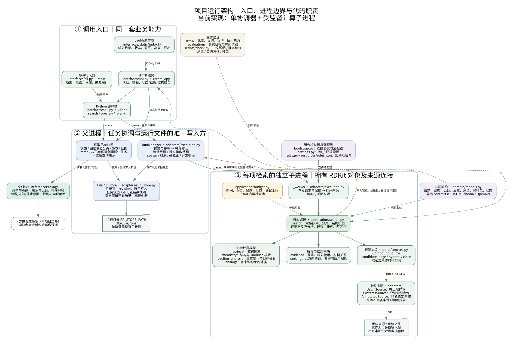
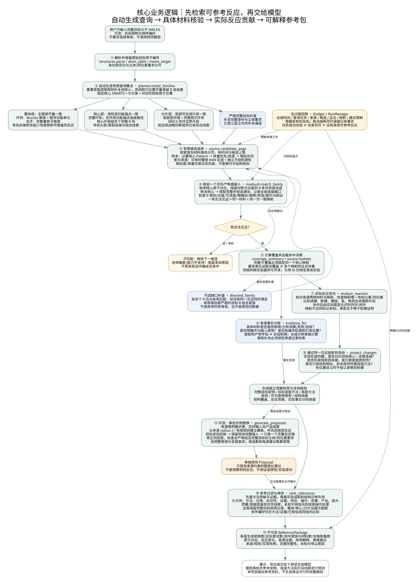

# 代码交接与阅读指南

本项目接收完整目标分子，在模型预测之前检索可参考的反应、底物和连接方法。阅读代码时，先跟随一次请求的数据流，再深入某个化学模块。本文描述当前实现；产品需求与后续范围分别见[产品计划](../../plan.md)和[实现状态](STATUS.md)。

函数、类、模块和关键逻辑均用中文说明；英文文件名、函数名和契约字段保留为代码中的实际标识。需要直接定位函数时，使用[函数阅读索引](FUNCTION_INDEX.md)。

## 两张图怎么读

[运行架构图 SVG](system-architecture.svg) / [PNG](system-architecture.png) 解释入口、进程边界、来源端口和文件快照。实线表示调用或结果传递，虚线表示配置、契约和验证依赖。化学计算与来源连接在子进程；父进程监督执行并保存结果。



[核心业务逻辑图 SVG](core-business-flow.svg) / [PNG](core-business-flow.png) 解释完整目标如何变成可追溯参考。按编号向下读；旁路是预算控制、缺口补查和可选替换建议。图中函数名都对应实际实现。



两张图都保留可编辑的 `.dot` 源文件。源码相对位置均从 `src/reaction_reference/` 开始；“下游模型”是消费结果的外部调用方，当前检索过程不调用模型。

## 先跑一遍，再沿着调用链读

以下命令在仓库根目录执行，使用已安装的锁定环境：

```bash
# 只看自动生成的查询家族，不读取反应来源。
./implementation/scripts/rr preview --target 'CCCNC(=O)c1ccccc1'

# 默认六条合成示例，导出全部参考与解释字段。
./implementation/scripts/rr search --target 'CCCNC(=O)c1ccccc1' --output var/handover-example.json

# 启动内部页面；浏览器打开 http://127.0.0.1:8000 。
./implementation/scripts/rr serve
```

示例目标是 N-丙基苯甲酰胺。示例来源中的酰胺化反应使用乙胺；可用来演示将一个完整输入换成丙胺的建议。示例引用会明确标记为合成数据，真实文献制备命中数为零。`search` 退出码 `2` 表示保留了部分范围结果，先看停止原因，不要据此判断没有参考。

建议按以下顺序阅读：

| 顺序 | 文件与入口 | 先理解什么 |
|---|---|---|
| 1 | [domain/models.py](../src/reaction_reference/domain/models.py) | 从 `SearchRequest → QueryFamily → Witness → Reference → ReferencePackage` 看对象含义 |
| 2 | [interfaces/sdk.py](../src/reaction_reference/interfaces/sdk.py) 的 `Client.search` | 请求怎样提交、等待并返回阶段或最终资料包 |
| 3 | [application/search.py](../src/reaction_reference/application/search.py) 的 `search` | 主业务入口；函数内用 ①～⑧ 标明编排阶段 |
| 4 | [retrieval/planner.py](../src/reaction_reference/retrieval/planner.py) | 自动查询从哪里来，哪些原子固定，哪些位置允许 R 变化 |
| 5 | [chemistry/markush.py](../src/reaction_reference/chemistry/markush.py) | 一条命中为何成立，为什么不能把不同映射的支链覆盖拼起来 |
| 6 | [reaction_analysis/analyze.py](../src/reaction_reference/reaction_analysis/analyze.py) | 真实反应形成了什么，如何对应目标要形成的连接 |
| 7 | [evidence/claims.py](../src/reaction_reference/evidence/claims.py)、[analogs/transfer.py](../src/reaction_reference/analogs/transfer.py) | 实验事实和图类比分别怎样成立 |
| 8 | [ranking/engine.py](../src/reaction_reference/ranking/engine.py)、[ranking/features.py](../src/reaction_reference/ranking/features.py) | 排序资格、九方向解释、展示配额和未知信息 |
| 9 | [adapters/execution.py](../src/reaction_reference/adapters/execution.py)、[adapters/run_store.py](../src/reaction_reference/adapters/run_store.py) | 并发、取消、硬超时、快照和重启处理 |
| 10 | [interfaces/api.py](../src/reaction_reference/interfaces/api.py)、[页面源码](../src/reaction_reference/interfaces/static/index.html) | HTTP、分页、结构高亮和页面事件 |

## 项目目录及职责

仓库根目录的 `plan.md`、`implementation_plan.md`、`ranking_plan.md` 和 `design/` 保存设计；`implementation/` 是独立安装、运行和测试的项目。不要在根目录另建一套业务实现。

```text
implementation/
├── pyproject.toml、uv.lock       # 项目入口、依赖范围及精确依赖锁
├── src/reaction_reference/
│   ├── __main__.py              # python -m reaction_reference 的入口
│   ├── bootstrap.py             # 组合根：选择来源与审核包装，创建协调器
│   ├── settings.py              # RR_* 环境配置及子进程配置白名单
│   ├── rules.py                 # 规则校验、能力说明、实现内容哈希
│   ├── schema_export.py         # 从模型和 API 导出契约
│   ├── domain/models.py         # 严格领域对象；不保存 RDKit 或连接对象
│   ├── ports/sources.py         # 来源协议及 Candidate / CandidatePage
│   ├── application/
│   │   ├── search.py            # 核心业务编排、缓存、队列、阶段包与统计
│   │   └── budget.py            # 时间和各类工作额度、任务轨迹
│   ├── chemistry/
│   │   ├── structures.py        # 解析、身份、目标约束、完整 R 块、描述符
│   │   └── markush.py           # 查询编译、逐映射核验、联合覆盖
│   ├── retrieval/planner.py     # 三层家族、严格目标补查、缺失 R 定向补查
│   ├── reaction_analysis/
│   │   └── analyze.py           # 来源端点校对、图变化、环变化、目标投影
│   ├── analogs/transfer.py      # 来源自回放与只替换一个完整输入的建议
│   ├── evidence/
│   │   ├── claims.py           # 产品观察、输入使用和有范围的文字摘要
│   │   └── relations.py        # 已返回材料间的完整身份关系
│   ├── ranking/
│   │   ├── features.py         # 九方向已知事实、未知和限制
│   │   └── engine.py           # 排序、实验适配及分层展示选择
│   ├── adapters/
│   │   ├── sources.py          # 有限 JSONL / 只读索引来源的实现
│   │   ├── annotations.py      # 绑定来源哈希的人工审核证据
│   │   ├── execution.py        # 单协调器、监督/接收线程、spawn 子进程
│   │   ├── run_store.py        # 运行目录锁、状态修订、原子文件快照
│   │   └── export.py           # 有数量上限的只读来源导出
│   ├── interfaces/
│   │   ├── sdk.py              # Python Client，含冻结候选重排
│   │   ├── api.py              # HTTP 工厂、认证、状态、分页和结果接口
│   │   ├── cli.py              # 命令行参数与命令分派
│   │   ├── depiction.py        # 来源材料 SVG 与命中原子高亮
│   │   └── static/index.html   # 无前端构建链的内部查看页面
│   ├── evaluation/runner.py    # 目标选样、屏蔽、结构和标注指标
│   └── resources/              # 版本化有限规则和明确标记的合成示例
├── contracts/                  # JSON Schema 与 OpenAPI 导出文件
├── tests/                      # 化学、来源、执行和服务回归
├── evaluation/                 # 固定目标、试跑报告、验证记录
├── scripts/
│   ├── rr                      # 优先选项目虚拟环境的启动脚本
│   ├── check.py                # 完整交付检查
│   ├── check_comments.py       # 中文说明覆盖检查及函数索引生成
│   └── probe_source.py         # 可选只读来源探针
├── configs/                    # 内部环境配置示例
├── deploy/                     # 单协调器部署文件
└── docs/                       # 本文、函数索引、架构图及实现状态
```

依赖方向由 `tests/test_architecture.py` 检查：领域、来源端口、化学与应用模块不反向导入具体适配器或接口。`application.search` 接收来源协议，由 `bootstrap.open_source` 选择具体实现；更换来源时，先改适配器与装配，不把连接或 SQL 塞进化学函数。

## 一次检索实际怎样执行

1. HTTP 的 `submit` 或 SDK 的 `Client.search` 把已校验请求交给 `RunManager.submit`。协调器检查目标、容量及幂等键，保存 `queued` 状态，返回任务编号。
2. 监督线程调用 `_supervise`，把任务改为 `running`，启动 `_worker` 子进程。进程间只传可序列化请求、配置和结果；RDKit 对象及来源连接都在子进程内建立。
3. `_worker` 调用 `bootstrap.open_source` 和 `application.search.search`。`search` 建立共享预算、查询家族和待处理队列，先发布初始快照。
4. 队列每项是“家族、材料角色、分页游标、选择阶段”。先请求轻量候选；逐个材料用 `match_family` 核验。来源调用失败记入范围问题，只有显式允许的独立补查才继续。
5. 命中后才 `hydrate` 加载详情；同一反应只分析一次。`analyze_reaction` 读取实际来源变化；`project_changes` 通过该材料的一致见证对应目标位置；`evidence_for` 独立判断实验观察和输入使用。
6. 同一材料被多个家族命中时，合并见证与层级。后发现的分片若能更清楚说明目标连接，可升级贡献解释；不同实验的证据不会因为结构相同而合并成一条实验。
7. 在预算内翻页、放宽候选选择，并有限补查缺失 R 组合。随后对已有参考尝试来源约束的单反应物替换；不预先枚举可能开环/闭环的位置。已验证且唯一的建议经 `on_proposal` 回调逐条保留；后续回放耗尽预算时，前面完成的建议仍进入部分资料包。
8. 闭包 `package()` 统一做排序、展示选择、三层统计、能力状态、材料关系和摘要。`publish()` 把阶段包写入单向管道；父进程接收线程读取完整消息后放入有界内存队列，监督线程持续检查取消/时限并验证、保存资料包。
9. 正常结束、取消、超时或失败都通过父进程收尾。已有包继续可读；分页绑定快照，重排从已存的全部候选产生新的派生任务。

`package()` 是对当前累计事实的重新封装，不负责文件持久化。`publish()` 是进度回调，不是对外消息发送。真正的文件写入在父进程 `FileRunStore` 中。

重排资料包保留原检索的 `manifest.implementation_hash`，另用 `rerank_implementation_hash` 和 `reranked_at` 标明本次排序的实现与时间。近期反例及修复见[三轮复审记录](MULTI_ROUND_REVIEW.md)。

`active_writer` 登记同步重排的生命周期；关闭会等待已登记写操作结束再释放目录锁。排序期间不持有全局协调锁，其他任务仍可取消。排队任务直接取消 Future，SDK 默认等待包含排队时间；关闭触发的取消即使先唤醒等待者、后执行完成回调，等待路径也会先保存取消终态再返回。损坏的幂等绑定返回冲突，不按新请求重复接纳；通信与持久化的故障路径见[执行层审查](RUNTIME_REVIEW.md)。

客户端复制传入配置；任务接纳和重排时复制、重校验请求，返回状态也与后台对象隔离。调用方之后修改原对象的嵌套列表，不会改变已经接纳的任务；需要不同要求时创建新请求。

API 同样复制配置，认证和就绪探测不会随外部对象修改而变化；部署配置变更需要重新创建应用。CLI 预览直接调用静态方法 `Client.preview(request)`，不创建协调器、不触发恢复，服务运行期间也可预览。

## 关键对象与编号含义

| 对象 / 字段 | 含义及阅读约定 |
|---|---|
| `SearchRequest` | 完整目标、检索/排序配置、实验限制、开关和预算 |
| `QueryFamily` | 一个可执行查询家族：固定核心 SMARTS、R 条件、目标位置和生成依据 |
| `Material.instance_id` | 一个反应中的具体材料实例；同一结构作为另一实验的输入/产物时仍是另一实例 |
| `Witness` | 在同一个具体材料、同一次一致映射下成立的结构见证；一条材料可有多个对称方向见证 |
| `Reference` | 绑定具体反应与材料的参考；包含命中家族、见证、实际贡献、事实支持及排序解释 |
| `Proposal` | 来源约束的未观察替换建议；它不是新增文献命中 |
| `ReferencePackage` | 包含全部已评估参考、展示 ID、建议、范围、统计及追溯信息的结果快照 |
| `RunState` | 执行任务状态与修订号；与资料包的检索范围完整性分开 |

有四套数字不能混用：

- **原始目标原子索引**：从 `0` 开始，按 `target_input_smiles` 的解析顺序编号。`target_smiles` 是规范身份表示，重新解析后不保证原子顺序相同。
- **查询核心位置**：从 `0` 开始。`QueryFamily.target_atoms[i]` 表示查询第 `i` 个原子对应的原始目标索引；`RConstraint.position` 和 `RBlock.core_positions` 使用查询位置。
- **来源材料局部原子索引**：从 `0` 开始，按该具体 `Material.smiles` 解析顺序编号。`Witness.target_to_source` 每一对为“原始目标索引、来源局部索引”。
- **反应原子映射号**：来源映射式中的正整数，例如 `[C:17]` 的 `17`。`BondChange.maps` 使用这套编号；`0` 和缺失映射不构成跨侧身份。

切下 R 块时，边界虚拟原子的 `:1`、`:2` 等临时端口标签表示“查询核心位置 + 1”，并非原始反应映射号。所有这些编号的互转都应通过保留的对应关系完成，不能靠规范 SMILES、排序或名字猜测。

非原生导出行的 `ReactionRecord.id` 和实验复合标识会转义组成字段中的 `%`、`:`，避免字段拼接碰撞。外置审核的 `record_id` 使用实际返回的 `ReactionRecord.id`；`SourceRef.record_id` 保留原始编号。缺少完整定位时按来源记录区分实验，不用空值关联其他记录的详情。

`Witness.id` 返回到结果时绑定具体反应/材料；`structural_witness_id` 保留可复用的结构核验身份。匹配缓存还保留原始材料 SMILES，防止同一身份但不同原子顺序串用局部索引。

## 化学逻辑需要守住的边界

**查询家族是自动生成的有限集合。** 整体、核心、分片是参考粒度，不是让用户挑选骨架的步骤。环系、官能团和无环锚点规则决定固定核心；R 约束描述核心外的完整连通块。生成家族数不是“该分子的全部可能骨架数”。严格完整目标另设补查。

**重要官能团由规则明确保留。** `functional_matches` 按版本化 SMARTS 识别功能单元，`_close_units` 将相交或所需邻近单元补进核心，`_core_smarts` 保留元素、芳香性、电荷、同位素等约束。羟基还约束氢数与连接度，防止把醇和醚角色混淆。当前是有限规则，不是自动预测所有活性；保护基和互变异构体全面展开尚未实现。

**完整 R 块与联合覆盖必须一致。** 核心外有两个连接端口的桥连部分要作为完整块核验。单个见证的覆盖可解释为“同一材料确实同时覆盖这些位置”；不同见证的位点并集只用于发现缺口，不能拿来声明所有目标支链已共同出现。

**产物结构命中后仍要分析方法。** 先验证来源映射两侧与实际材料一致，再识别成断键和官能团变化，通过同一见证投影目标。只是“产物里有这个片段”可能只能算结构线索；只有对应变化才支持连接方法或修饰贡献。开/闭环依据命中反应的真实变化辨认。

**事实、推定和建议分别记账。** `reported_prepared` 需要实际观察引用；提取到产物数组不够。图变化支持的是图贡献；来源自回放成功只说明模板能解释该来源图。换一个完整输入后命中目标仍是未观察建议，不能继承原反应收率或声称实验成功。

产品结论的来源位置使用该观察的精确 `source_location`，原记录仍保留原定位。已有底物审核引用按实例写入使用结论的 `evidence_text`，并随摘要导出；局部审核按实例更新引用，未提及的项保留。

**排序先守住参考资格。** 方法贡献和证据先分组，再按配置排序。分子量和相似度描述迁移负担，官能团差异描述环境线索，均不保证方法适用。供应、危害、监管等没有资料供应器时保持未知。`max_display` 只限制展示，资料包保留全部已评估候选，便于重排和追溯。

## 如何判断“完成了多少”

`RunState.lifecycle=succeeded` 表示本次任务正常返回结果，不代表全库穷尽。在线模式的 `coverage_state` 仍是 `partial`；有限 JSONL 的显式穷尽模式也只能承诺声明的来源/家族范围。

浏览器导出直接保存服务器返回的原始资料包字节，保留合法大整数等元数据；错误响应不会另存为资料包。JSONL 来源中的非有限数和无效 Unicode 会作为坏行隔离，详见[数据边界审查](DATA_BOUNDARY_REVIEW.md)。

读资料包时依次检查 `coverage_state`、`stop_reasons`、`family_states`、`feature_status` 和 `source_issues`。然后看 `statistics.by_layer` 的生成/尝试/命中统计、`preparation_hits` 与 `usage_hits`。材料、实验、家族和建议各有不同去重口径，不能相加当成同一种“命中数”。

正常停止扩展的预算信号是 `BudgetExceeded`，由业务编排捕获并保留结果。来源失败、映射不足、未支持的查询语义有各自原因。父进程还有硬截止，可以终止卡住的原生计算；没有阶段快照时则没有可读取的参考包。

## 以后改需求，从哪里下手

| 要修改的行为 | 首先修改 | 同时查看的回归 |
|---|---|---|
| 新增官能团或保留重要结构 | `resources/rules.json`、`retrieval/planner.py` | `test_chemistry.py`、`test_architecture.py` |
| 支持新的 R 类别、桥连或覆盖语义 | `chemistry/structures.py`、`chemistry/markush.py`、相关契约 | `test_chemistry.py` 中对称、完整块和联合覆盖案例 |
| 新增来源或改变候选优先方式 | `ports/sources.py`、`adapters/sources.py`、`bootstrap.py` | `test_pipeline.py` 的分页、脏数据、截断及失败补查 |
| 改实际反应类型、映射校验、目标贡献 | `reaction_analysis/analyze.py`、`application/search.py` | `test_reactions.py`、`test_pipeline.py` |
| 扩充单反应物替换 | `analogs/transfer.py`、有限注册规则 | `test_reactions.py` 的原反应回放、整骨架和支链替换 |
| 补充来源观察或审核信息 | `adapters/annotations.py`、`evidence/claims.py` | `test_annotations.py`、证据冲突与示例隔离案例 |
| 改参考价值或实验适配 | `ranking/features.py`、`ranking/engine.py` | `test_pipeline.py` 中未知字段、配额和完整目标保留 |
| 改并发、取消、持久化或分页 | `adapters/execution.py`、`run_store.py`、`interfaces/api.py` | `test_service.py` |
| 改资料包或接口字段 | `domain/models.py`、`interfaces/api.py` | 重新导出 `contracts/`，检查契约漂移与接口测试 |
| 改评测口径 | `evaluation/runner.py` | `test_evaluation.py`；未审核标签仍不得计算方法质量 |

修改回放规则后先运行 `validate-rules`。除了编译成功，规则 ID 必须唯一；逆向只接收一个目标，正向使用 1–4 个输入，逆向输出数量应与正向输入槽位一致。正向允许多个产物，这些检查不代替来源自回放和化学审核。

## 修改后的交付步骤

先刷新函数索引，再执行项目自检；新增 Python 函数没有中文 docstring 会直接报文件与行号：

```bash
implementation/.venv/bin/python implementation/scripts/check_comments.py --write-index
implementation/.venv/bin/python implementation/scripts/check.py
```

检查包括中文说明覆盖、Ruff、mypy、282 项回归、契约漂移和 wheel 构建。真实来源/浏览器集成需要额外测试环境，缺失会跳过；安装及运行方法见[项目说明](../README.md#真实来源和浏览器集成检查)。中文检查覆盖业务源码、测试、仓库根目录脚本、`reviews/` 和绘图脚本，逐行核对 docstring 并使用 Python 词法分析提取独立及行尾注释。只有 shebang、`type: ignore` 等工具指令按语法保留，其后附带的人工解释仍需使用中文。检查可以发现遗漏和纯英文说明，内容是否准确仍需对照实现审查。前端函数与匿名事件回调的中文说明在页面源码中人工维护；前端异步回归需要 Node.js，缺失时 pytest 会明确显示跳过。本轮问题与针对性测试见[整体代码审查记录](CODE_REVIEW.md)。

Pydantic 类说明和 API 处理函数说明会进入 JSON Schema / OpenAPI。修改这些说明后，在仓库根目录执行导出：

```bash
implementation/.venv/bin/python -c 'from pathlib import Path; from reaction_reference.schema_export import export_schemas; export_schemas(Path("implementation/contracts"))'
```

修改包内源码、注释或 HTML 都会改变 `code_fingerprint()`。需要对新版本提供评测记录时，重新运行评测并更新验证记录，不应只替换旧报告的代码哈希。

图需要修改时编辑 `.dot` 后重新生成：

```bash
dot -Tsvg implementation/docs/system-architecture.dot -o implementation/docs/system-architecture.svg
dot -Tpng -Gdpi=120 implementation/docs/system-architecture.dot -o implementation/docs/system-architecture.png
dot -Tsvg implementation/docs/core-business-flow.dot -o implementation/docs/core-business-flow.svg
dot -Tpng -Gdpi=120 implementation/docs/core-business-flow.dot -o implementation/docs/core-business-flow.png
```

## 运行和排查入口

| 现象 | 先查哪里 |
|---|---|
| 启动提示协调器目录锁占用 | 是否有另一个服务/SDK 使用同一 `RR_STORE_PATH`；API 保持单 Uvicorn worker |
| 有结构参考却没有制备命中 | `record.observations`、产品实例和引用；默认示例必须为零真实命中 |
| 少量结果就停止 | `stop_reasons`、任务预算与家族状态；不要先改大所有上限 |
| 方法贡献未知 | `analysis.reasons`、映射端点校对、位置歧义及 `contribution_support` |
| 无替换建议 | 来源是否明确步骤/输入/产品观察，自回放是否成立，建议预算及能力状态 |
| 条件或危害显示未知 | 来源条件归属、已知字段和外部资料能力状态；未知不自动填默认值 |
| 翻页返回冲突或游标无效 | 是否混用了任务或快照；重排生成新任务，应从其第一页重新读取 |
| 实际来源未就绪 | 来源配置与索引能力检查；当前不自动退回全表扫描 |
| 重启后部分旧任务不可读取 | 查看 `/health/ready` 的 `recovery_issues`；损坏文件被保留，按任务 ID 检查对应状态或快照，其余有效任务可以继续使用 |

锁定环境安装方式、接口示例见[项目 README](../README.md)。当前支持范围、真实样本限制和尚未验证的部署能力见 [STATUS](STATUS.md)，它们是交接时应一起阅读的现状说明。
