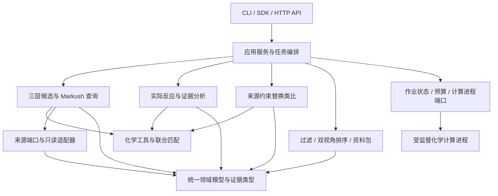
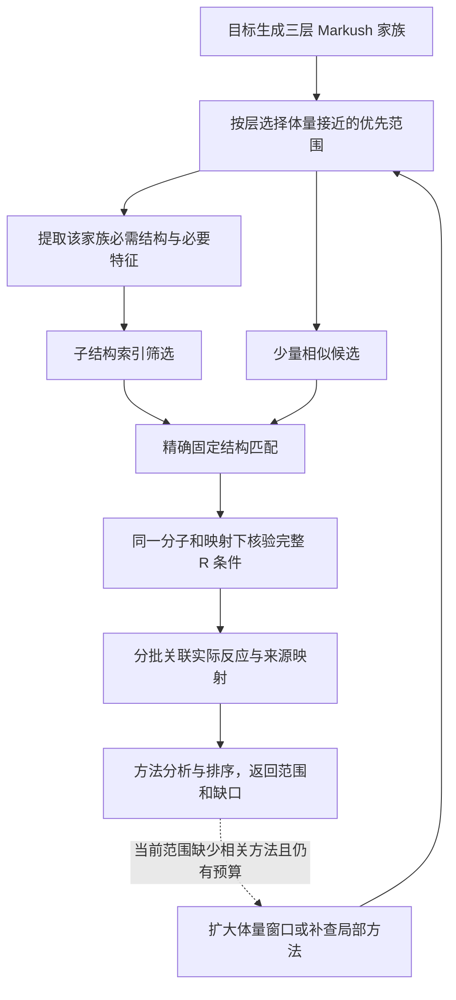

# 项目实现计划：模块化的目标导向反应先例检索系统

日期：2026-10-28。状态：工程设计；M0 的独立开发环境已安装并验证，尚未创建业务代码、部署服务或完成真实召回验证。

## 1. 工程目标与固定边界

把现有化学设计实现为可测试、可追溯、可替换数据源的 Python 系统：用户输入完整目标分子，系统自动生成三层 Markush 查询，召回具体分子及反应，分析目标连接方法和真实环变化，生成受控的单反应物替换类比，最后提供参考价值/实验适配双视角结果。

部署定位为内部研究服务，不包含付费模块、支付、订阅、套餐、账单或按用户收费的额度体系。任务预算仅记录计算工作量，用于限制资源占用和避免无界枚举。

固定执行顺序：

**具体目标 → Markush 家族 → 结构召回与联合匹配 → 实际反应分析 → 来源约束类比 → 证据聚合与排序 → 资料包 → 下游模型。**

工程化不能改变以下语义：

- 默认固定必要核心、位置和重要功能单元，非关键 R 位点放宽；不静默降级为精确连续片段查询。
- R 条件和共存关系在同一具体分子、同一核心映射下核验；通式不冒充具体制备实例。
- 产物命中不是反应方法命中；每条结果必须有目标贡献类别或明确未知状态。
- 开闭环来自已召回反应的实际变化；不在无来源时预先枚举目标环前体。
- 替换类比是依附真实来源的有限推定，不能进入已观察实验事实与制备计数。
- 未知、未支持、无命中、失败实验和超时是不同状态。
- 无实验能力配置时仍返回参考排序；不声称实验适配、安全或可直接沿用条件。

本文件规划应用层、化学模块、接口和运行工程，不指定业务数据库表结构、迁移方案或旧库标准。具体来源通过只读适配接口接入。

## 2. 当前基础、缺口与技术决策

### 2.1 已有基础

仓库已有主计划、详细化学规则、排序规范、示意图和 9 个 RDKit 探针。它们是需求与局部行为依据，不是完整检索引擎或现成可复用的通用算法。

现已建立 `pyproject.toml`、`uv.lock`、项目专用 Python 3.12.12 和 `.venv`，安装运行与开发依赖，并通过 9 个现有探针、API 本地调用、图表生成及依赖一致性检查。环境位置、复现命令、锁定版本及验证范围统一记录在 [开发环境文档](ENVIRONMENT.md)。项目仍没有生产业务包或完整引擎测试；环境就绪仅完成 M0 的环境部分，不代表领域模型、配置 schema、导入边界或 CI 已完成。

### 2.2 技术基线

| 决策 | 初始方案 | 原因与落地要求 |
|---|---|---|
| 架构 | 单仓库、模块化单体；化学计算独立进程 | 先保证端到端可运行与模块隔离，按实测瓶颈决定是否拆服务 |
| 语言 | Python 3.12.12，已安装并固定 | 已在隔离环境重跑现有探针；业务模块仍需各自的兼容性和行为测试 |
| 化学工具 | RDKit 固定为 2026.03.2 | 已通过现有探针；升级必须做查询语义和原子对应回归，不使用浮动 latest |
| 数据契约 | Pydantic v2 的受约束模型及 JSON Schema | 必须字段、枚举、未知状态、版本和来源可验证；化学对象不直接暴露给 API |
| 入口 | Python SDK、CLI、FastAPI `/v1` | 三种入口复用应用服务，避免 CLI 与 HTTP 存在两套化学逻辑 |
| I/O | 异步且有超时；独立适配器 | 外部资料不可用不阻塞所有核心计算 |
| CPU 工作 | 受监督子进程与全局并发上限 | Markush 枚举等原生调用可能长时间运行，不能仅靠协程超时释放资源 |
| 配置 | 类型化环境设置 + 版本化 JSON 规则/策略 | 沿用现有 JSON 配置，在 M0 迁为统一 schema；未知字段和非法预算拒绝启动 |
| 依赖与构建 | `pyproject.toml` + `uv.lock`，已采用 uv | 运行与开发依赖已锁定；可选连接器按需加入；未来 CI 与镜像使用同一锁 |
| 质量工具 | pytest、Ruff、mypy、Hypothesis、import-linter，已安装并锁定 | 行为/性质测试、业务类型检查和导入边界随 M0/M1 的真实模块落地 |
| 可观测性 | 结构化日志、阶段指标、可选 OpenTelemetry 导出 | 先有统一事件模型，再接观测后端，核心代码不绑定监控平台 |
| 运行封装 | 单机 CLI/容器 API 为首版；后续可接队列 | 不默认引入分布式调度、消息总线或微服务数量负担 |

依赖的实际安装版本和验证范围以环境文档及锁文件为准；API、任务调度和业务包仍为待实现项。FastAPI 的响应后后台任务不承担关键计算作业；其文档对重计算有专门说明。[框架文档](https://fastapi.tiangolo.com/tutorial/background-tasks/)

## 3. 逻辑架构与依赖方向



`domain` 是最内层，包含数据和纯业务不变量，不执行 I/O，不导入 RDKit 或 Web 框架。`chemistry` 封装 RDKit 对象生命周期、表示与图操作；其外部返回可序列化的结构、映射和状态。具体数据源、持久化、HTTP 客户端及进程实现只在 `adapters` 中。

应用层通过 `ports` 包内的 `Protocol` 组织调用。端口只依赖领域模型，避免 retrieval 需要来源接口时反向导入 application。`bootstrap` 是唯一组装具体实现的地方；禁止服务模块自己读取全局配置、创建网络客户端或加载未知版本规则。模块有明确输入/输出后再拆文件，不为每个辅助函数创建抽象工厂。

本文的 IR 指统一查询中间表示，DSL 指有限的规则描述语言，CAS 指“仅当版本仍符合预期时更新”的条件写入。它们用于隔离化学语义、工具实现和并发状态，不是新的合成算法。

## 4. 拟议项目目录

以下是**实施后的目标结构**。业务模块按阶段实现；当前文件入口见 README。

```text
substructure_search/
├── README.md                         # 产品定位、文档入口；业务实现后补快速运行
├── ENVIRONMENT.md                    # 环境复现命令与检查范围
├── pyproject.toml                    # 构建、依赖组、CLI、质量工具设置
├── uv.lock                           # M0 解析验证后的锁文件
├── .python-version
├── .env.example                      # 仅键名/无敏感示例，不存凭据
├── .gitignore
├── Makefile                          # lint/typecheck/test/check/eval/schema
├── plan.md                           # 现行产品计划
├── implementation_plan.md             # 本工程实施计划
├── ranking_plan.md                    # 独立过滤排序语义
├── design/                           # 已有详细化学规范与契约
│   ├── specification.md
│   ├── markush_queries.md
│   ├── attachment_methods.md
│   ├── evidence_contract.md
│   ├── single_reactant_transfer.md
│   ├── source_reference.md          # 当前来源字段与接入约定
│   ├── ...
│   └── adr/                          # 架构决策：选择、替代方案和适用条件
├── configs/
│   ├── app.example.json              # 作业/并发/输出/超时配置
│   ├── retrieval/pilot.json          # 从现有 pilot_profile 迁入的运行配置
│   ├── ranking/reference.json
│   ├── ranking/lab_fit.json
│   └── ranking/process.json
├── rules/
│   ├── manifest.json                # 规则集版本、哈希、能力与来源清单
│   ├── schemas/                     # 规则文件的 JSON Schema
│   ├── functional_groups/
│   ├── query_families/
│   ├── generic_groups/
│   ├── normalization_views/
│   ├── reaction_classes/
│   ├── attachment_methods/
│   └── transfer_templates/          # 经审核的来源约束回放规则
├── src/reaction_reference/
│   ├── __init__.py
│   ├── bootstrap.py                 # 依赖组装，不放业务算法
│   ├── settings.py                  # 类型化启动设置
│   ├── domain/
│   │   ├── structures.py            # MoleculeRecord、AtomRef、材料/组分
│   │   ├── queries.py               # QueryFamilySpec、R 位点与联合约束
│   │   ├── reactions.py             # 真实反应、阶段、实例、观察结果
│   │   ├── evidence.py              # Claim、来源、未知/争议和任务贡献
│   │   ├── proposals.py             # 独立的推定替换建议
│   │   ├── ranking.py               # 特征、约束判定、双视角结果
│   │   ├── runs.py                  # 任务状态、范围、快照与版本
│   │   └── errors.py                # 结构化原因码
│   ├── ports/
│   │   ├── sources.py               # 分子/反应来源与映射接口
│   │   ├── execution.py             # 计算任务与时钟接口
│   │   ├── persistence.py           # RunStore 与缓存接口
│   │   └── enrichment.py            # 有来源的资料增强接口
│   ├── application/
│   │   ├── search.py                # 提交与执行检索用例
│   │   ├── preview.py               # 家族与目标对应预览
│   │   ├── rerank.py                # 基于已有证据快照重新排序
│   │   ├── cancel.py
│   │   ├── pipeline.py              # 阶段流转与不变量
│   │   └── budget.py                # 全局与子任务预算账本
│   ├── chemistry/
│   │   ├── parsing.py
│   │   ├── normalization.py
│   │   ├── atom_refs.py             # 原始/规范化/查询/参考原子对应
│   │   ├── scaffolds.py             # 有环与无环结构视图
│   │   ├── fragments.py             # 实际结构片段与边界
│   │   ├── descriptors.py
│   │   └── markush/
│   │       ├── compiler.py          # 统一家族 IR → 匹配计划
│   │       ├── capabilities.py      # 支持/不支持的明确检查
│   │       ├── matcher.py           # 显式参数和匹配预算
│   │       ├── predicates.py        # 全支链、H/电荷和联合条件
│   │       └── assignments.py       # 真实 R 分配、联合块和等价映射
│   ├── retrieval/
│   │   ├── planner.py               # 三层家族、身份补查和受控扩展
│   │   ├── scheduler.py             # 候选轮转、名额和任务优先级
│   │   ├── executor.py              # 来源候选页 → 化学完整匹配
│   │   ├── reaction_lookup.py       # 一产物多反应，保留所有返回状态
│   │   ├── dedup.py
│   │   └── coverage.py              # 家族/位置/反应和结构覆盖
│   ├── reaction_analysis/
│   │   ├── mapping_quality.py       # 形式、局部稳定性、来源支持
│   │   ├── changes.py               # 原始差异、表示差异核验及保留变化
│   │   ├── classify.py              # 类型依据与未知，不按名字猜中心
│   │   ├── attachment.py            # 目标母核—支链边界贡献
│   │   ├── topology.py              # 来源开闭环/重组/环保留
│   │   ├── provenance.py            # 原子来源与重复实例份数
│   │   └── stereo_origin.py         # 继承/建立/富集/未知
│   ├── evidence/
│   │   ├── observations.py          # 制备、分析、使用、回收、冲突
│   │   ├── stages.py                # 结构、条件、测量的阶段关系
│   │   ├── claims.py
│   │   ├── aggregate.py             # 合格见证与分账计数
│   │   └── recorded_links.py        # 真实共同中间体与有限方向补查
│   ├── analogs/
│   │   ├── product_delta.py         # 目标与来源产物的差异
│   │   ├── reactant_attribution.py  # 一个槽位还是多个来源
│   │   ├── substitution.py          # 保持必要反应端的替代候选
│   │   ├── replay.py                # 有界图回放及完整目标检查
│   │   └── applicability.py         # 迁移差异；不预测实验成功率
│   ├── ranking/
│   │   ├── features.py              # 九方向特征和未知
│   │   ├── eligibility.py           # 方法资格和明确约束四态
│   │   ├── reference.py
│   │   ├── lab_fit.py
│   │   ├── diversity.py
│   │   └── explain.py               # 原因模板，引用 claim，不造事实
│   ├── rule_registry/
│   │   ├── loader.py
│   │   ├── validate.py
│   │   └── registry.py
│   ├── adapters/
│   │   ├── sources/jsonl_source.py  # 固定样例与小集的只读全扫描
│   │   ├── sources/external_source.py # 实际来源接入点，按契约实现
│   │   ├── mapping/provided.py      # 首版使用来源映射与显式未知
│   │   ├── enrichment/fixtures.py   # 离线条件/材料资料
│   │   ├── enrichment/http.py       # 可选资料服务，明确身份和日期
│   │   ├── execution/local.py       # 并发上限、超时、进程退出
│   │   ├── run_store/files.py       # 单协调进程的原型作业持久化
│   │   └── cache/local.py
│   ├── interfaces/
│   │   ├── sdk.py
│   │   ├── cli.py
│   │   ├── api/app.py
│   │   ├── api/routes.py
│   │   ├── api/transport.py         # 请求/响应映射，不复制化学规则
│   │   └── api/errors.py
│   └── observability/
│       ├── events.py
│       ├── logging.py
│       └── metrics.py
├── contracts/                        # 从领域/接口模型导出的版本化 Schema
├── tests/
│   ├── unit/
│   ├── property/
│   ├── contract/
│   ├── integration/
│   ├── e2e/
│   ├── regression/
│   └── fixtures/
│       ├── synthetic/               # 显式人工例子，永不当文献事实
│       ├── source_examples/         # 有许可和出处的真实样例
│       └── expected/                # 专家标注期望与解释
├── evaluation/
│   ├── protocol.md
│   ├── targets.jsonl
│   ├── annotations.jsonl
│   ├── acceptance_registry.json     # 需求/案例 → 测试 → 状态映射
│   └── run.py
├── scripts/
│   ├── validate_design.py           # 已有文档检查
│   ├── plan-git                     # 当前工作区 Git 入口
│   ├── project-uv                   # 项目专用解释器、环境与缓存入口
│   ├── verify_environment.py        # 依赖协作、化学探针和图表验证
│   ├── export_schemas.py
│   ├── validate_rules.py
│   └── smoke.py
├── deploy/
│   ├── Dockerfile
│   └── compose.example.yml          # 单实例 API + 受控进程执行配置
├── .github/workflows/ci.yml
├── diagrams/                         # 已有设计图和生成器
├── reviews/                          # 可运行探针、验收场景和来源样本摘要
└── var/                              # 未跟踪：runs/cache/logs/exports
```

包名统一为 `reaction_reference`；外部 API 不使用内部 Python 文件名作契约。现有脚本/图仍按原路径维护。运行产物和大型数据不进 Git；允许入库的真实样例单独核对许可与来源。

## 5. 模块职责、输入输出和依赖约束

| 模块 | 核心输入 | 核心输出 | 责任边界 |
|---|---|---|---|
| domain | 明确字段与来源引用 | 结构化对象与不变量 | 无 I/O、无 RDKit、无框架路由 |
| chemistry | 原结构、家族约束、固定规则版本 | 规范化视图、原子对应、MatchWitness、有限图结果 | 不判文献制备成功，不连接来源服务 |
| retrieval | 目标、规则包、来源快照、预算 | 家族任务、具体匹配、反应候选、覆盖状态 | 不凭产物匹配判方法，不输出预测路线 |
| reaction_analysis | 实际反应、目标匹配、来源映射 | 变化、目标贡献、类型依据、局部争议 | 不替实验观察背书，不无来源猜环前体 |
| evidence | 来源观察、阶段、结构与分析结论 | 实验事实、Claim、见证与分账 | 不执行结构召回或偷偷生成新反应 |
| analogs | 有来源的实际反应与目标差异 | 独立 ProposalRecord、回放/迁移状态 | 不能写入实际 ReactionRecord 或“制备命中” |
| ranking | 证据快照、推定建议、配置与明确能力 | 两套列表、原因、缺口与稳定顺序 | 不改变事实，不将未知当有利信息 |
| application | SearchRequest、依赖端口 | RunSnapshot、ReferencePackage | 组织生命周期和预算；不嵌入具体 SMARTS 判断 |
| adapters | 端口请求与外部系统 | 契约模型或结构化错误 | 外部格式、网络、文件、进程实现细节在此隔离 |

依赖原则：`interfaces → application → 领域服务 → chemistry/domain`，I/O 调用依赖独立 `ports → domain`；`adapters → ports/domain` 实现接口，bootstrap 完成组装。领域服务不能反向导入 application 或具体 adapters。`ranking` 不直接读取原始来源文本，`analogs` 不修改来源事实，`chemistry` 不导入 `application`。共享只是领域契约与端口，不创建无边界的 `utils` 大包。

用 import-linter 固化关键限制。业务模块间传结果模型或调用窄服务接口，不通过文件路径或全局字典交换状态。首版模块内可用普通函数/类，只有外部依赖或明确替换点使用端口。

## 6. 核心数据契约

所有对外模型使用显式 `schema_version`，严格类型与枚举，未知字段默认拒绝或按明示扩展机制处理。枚举和状态只有一个定义来源，API/OpenAPI、CLI JSON 和 JSON Schema 共同生成。

| 对象 | 必要字段/关系 | 关键约束 |
|---|---|---|
| `SearchRequest` | target{format,value}、retrieval_profile、ranking_profile、可选 lab_context、options、budget_override | 具体目标与高级查询类型分开；用户覆盖只能在服务上限内 |
| `MoleculeRecord` | record_id、原始结构、具体组分/实例、材料状态、来源、视图列表 | 化合物身份、实例与样品状态不能合并 |
| `AtomRef` | structure_record_id、representation_id、atom_uid | 原子编号属于具体表示；规范化/切片后须有显式 remap |
| `MappingCopyRef` | mapping_copy_id、源映射版本、图原子引用、可能的材料实例、归属状态与依据 | 算法配平副本不自动实例化为实际投料，不能据副本数计算当量 |
| `QueryFamilySpec` | family_id、parent_candidate、layer、固定要素、R 约束、core_topology_policy、联合条件、目标位置、rule_ref | 化学语义统一 IR；包含匹配不自动证明核心没有额外连接 |
| `CandidateSelectionScope` | selection_scope_id、family_id、来源快照、输入/产物角色范围、比较结构/区域、表示及属性版本、体量窗口、相似策略/K、放宽阶段 | 角色或选择范围改变生成新 ID，不把输入侧命中混入产物制备统计 |
| `CompiledMatchPlan` | family_revision、必要筛选、精确 matcher 配置、后检查、能力需求 | 不支持条件不能静默丢掉；预筛不得比最终语义更窄 |
| `MatchWitness` | source_snapshot、实际分子实例、family_id、目标/查询/参考对应、R 分配、枚举状态、直接目标关系（如适用） | 区分严格记录身份与满足目标要求；纯核心预筛通过不算完整见证 |
| `ReactionRecord` | experiment_id、真实组分实例、阶段、观察、条件、来源、映射来源 | 未知反应物不能由默认值补出；净变化不自动拆为多步 |
| `AttachmentAssessment` | attachment_id、原始/表示/保留变化、表示规则与核验状态、comparison_scope、母核/支链覆盖、边界事件、未追踪片段、支持范围、未知原因 | map=0不作身份；遗漏副产物与共振写法不制造虚假变化，类型名与目标贡献分开 |
| `EvidenceClaim` | claim_id、subject、predicate、source_refs、mapping_basis、support、limitations | 阳性计数必须引用合格见证，规则推定不能成为实验观察 |
| `ProposalRecord` | source_reaction_id、原/替代实例、差异、回放组合与目标产物位置、枚举/校验状态、条件缺口、proposal_not_observed | 组合内逐产物核验，保留原子追踪；图回放不混入实验事实 |
| `FeatureValue` | value/state、unit、材料/阶段/规模、来源/日期、计算版本 | 0、false、未知、未适用、冲突分开 |
| `ReferencePackage` | 完整目标取得记录、局部方法/其他线索分区、证据/建议引用、双视角列表、覆盖、快照、feature_status、summary_status | 检索完整性与摘要裁剪分开；缩短摘要不提升结论强度 |

### 6.1 原子引用与稳定身份

原子 map number 是某次映射的标签，不作跨记录全局 ID。目标导入后生成稳定 atom_uid；规范化、盐主体视图、保护/互变视图和核心提取都返回原表示到新表示的对应以及未映射原因。

未映射原子的 map=0 只表示标签缺失，仍通过各自 AtomRef 区分；正标签的唯一性和元素/同位素对应通过后才用于跨侧连接比较。净键变化按已报告产物范围计算，来源缺少副产物时保留未追踪片段，不把消失片段内部所有键计作断裂。

映射输入副本与实际材料分别建模。原子先引用映射版本和图副本，再通过有据关系关联材料实例；多副本可关联同一材料，关系也可为未知。材料份数、原子来源份数和实测投料当量不能互相代替。

分子结构身份键忽略无语义 atom-map 标号，但保留声明的立体、同位素、电荷/材料策略；来源记录 ID 与实验 ID 不等同于结构身份键。相同结构参与两份时有两个实例 ID。不能靠 canonical SMILES 的原子顺序回推用户输入位置。

完整目标查找包含严格记录身份核验，以及对目标未约束立体位置的要求匹配。可先用独立的立体放宽视图取候选，但该视图须保留同位素、电荷及组分策略，最终仍检查完整目标。来源中更明确的立体信息保留在结果里，不因目标未约束就合并来源身份；这些候选是否能直接取得目标还需实际观察证据。

结构相同不等于本地原子索引相同。缓存中的匹配索引只能解释在缓存注明的具体表示中；返回当前 run 前，按显式表示对应重新绑定目标 atom_uid、来源实例及本次 occurrence。若只有 canonical SMILES 身份一致而无可靠重绑定，就重算匹配。对称核心的多种合法对应继续保留，不能随意取一个对称编号完成重绑定。[RDKit 原子重编号接口](https://www.rdkit.org/docs/source/rdkit.Chem.rdmolops.html#rdkit.Chem.rdmolops.RenumberAtoms)

`Mol`、原生 matcher 及 Python 回调仅在化学工作进程内部存活。跨进程/API 使用受验证的结构与查询 IR，不允许客户端提供 Python pickle 或任意执行回调。结构字符串不足以表达的标签必须显式序列化并做 round-trip 测试。

通用组的普通 SMARTS 导出会丢失类别，不能作为完整编译载荷或唯一缓存键。接收端从完整 IR 重建原生对象，核对必需条件、规则/工具版本与 matcher 参数；使用 CXSMARTS 时还须恢复通用组属性并启用相应匹配。自定义 R 谓词按受信规则标识重建，不传可执行回调。M1 即检验本地编译和恢复后的命中/R 分配一致，条件丢失时停止完整判定，详见 [查询传递规范](design/markush_queries.md#51-查询传递与缓存恢复不丢约束)。

### 6.2 能力协商与未知

能力按版本发布：固定核心、单点 R、多位点同实例、可选 H、限定通用组、完整支链谓词、多点桥接、位点相等/依赖、可变连接段等分别声明支持状态。

一个家族含未实现的必要条件时，返回 `unsupported_query_feature`。可以另生成一个明确更宽的家族用于探索，但它有新的语义 ID、放宽理由与独立计数，不能称原家族完成。

“未知”至少带原因：来源缺失、映射歧义、规则不支持、材料身份未匹配、条件未记录、预算截断、执行失败等。关键未知字段不得用 `False` 代表，也不得把字符串 `"false"` 自动当布尔真值；边界采用显式严格解析和单位归一化。[Pydantic 严格模式](https://docs.pydantic.dev/latest/concepts/strict_mode/)

## 7. 外部端口与首版适配器

| 端口 | 最小能力 | 首版实现与契约要求 |
|---|---|---|
| `CompoundSourcePort` | capabilities、固定 snapshot、candidate_page、fetch_structure | 声明属性/指纹表示及条件 Top-K 能力；分页绑定选择范围和明确穷尽含义 |
| `ReactionSourcePort` | 按具体分子实例及输入/产物角色分页关联反应、取组分/来源、来源锚定补查 | 默认产物制备通道，必要时补输入使用通道；一个分子的多个实际反应分别保留 |
| `MappingPort` | 来源映射与可选补充映射，附版本/范围 | 首版优先现成映射，缺失返回未知；以后接自动映射仍保留推定标签 |
| `EnrichmentPort` | 获取有来源的材料/条件/来源补充信息 | 首版离线 fixture，后续可选 HTTP 适配；不返回缺省“无危害” |
| `RunStorePort` | create/load、条件状态更新、事件、快照发布、按租约状态恢复 | 首版单协调进程文件适配，正式多实例前必须通过并发持久化契约 |
| `ComputeExecutorPort` | submit、result、cancel、deadline、resource_limits | 本地受监督进程；不会因 HTTP 客户端断连自动误丢状态 |
| `CachePort` | 按不可变语义键 get/put、到期/来源失效 | 首版本地可关闭缓存，正确性不得依赖缓存命中 |
| `ClockPort` | 单调时间和 UTC 记录时间 | 用于确定性预算与超时测试，禁止测试依赖真实 sleep |

数据源返回的候选页是**未完成化学核验的候选**，除非它提供同版本、已通过契约测试的完整匹配能力。返回 `items / next_cursor / source_snapshot / selection_scope_id / enumeration_kind / stream_exhausted / selection_scope_complete / completeness`，可无精确总数。`enumeration_kind` 区分完整范围扫描、条件 Top-K、全库前缀再筛选及抽样。列表读完不代表窗口已穷尽；窗口穷尽也不代表整个家族完成。取得空页但范围未穷尽，不得报告完整无命中。

上游扩展 JSON 保存在 raw 字段，由适配器显式转换为内部类型；不要因为来源多了一个非关键字段就拒绝整个批次。用户目标无法解析时拒绝请求；来源某条结构、条件或映射损坏时按字段/记录隔离，记录原因并继续其他可用记录。无法验证的方法不产生阳性结论，扫描中的相关验证缺口影响完整性声明。失去整体快照、契约不兼容等来源级故障才中止该来源分支。

来源适配器对 `product` 和 `reactant` 的结构候选能力分别声明。默认先检索产物；分片端口需要投入证据或缺少制备参考时，可在剩余预算内检索实际输入结构并关联它参加的反应。返回 `matched_role`、材料实例及源反应方向，不通过倒转反应把使用记录改成制备先例；仅溶剂/试剂标签不足以确认底物角色。角色范围进入候选缓存与完整性统计。

来源不支持某类安全预筛时，小型固定样例可使用有预算的全扫描；大规模在线来源需选择已验证的索引预筛，或返回该路径未支持/未完成。完整扫描只在明确的离线验证任务中执行，不因索引缺失就把千万条结构拉到 Python 逐条匹配，也不用不安全的相似度阈值制造漏检。数据源变更而无法维持快照时，中止该分支为来源变化，或建立新 run，不拼接两个快照为完整结果。

`SourceSnapshot` 明确包含来源版本/一致性令牌、范围、有效期、是否支持重启后续读，以及已取记录的内容哈希。候选页、结构、反应、映射和证据原文必须引用同一来源快照。只记录读取时间、最大记录 ID 或分页最后 ID 不能阻止已有记录被改写。

首版优先固定的导出样例或适配器提供的一致读取会话；一次 run 内冻结实际使用的来源内容及哈希。会话过期或进程重启后无法恢复时，不继续从活动来源拼接结果；封存已有部分候选并标明截断，或创建新 run。固定候选池允许离线重排，但不代表未读取的来源也已冻结。实际来源字段见 [接入约定](design/source_reference.md)。

外部 HTTP 连接器使用明确配置的服务、连接/读取超时、有限重试和资料缓存；未知或受限来源保持可见。来源文献原文仅作为数据，不作为执行指令；客户端不提供任意内网抓取 URL。

### 7.1 千万级反应来源的检索执行

百万至千万条反应时，默认参考模式采用“按层选择近体量候选范围 → 相似优先/子结构索引筛选 → 精确结构匹配 → 联合 R 核验 → 实际反应分析”的分级执行。体量与相似度用于优先取得有用参考，完整家族枚举保持单独的范围与状态。反应条数、不同具体结构数和同一产物关联的反应数分别计量；相同结构的匹配可复用，实验实例及不同方法保留。



**筛选语义。** 体量窗口和相似优先集合限定的是当前选择范围，应显式记录；在这个范围内，再使用适合子结构包含的指纹/索引排除不可能命中。对于已验证的查询语义，查询必需位不在候选位集合中时才排除；通过位筛选仍需图匹配。Morgan/Tanimoto 描述整体相似性，完整子结构命中也可能低相似；这一点不要求默认模式保留所有此类候选，只要求不能把相似选择范围冒充完整家族范围。Morgan 位集合本身也不具备通用的子图包含保证。

RDKit 的 Pattern Fingerprint 用于子结构预筛，但具体版本、查询特性和规范化视图要通过对照检查。Markush 只能使用该家族必需部分构建安全预筛，不能从完整目标带入已放宽 R 的指纹位。`F 或 Cl` 等备选条件按分支并集或共同必要特征处理，不要求同时包含两种元素；互变异构与化学扩展采用兼容的预筛路径。[Pattern Fingerprint 说明](https://www.rdkit.org/docs/RDKit_Book.html#pattern-fingerprints)

**相似度的用途。** 整体/核心层默认优先检查体量接近的相似候选，减少“只含小片段、其余结构很大”的低相关资料；宽查询尤其优先走这个路径。另保留当前选择范围内的限时子结构索引通道，两者取并集去重。只完成相似候选核验时注明该范围，参考不足再按层扩大范围，避免直接执行无限制宽查询。局部层按片段与反应位置判断，不强制与完整目标全局相似。对全库计算相似度再排序也可能很慢，需要来源本身提供索引能力。

已核验的 R 分配还用于发现相似优先集合的位点偏向。某一目标位点缺参考时，在原家族上限内可创建定位该位点的定向子家族，保留生成依据并继续比较近体量候选；不改变用户目标，不调用合成预测模型，也不把这种新查询冒充原宽查询的完整枚举。

**体量窗口。** 目标与参考采用同一声明的结构表示策略比较平均摩尔质量及重原子数；匹配后补充目标覆盖、参考覆盖与额外结构。窗口宽度按标注和试跑校准，不在文档中臆定适用于所有反应的质量倍数。首次请求无需用户设置窗口；运行配置负责默认范围与逐级放宽。完整选择规则见 [排序规划第 4.3 节](ranking_plan.md#43-默认先找体量接近的参考)。

预选只能使用无需该次匹配即可获得的属性，例如分子量和重原子数；目标覆盖、参考覆盖及额外原子数依赖实际映射，在匹配后计算。窗口策略必须含版本、比较对象、边界/单位及有限放宽步骤；配置中的“待校准”不是可直接运行的窗口。缺少可用策略或属性时，允许退回有上限的相似候选并在本地计算属性，明确哪些范围条件尚未应用，不能默认填 0 或伪装成已执行近体量筛选。

**条件 Top-K 与唯一结构。** “在体量窗口内取最相似的 K 个”与“全库取 K 个后剔除窗口外记录”不同。适配器支持前者时将窗口置于候选选择语义中；仅支持后者时返回 `global_prefix_filtered`，通过有界续取补充，候选少或为零不代表窗口没有参考。实际推入来源侧的必要家族条件也要列明，未推入的 R 条件留给精确核验。SQL 执行顺序按实际计划验证，不能仅根据条件书写顺序判断。[LIMIT 语义](https://www.postgresql.org/docs/18/queries-limit.html)

相似优先的 100 个名额按明确比较表示下的不同具体结构累计，不按反应行累计。相同产物的全部来源关联保留，但重复行不占多个结构名额；原始读取仍消耗 2000 条接收上限。没有独立结构索引时，可在有界候选流中去重并继续取数，不强制做全库 DISTINCT，也不能因取到了 100 行就宣称获得了 100 个不同分子。

**减少重复工作。** 来源侧提前准备结构表示与索引，查询时复用编译结果；以具体结构身份、表示/工具版本和完整家族约束缓存联合匹配，以源反应版本缓存与目标无关的净键变化。目标相关贡献仍结合目标重新分析。先返回候选 ID 和结构，进入精排后再批量加载 AAM/原文，避免重复传输大 JSON 和逐条请求。同产物的不同反应分批关联，不因结构缓存而只保留一个反应。

**宽查询与分页。** 常见苯环、短链或很宽的 R 家族仍可能命中大量结构，索引不能消除真实大结果集。可利用同一家族已经声明的更有区分度的必需锚点，或先调度另一个明确的定向家族；原宽家族保持独立完整性状态。首屏不要求精确总数，不先全量计数或排序后再截取少量结果；页大小、后端查询时间和返回候选量分别限制。来源游标或分批取数方式须检查执行计划，不能假设加上 LIMIT、OFFSET 或主键条件就一定利用结构索引且只扫描少量数据。

首版沿用现有来源的索引能力和受控化学工作进程。若代表性压测证明瓶颈仍在结构召回，再评估按具体结构去重的派生检索资产或 RDKit SubstructLibrary 等实现；它们需保留原实例关联、固定来源版本并通过同语义召回对照。线程数在服务层统一分配，避免每个请求各占满所有 CPU。[SubstructLibrary 的筛选与线程接口](https://www.rdkit.org/docs/source/rdkit.Chem.rdSubstructLibrary.html)

### 7.2 小而简单的目标：宽查询快返

检索目标是找到有用的反应参考，默认交互请求不要求立即列出全部子结构命中。小分子或常见片段往往选择性差，单条来源查询需要独立控制；结构索引与返回数量上限不能保证低延迟。大量命中不必然使“无排序的首批取数”很慢，但全量计数、排序、关联、指纹筛选效果差和复杂后过滤都可能造成长时间执行。

按实际查询选择性分流，不仅按分子量划线。优先使用已有必需特征频率、历史查询耗时/扇出以及限时试取一页的观察；不先执行 `COUNT(*)` 判断是否宽查询，也不把优化器估计当作精确命中数。

| 查询情况 | 默认执行 |
|---|---|
| 完整具体目标有直接身份索引入口 | 优先取得精确目标记录及其不同来源反应，同时保留其他层查询 |
| 整体/核心层查找类似物 | 优先选择与完整目标体量接近的相似候选，再做子结构/R 核验，并取得索引通道的补充代表 |
| 固定核心或重要官能团组合有区分度 | 可在当前体量范围内直接做子结构索引查询，分批完整核验 |
| 小而简单、常见片段或宽 R，预计大量命中 | 优先限制候选体量并取少量相似候选，核验后先返回有据参考；不足时逐级扩大范围 |
| 在线读取到时限或候选数上限 | 封存已核验参考，报告主通道/相似通道范围；不自动重新执行同一慢查询 |
| 明确要求所有实际支链/全部匹配实例 | 后续提供固定来源上的独立离线枚举；该能力未实现时明确返回未支持，不阻塞内部在线首版 |

宽查询可以执行“相似索引 Top-K → 这些具体候选的子结构匹配”，用于优先返回参考。实际执行必须限制昂贵匹配的输入集合，例如由适配器分两次取候选并核验，或使用确认物化的小候选集合；SQL 文本中把相似条件写在前面不保证优化器按此先后执行。相似候选命中只证明这些分子满足查询，剩余范围仍为未完成，不能据此声称全部命中已找齐。

子结构通道在当前明确的选择范围内有短时读取机会；不为了“完整”让一次宽查询占满全部时间。分页优先复用同一有界读取会话中的服务端游标或实测可行的稳定键分块，避免每次重做深 OFFSET 或从头扫描。游标仅帮助增量取数，不能消除上游全量排序/聚合的启动成本。应用层拿到完整核验后的候选后再排序参考价值，源 SQL 首批不连接全部大 JSON、不要求全量去重/计数。

每次来源查询的截止时间为运行剩余时间与单次读取上限的较小值；原型单次上限 1500 ms，需压测调整。超时要取消后端正在执行的操作，确认停止后回收连接；仅在应用层放弃等待不足以释放来源资源。得到的少量参考可以交付，不能把超时误作无命中。独立离线枚举属于后续能力，实施时另设总资源限制和检查点；首版不为此引入额外队列服务或长时间持有活动来源事务。

以上均为内部运行策略。返回至少包含候选选择方式、体量窗口/比较对象、放宽阶段、是否完整、已核验数量和停止原因。当前窗口完成与整个 Markush 家族穷尽分别记录；宽查询结果不宣传为全库最优 Top-K。

“参考不足”要先确定原因：相似候选被窗口/结构条件排除时补取当前范围；候选结构命中但只有无关修饰时继续关联实际反应；方法有据而条件缺失时优先读证据或返回未知；只有当前范围确实缺少有用方法，才扩大体量范围或切换局部查询。每次只改变一个已记录的选择阶段，避免用扩大窗口掩盖映射、来源或解析故障。具体调度表见 [调度约定](design/scheduling_and_pilot.md)。

## 8. 一次检索的执行步骤

1. **接收与固定范围**：提交时验证请求并保存规则/排序配置；开始执行时绑定 source snapshot、deadline 和任务范围，之后才读取来源。
2. **结构分析**：规范化预览、原子对应、链/环核心、重要功能单元及目标要求；处理组分歧义。
3. **家族规划**：三层默认 Markush，生成固定要素/宽 R/必要约束，登记家族及位置；完整目标身份查询并行补充。
4. **能力检查与编译**：逐家族决定可用预筛、matcher 参数和完整后检查。未支持任务有明确终态。
5. **候选检索与联合匹配**：按三层配额轮转分页；工作进程提取完整 R 和联合见证；去重保留位置与来源。
6. **实际反应关联**：按命中分子及其实际输入/产物角色分批获取关联反应，保留实例/阶段/结果；产物通道优先，输入使用通道受独立上限约束。
7. **反应贡献判定**：类型、实际变化、母核—支链边界、来源环变化、原子来源份数、手性来源及局部映射确定性。
8. **有限增强**：按有据来源开展共同中间体/方向补查和单反应物替换回放；有预算、不可递归变成新文献。
9. **证据与排序**：事实/推定分开，角色分账；九方向特征、明确限制、参考价值/实验适配、策略多样性。
10. **发布快照与包**：原子/位点、具体分子、底物、方法、条件、来源、计数和缺口一起冻结；此后才供下游预测模块消费。

第 5–7 步是按批次推进的流水线，每批实际反应分析都发生在该批结构命中之后；不要求先耗尽全部结构候选才开始反应分析。

来源补读还覆盖原文明确的通法/例号引用：定位操作文本及本例差异，保留引用链与字段出处；其引用深度和读取任务受同一补查预算限制。操作引用不计入已有反应路线边数，也不使示例的产率或产物结果成为当前实例的结果。

M2 的首条参考反应闭环即要求第 7 步产出“已支持类别或未知”。M1 可作为结构匹配开发里程碑，但不能被发布为已完成的反应方法检索服务。

有限增强不是首版资料交付的阻塞前提。`feature_status` 为替换建议、共同中间体补查等能力分别返回 `not_requested / not_supported / not_evaluated / partial / completed` 及原因。M2 尚未实现替换模块时，返回 `not_supported`，不能用空建议数组让用户误以为已完整评估且没有机会；只在 completed 时将空集合解释为已声明范围内未发现。

## 9. 作业生命周期、并发与恢复

### 9.1 状态分开

Run 生命周期为 `queued → running → finalizing → succeeded`，另可终结为 `failed` 或 `cancelled`。`succeeded` 只说明作业正常形成可解释交付，不意味着召回完整或所有化学问题已解决。

独立字段：`coverage_state = complete | partial | not_evaluated`，以及带范围的 `stop_reasons`。任务状态有 `pending/running/completed/unsupported/timed_out/failed/cancelled`，并单列 `match_outcome = found | no_match | unknown`。

只有任务完成且在所声明语义/来源范围穷尽，才能 `no_match`。任务完整但实际证据未知，可以完成资料交付；部分家族未支持、预算结束或源查询未穷尽，coverage 仍为 partial。

### 9.2 初始本地运行模式

API 和协调器在同一个受控单进程服务内运行，化学任务在独立子进程执行。首版文件 RunStore 明确要求协调进程单实例，API 不启用多个 Uvicorn worker；重复启动检测并拒绝同时写同一运行目录。

RunStore 通过目录锁、递增 revision、临时写入+原子替换和必要持久化保证快照可恢复。保存请求与 manifest 后才接纳作业；阶段结果写入不可变产物，提交 checkpoint 后再对外公布。子进程不直接修改共享状态，只返回结果给协调器。

重启时核验版本、来源快照、产物校验和及未完成 attempt：能在原范围恢复的排队/运行作业有限重试；版本不符或来源不可保持时，以 `interrupted/not_resumable` 保留已有快照，显式新建 run。不能把重启后新结果混入旧范围。

`interrupted/not_resumable` 是原因码，不是未声明的生命周期状态：可正常封存部分结果时为 `succeeded + partial`，无法形成一致交付时为 `failed`，两者都保留已有可核验产物。排队请求可先持久化请求配置，执行开始时一次性绑定来源快照及绝对到期时间；绑定前不得生成来源结论。

跨主机、多 API 实例或外部队列只在实现阶段更换 RunStore/执行适配器，需有原子租约/CAS、幂等与恢复测试。业务模块不因此重写；当前文件实现不能被宣称具备分布式一致性。

### 9.3 预算与取消

- 全局预算从实际开始执行计时，排队等待单独计量并有排队超时；子任务继承剩余 deadline 和工作量上限。
- manifest 保存首次执行的 UTC 到期时间和已消耗工作量，活动进程使用单调时钟检查耗时；重启只能使用原到期时间内的剩余额度，不能重置完整预算。原单调时钟数值不跨系统重启复用。
- 同时限制家族、候选分子、核心映射、支链遍历、反应分析、来源补查、回放和返回量。资源上限不暗改化学语义。
- 原型各资源上限的单位和预算计数规则按 [调度约定](design/scheduling_and_pilot.md)执行：来源分页、匹配批次、分析批次和回放各有执行记录；重试占用新 attempt 和剩余计算预算。重排用的候选池与展示条数分别设限，不能因只展示少量记录就无界扫描。
- I/O 受连接/读取期限约束；重试仅用于可恢复的读取错误，并消耗原预算。非法查询、缺资料、无命中及未知不重试成成功。
- 化学计算进程在循环边界检查取消；单个原生调用不响应时，由 supervisor 终止对应 attempt，等待短清理期限后回收进程。不能将 `Future.cancel()` 或协程 timeout 当作已停止正在运行的 RDKit 调用。[Python Future 说明](https://docs.python.org/3.12/library/concurrent.futures.html)
- 每个结果携带 run/task/attempt 和版本。取消、超时或重试后迟到结果若不属于当前 attempt，则不写入快照，不改变终态。
- 完成发布和取消通过同一 revision 条件更新竞争；已提交的终态不被后到事件反转。取消请求需等相应进程被停止或确认退出后释放计算槽位，不能仅改变 UI 状态就宣称资源已回收。
- 对 API 请求、正在运行的 run、来源 I/O 和化学进程分别设全局上限，避免每个 run 自建满核进程池。优先保证简单查询仍能取得执行机会。

启动并发默认保守，M0 配置支持覆盖，最终值由内存/CPU/数据量基准确定，不把当前 10 秒试验预算理解为服务性能保证。

## 10. API、SDK 与 CLI

### 10.1 API 草案

| 接口 | 行为 | 约定 |
|---|---|---|
| `POST /v1/search-runs` | 提交检索，返回 202 和 run_id | `Idempotency-Key` 在相同调用范围+相同请求摘要下复用；同键异请求返回 409 |
| `GET /v1/search-runs/{id}` | 状态、阶段、计数和已发布快照 | 不通过“HTTP 成功”暗示化学成功 |
| `GET /v1/search-runs/{id}/results` | 分页参考结果，可选 reference/lab_fit | 响应带 snapshot_id；后续游标固定该快照 |
| `GET /v1/search-runs/{id}/evidence/{claim_id}` | 结构对应、原始记录位置、依赖和范围 | 所有引用须属于该 run 可见的来源范围 |
| `POST /v1/search-runs/{id}/cancel` | 幂等取消请求 | 返回已完成或已取消的真实状态，处理结果发布竞争 |
| `POST /v1/search-runs/{id}/rerank` | 基于固定证据快照创建排序派生 run | 不默默重查数据；需新资料时显式新检索/增强 run |
| `POST /v1/query-families/preview` | 高级预览目标及生成的家族 | 可选接口，普通用户不需先确认预览 |
| `GET /v1/capabilities` | 规则/查询/视图与模块已支持能力 | 与实际启用版本绑定，不按路线图宣称实现 |
| `GET /health/live`、`GET /health/ready` | 进程存活和依赖就绪 | 就绪检查核对规则、运行存储及来源能力，非全量化学检索 |

`rerank` 仅接受原结果快照、排序偏好、实验能力/限制及已存在特征上的展示过滤。目标结构、查询家族、来源快照和候选体量选择窗口属于检索输入，改变它们需要新检索，不能重用旧目标的匹配/证据作为新目标事实。重排可以调整实验适配分组和展示顺序，但不生成新原子对应、方法见证或补读来源。

### 10.2 请求与返回示例

仅为接口形态，字段值不是真实任务结果：

```json
{
  "target": {"format": "smiles", "value": "CCNC(=O)c1ccccc1"},
  "retrieval_profile": "pilot-v0-unmeasured",
  "ranking_profile": "reference_first",
  "lab_context": null,
  "options": {"include_exact_identity": true, "include_proposals": true}
}
```

```json
{
  "schema_version": "1",
  "run_id": "illustrative-run-id",
  "lifecycle": "succeeded",
  "coverage_state": "partial",
  "snapshot_id": "illustrative-snapshot-id",
  "stop_reasons": ["reaction_budget_exhausted"],
  "feature_status": {"single_reactant_transfer": {"state": "not_supported", "reason": "module_not_implemented"}},
  "results": [],
  "next_cursor": null
}
```

`results` 为空与 coverage 为 partial 组合不能显示为“全库没有方法”。资料包还须包含各家族、方法和证据分账，不能仅有这个简化示例的字段。

错误响应保留 `code / stage / field_or_task / retryable / source_ref / message`，不返回服务凭据或原生堆栈。非法结构、未知配置 ID 或不支持的输入格式为 422，幂等冲突为 409，已过期快照为 410，容量限制为 429，服务级依赖失败为 503。某个生成家族的必要能力不支持时记录任务状态；可选增强尚未实现时返回 feature_status，不因此拒绝基础检索。任务内局部失败记录在 run，而非把所有部分结果转换成请求失败。

### 10.3 本地入口

拟提供命令：`reaction-reference search --target-file target.smi --source fixture --output run.json`，以及 `preview`、`inspect-run`、`rerank`、`validate-rules`。这些命令当前不存在，M1/M2 实现后才进入 README 快速开始。

SDK 复用同一应用服务和模型，支持离线样例及注入来源适配器。CLI 的 exit code 区分请求失败和可用但不完整的交付；不通过一个退出码替代详细 coverage 状态。

## 11. 不可变快照、缓存和可重现性

每个 run manifest 固定：代码/构建版本、Python/RDKit 版本、schema 版本、原始目标摘要、规范化/查询规则哈希、来源快照、排序配置、预算配置、可选随机种子和阶段产物哈希。

缓存键至少包括：具体源记录或查询 IR、视图与编译参数、规则/工具版本、来源快照、匹配限制和所需证据范围。来源事实、Markush 匹配、反应分析、资料增强和推定建议使用不同缓存命名空间，防止推定污染事实。

候选页与候选池缓存还必须包括 `selection_scope_id`，其内容覆盖体量窗口、比较表示与属性版本、相似参照/指纹版本、K 和放宽阶段。窄窗口的空结果不能作为宽窗口的空结果；全库前缀后筛选的缓存不能冒充窗口内 Top-K。纯粹的“家族—具体结构”核验结果仍可跨选择阶段复用，但不能携带上一阶段的枚举完整性。游标绑定相同范围，放宽后使用新游标。

可跨运行复用的是绑定明确表示的核验数据，不是带旧 run 原子编号的完整 MatchWitness。重新绑定成功后生成当前见证；缓存没有足够的表示映射时按未命中重算，不输出错误高亮或错误成键位点。来源修订、规范化策略和表示版本仍按原缓存键隔离。

截断结果可复用为“已获得的局部结果”，不能当作完整空集；复用时保留覆盖范围，追加计算需要剩余预算和新的执行记录。日期敏感的供应/监管/SDS 关联有明确时间戳和刷新策略，未刷新标状态，不用永久缓存宣称当前有效。

排序快照一旦发布即不可变。分页 cursor 绑定 snapshot_id、排序配置、过滤条件与稳定次序；规则或排序改变生成新快照，不能让前后页来自不同顺序。新的阶段结果可生成新 snapshot，客户端自行选择切换；旧游标不被静默重解释。

重排的输入是冻结的全部已评估候选、证据与推定，非上次展示列表。`candidate_key` 同时区分来源、目标任务、见证与推定，游标不只使用源反应 ID；具体可比组、并列及展示配额按排序规范执行。证据池与已发布展示快照分开保留，切换偏好不丢掉此前未入选的事实。

模型摘要从结构化证据生成，记录实际大小上限、选取条目及 `summary_status`；结论和其证据限制不可分割。摘要的长度控制与消费端的模型 token 检查按 [调度约定](design/scheduling_and_pilot.md#模型输入的必备与可折叠部分)执行，不把完整 AAM、全部原文或历史输出直接拼进提示词。不同摘要长度可生成不同展示结果，但不能改变来源事实或检索计数。

同一来源、规则和输入在固定来源枚举顺序的“工作量上限”模式下应得到确定结果。适配器声明枚举顺序是否可跨运行复现；依赖索引物理顺序的截断查询，须保留实际取得的候选与顺序，不能承诺重新访问活动来源会得到同一前缀。壁钟时间截止下调度和负载也会影响已完成集合，因此记录实际执行次序、截断和版本；冻结候选池上的重排保持可重复。

作业目录设置保留期限、总磁盘上限与按访问范围清理策略。未完成 checkpoint 或被快照引用的证据不能被缓存淘汰直接删除；过期的 run/快照返回明确状态。可复现导出包含 manifest、允许导出的证据和内容校验和；受来源权限限制不能导出的字段保留引用和缺失说明。

## 12. Markush 实现分级与化学规则发布

### 12.1 能力分级

| 能力级别 | 支持内容 | 不支持时 |
|---|---|---|
| 初始闭环 | 固定连通核心、多单点 R、额外取代、可选 H、通用组与整支链谓词；保留影响 R 条件的全部核心映射 | 必要条件不支持或映射未穷尽则明确标记，不能把默认去重当完整枚举 |
| 联合扩展 | 多点连接/桥接块、受控 R 相等/依赖、复杂分配优化 | 优化不能改变初始闭环的见证语义；不支持时保留其他可执行家族 |
| 高级探索 | 经审核的分离锚点和可变连接段、特定来源通式范围 | 独立能力/测试，不称任意专利 Markush 全支持 |

工具的 generic matcher 要显式启用；核心预筛、通用组检查和联合约束的结果均须可验证。[RDKit 通用查询](https://www.rdkit.org/docs/RDKit_Book.html#generic-markush-queries-in-substructure-matching)

### 12.2 规则作为受版本控制的产品资产

规则文件包含 `rule_id / version / kind / scope / applicability / predicate_or_template / atom_mapping_policy / source_refs / positive_cases / negative_cases / unsupported_cases / status`。发布前做 schema、SMARTS/模板编译、反例及资源预算检查。

规则 DSL 支持审核过的有限谓词和组合，不允许在 JSON 中嵌任意 Python 或 `eval`。复杂谓词由明确注册的代码实现，规则只引用名称与参数。

规则集按内容哈希发布不可变包，run 固定包版本；回滚只影响新 run，不修改已发布结果。原子映射/模板提取改变时同步升级相关规则和缓存键。规则审阅看化学范围及正反例，不能只通过语法检查。

现有 `design/pilot_profile.json`、`design/ranking_profiles.json` 是设计草案。M0 迁移时生成正式 configs 并明确草案状态，运行时只读经 schema 验证的一个确定版本，不能同时加载两份互相覆盖。环境变量只覆盖允许的资源/连接设置，不悄悄改变化学匹配语义。

## 13. 测试与评测工程

### 13.1 测试分层

| 层级 | 必测行为 |
|---|---|
| 单元 | 契约严格解析、单位/未知、预算分配、幂等、快照、证据分账、排名资格 |
| 化学性质测试 | 原子重编号及普通氢表示不改家族匹配；查询传递保留类别、参数及 R 分配；同实例联合 R；不同来源实例不被折叠；语义加限制不应无故扩大命中 |
| Markush oracle | 在固定小候选集上，与相同谓词的独立全扫描比较；完整匹配及 R 分配都比较，不只看数量 |
| 适配器契约 | 分页无漏重复、snapshot 固定、错误/超时、来源字段未伪填、能力声明可证实 |
| 集成 | 同产物不同反应中心、实例份数、环变化未知、单底物推定隔离、来源冲突及多阶段测量 |
| 故障注入 | worker 挂起/退出、来源中断、取消竞争、迟到结果、重试重复、进程重启、规则/快照不一致 |
| 端到端 | 同一 fixture 经 SDK/CLI/API 得到等价语义；未评估/截断如实输出 |
| 排序评测 | 目标方法资格先于表面相似和操作便利；未知信息不获得低风险优势；偏好改变不篡改事实 |

探针中的人工反应保留 `synthetic=true`，禁止进入真实先例来源计数。现有 `reviews/check_*.py` 逐项迁成明确的回归样例，不直接将整个脚本复制为生产模块。检查与场景入口见 [验证说明](reviews/README.md)。

详细规范的 126 项验收、证据场景和排序场景在 `acceptance_registry.json` 中分配稳定 case_id，并关联需求章节、fixture、测试名、实现阶段及 `planned/implemented/tested/unsupported`。原有文档数字只是清单数量，不作覆盖率替代。

### 13.2 性能与化学质量分开报告

性能记录硬件、并发、候选规模、查询复杂度、各阶段耗时/内存和截断。先跑离线小集合，再在实际来源上分规模测量；不把 synthetic 扩充数据的结果声称为真实资料召回质量。

按实际可用数据逐步测 10 万、100 万、1000 万条反应，同时报告不同具体产物数和反应关联扇出。查询集包括稀有复杂核心、常见环/短链、宽 R、多锚点、立体/互变视图、低相似度的真实子结构命中以及零命中。固定来源和软硬件配置，区分缓存命中/未命中、单请求与受控并发；合成扩容只测负载，不代替真实化学分布。

至少比较：小型固定集上的完整图匹配基准、索引子结构主通道、相似度预选后匹配、主通道加相似优先的并集。报告首批有用参考时间、请求 P50/P95/P99、吞吐、后端读块/索引重查量、应用收到的候选数、图匹配及 R 核验次数、反应分析耗时、内存和截断比例。召回比较使用相同语义；有限样本全扫描通过不等于已证明千万级全库召回率。

2000 条候选、10 秒总预算等仅为原型参数，尚无千万级延迟承诺。索引效果不佳时先定位候选选择性、重复结构、数据读取或图匹配瓶颈，再调整；不能仅降低相似度阈值或增加进程数就宣称性能问题已解决。

宽查询专项验收还需覆盖：首批不依赖精确 COUNT、大结果集排序的启动耗时、深分页重复扫描、超时后后端确实停止、失败游标不会被继续使用、相似优先零命中不冒充子结构完整无命中，以及后台完整枚举与在线部分结果的计数范围区别。

化学评测按现有约定至少从 12 个真实具体目标起步，独立标注与复核。划分按来源组和分子系列防泄漏；分别评估结构召回、R 组合、方法相关性、阳性证据误报、替换类比边界及目标未覆盖部分。

下游模型评测固定模型、上下文预算和目标集，比较无参考与不同版本参考包。它属于独立评测任务，不把模型调用插到检索前置流程里。

## 14. CI、发布与运行

### 14.1 合并前流水线

1. 文档、规则 schema、配置和 import 边界检查。
2. Ruff、mypy 与领域单元/契约测试。
3. 固定 RDKit 版本的化学回归和 Markush oracle。
4. API/CLI fixture 端到端及关键故障测试。
5. 导出并校验 OpenAPI/JSON Schema，检查兼容性差异。
6. 构建 wheel 和固定依赖容器；版本写入 manifest。

较重评测和扩展工具版本矩阵可定期运行，不用它们替代必要合并检查。CI 默认离线数据，不依赖个人来源账号或实时危险信息网站。

本机的 `.plan-history.git` 与 `scripts/plan-git` 仅用于当前只读 `.git` 工作区；正常克隆的开发机与 CI 使用标准 Git。CI 检出只依赖已提交的文件，不能引用本机绝对环境路径或外部隐藏目录。

### 14.2 发布模式

首版支持离线 CLI 和单实例 API 容器。API 进程与化学子进程资源上限明确；持久运行目录单写入者。容器重启保留已有任务快照，临时产物单独清理；发布/回滚不修改历史证据。

实际网络服务通过部署层提供认证，API 对 run、来源与结果引用实施调用范围隔离；幂等键、缓存和游标不能跨访问范围误共享。接口限制目标长度、查询深度、R 约束复杂度、并发和资源，避免一个宽查询耗尽全部进程。

日志默认记录摘要 ID、阶段和计数，目标结构、原文、凭据等不直接作为日志/指标标签。确需化学调试时使用显式开启、限时的内部产物记录，遵循来源访问范围。

### 14.3 最低观测项

- 作业排队、运行、取消、成功交付与失败数；完整/部分覆盖分别计数。
- 三层 family/task 数、预筛候选、联合匹配数、实际 R 组合及截断原因。
- 每产物关联反应数、方法分析覆盖、映射争议/未知、各证据角色计数。
- 推定候选及回放状态、来源资料补查延迟、双视角结果数。
- 每阶段 P50/P95、worker 强制退出、内存峰值、缓存命中和过期来源。

Trace 串联 run、task、attempt、family、源实验和排序快照；高基数结构/全文放可访问的证据产物，不塞进指标标签。

## 15. 分阶段实施计划

估算以一名熟悉 Python/RDKit 的工程师、一个可使用的小型反应样例集为前提；是工作量区间，不是工期承诺。真实资料接入、规则审核与化学专家标注可能成为主导工作。

| 阶段 | 主要工作 | 可检查交付 | 估计人日 |
|---|---|---|---|
| M0 项目基线 | 依赖兼容性、包结构、核心模型、配置 schema、ADR、测试/CI 基础 | 隔离环境、锁文件、导入边界和已有探针回归；无生产功能声明 | 3–5 |
| M1 语义与来源闭环 | JSONL 对照与实际来源只读适配、原子/实例引用、初始 Markush、CLI | 来源快照契约与同语义扫描对照；包含对称 R 分配和映射截断 | 6–9 |
| M2 实际反应与证据 | 多反应关联、来源映射核查、边界贡献、环变化、阶段分账及基础参考排序 | 同产物不同变化被区分；制备/使用分别有据；首次输出可用参考包 | 7–11 |
| M3 联合结构与排序 | 复杂联合 R/桥接与枚举优化、支链矩阵、reference/lab_fit | 真实共存与独立覆盖分开；可比组、冻结候选池重排和双视角排序 | 6–10 |
| M4 作业服务 | API、RunStore、进程监督、预算、取消恢复、快照与分页 | 可复现 API/CLI/SDK；故障与并发契约通过 | 6–9 |
| M5 来源约束增强 | 单底物差异归因、有限回放、共同中间体、可选资料适配 | Proposal 与事实完全隔离；不可支持的迁移不作成功结论 | 6–10 |
| M6 规模评测与发布 | 已接入来源的规模/故障验证、12 目标试评、规则覆盖与发布 | 真实评测报告、版本化配置、剩余缺口与发布门槛 | 6–10 |

合计粗估 40–64 人日，化学标注/审核另按实际资源协调；可根据 M1/M2 的错误分布调整，而不是平均完成所有规则后才允许评估。

**第一项端到端里程碑在 M2**：输入完整分子，Markush 默认召回，关联实际反应，返回相关连接/修饰/未知及来源。它不要求所有高级家族或危险资料已实现，也不能将未实现能力隐藏。

M3/M4 顺序可按交付需求微调，但 CPU/来源查询超时与全局上限的基础从 M1 就要存在；无环目标和基础对称匹配也属于 M1。M2 提供基础参考排序及资料包，M3 才扩展复杂联合约束和实验适配；M4 完善持久化和 HTTP 生命周期。M5 不反过来成为结构召回的前置模型。阶段顺序以本表为统一依据，离线穷尽等扩展不作为 M2 的前置条件。

## 16. 开始编码时的任务拆解

### 第一批：把语义固定在类型和样例上

1. 环境部分已完成：`pyproject.toml`、隔离环境、锁文件和环境验证入口。继续补齐业务包构建、导入边界、完整质量命令与 CI。
2. 定义 MoleculeRecord、QueryFamilySpec、ReactionRecord、Claim、Proposal、RunSnapshot 及原因码。
3. 从现有研究整理最小 fixture：普通 OH/电荷、联合 R、同产物不同反应、重复实例、证据冲突和未知。
4. 实现 `JsonlSource`、实际来源只读适配、单机 executor 与来源快照契约；以小型固定导出作对照。
5. 实现目标原子引用、有限共振/芳香性统一表示和 Markush 初级编译/完整匹配，建立 oracle 对照。
6. 提供 CLI 从目标到家族/R 分配及实际反应候选，附完整性说明。

### 第二批：让“参考反应”有明确化学含义

1. 把现有映射数据转换为可核查的实例对应，逐关键键给出支持层级；有限共振规则与芳香性处理保留原始差异、表示判定和未确定状态，避免伪反应中心。
2. 实现实际观察结果与阶段解析契约；不支持的原文结构由适配器标未知，不让核心临时调用合成模型猜测。
3. 实现母核—支链贡献、环变化分类和证据聚合，确保反应名称不覆盖实际变化。
4. 输出 ReferencePackage；接入基础排序和单元/端到端测试。

后续在此稳定接口上加入更复杂联合 R、资料服务、来源约束回放和 API 运行工程。新增模块必须能独立测试，其失败不改变已有证据的事实类型。

## 17. 文档与工程完成标准

| 项目 | 完成定义 |
|---|---|
| 模块完成 | 输入输出、支持范围、失败原因、版本及测试均明确，不以“文件已建”作为完成 |
| 化学能力完成 | 规定正反例与 oracle/专家样例通过，不能只通过 RDKit 语法解析 |
| 来源接入完成 | 能分页、保留实例和出处、固定快照、处理缺失/冲突，并通过适配器契约 |
| API 完成 | 请求/结果版本一致，幂等、取消、恢复、分页与权限范围有测试 |
| 排序完成 | 方法资格、未知与证据分账不被偏好覆盖；有真实标注效果报告 |
| 发布就绪 | 关键验收、来源范围、版本回滚和性能/资源报告明确；不承诺未经测量的完整召回 |

已完成设计、独立开发环境和局部来源核验。目录树中的业务模块、命令、API 和运行队列仍需实施；模块验收及真实目标评测按以上标准执行。

## 18. 依据与待实施时核对的文档

- [现行产品计划](plan.md)、[完整化学规范](design/specification.md)、[Markush 默认查询](design/markush_queries.md)、[方法判定](design/attachment_methods.md)、[排序规范](ranking_plan.md)：需求依据。
- [证据契约](design/evidence_contract.md)、[调度约定](design/scheduling_and_pilot.md)、[原型预算](design/pilot_profile.json)：本计划实现的行为约定，不能各自生成不一致的规则副本。
- [FastAPI Background Tasks](https://fastapi.tiangolo.com/tutorial/background-tasks/)：框架后台任务与重计算的边界。
- [Python concurrent.futures](https://docs.python.org/3.12/library/concurrent.futures.html)：任务/进程及取消语义，实施时核对锁定 Python 版本。
- [Pydantic 严格模式](https://docs.pydantic.dev/latest/concepts/strict_mode/)：边界验证参考。
- [RDKit Book](https://www.rdkit.org/docs/RDKit_Book.html)：通用查询、表示及能力范围；工具文档支持不等于本项目全部语义已实现。
