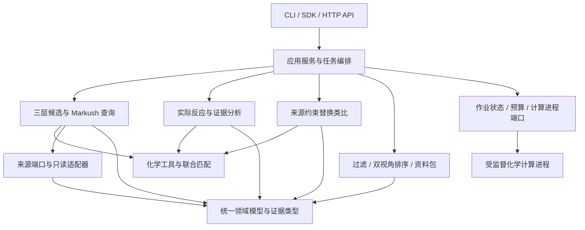

# 项目实现计划：模块化的目标导向反应先例检索系统

日期：2026-10-27。状态：工程设计，尚未创建业务代码、部署服务或完成真实召回验证。

## 1. 工程目标与固定边界

把现有化学设计实现为可测试、可追溯、可替换数据源的 Python 系统：用户输入完整目标分子，系统自动生成三层 Markush 查询，召回具体分子及反应，分析目标连接方法和真实环变化，生成受控的单反应物替换类比，最后提供参考价值/实验适配双视角结果。

固定执行顺序：

**具体目标 → Markush 家族 → 结构召回与联合匹配 → 实际反应分析 → 来源约束类比 → 证据聚合与排序 → 资料包 → 下游模型。**

工程化不能改变以下语义：

- 默认固定必要核心、位置和重要功能单元，非关键 R 位点放宽；不静默降级为精确连续片段查询。
- R 条件和共存关系在同一具体分子、同一核心映射下核验；通式不冒充具体制备实例。
- 产物命中不是反应方法命中；每条结果必须有目标贡献类别或明确未知状态。
- 开闭环来自已召回反应的实际变化；不在无来源时预先枚举目标环前体。
- 替换类比是依附真实来源的有限推定，不能进入已观察实验事实与制备计数。
- 未知、未支持、无命中、失败实验和超时是不同状态。
- 无实验能力配置时仍返回参考排序；不声称实验适配、安全或可直接沿用条件。

本文件规划应用层、化学模块、接口和运行工程，不指定业务数据库表结构、迁移方案或旧库标准。具体来源通过只读适配接口接入。

## 2. 当前基础、缺口与技术决策

### 2.1 已有基础

仓库已有主计划、详细化学规则、排序规范、审查记录、示意图和若干 RDKit 探针。它们是需求与局部行为依据，不是完整检索引擎或现成可复用的通用算法。

本次只读核对的本地环境：Python 3.10.20、RDKit 2026.03.2、FastAPI 0.128.0、Pydantic 2.13.2、Uvicorn 0.40.0、HTTPX 0.28.1；该环境中没有 pytest、Ruff。项目目前没有 `pyproject.toml`、生产业务包或完整自动测试。

### 2.2 技术基线

| 决策 | 初始方案 | 原因与落地要求 |
|---|---|---|
| 架构 | 单仓库、模块化单体；化学计算独立进程 | 先保证端到端可运行与模块隔离，按实测瓶颈决定是否拆服务 |
| 语言 | 新项目拟用 Python 3.12；M0 核对依赖后冻结 | 现有探针在 3.10 已运行不代表 3.12 自动兼容；M0 在隔离环境重跑并记录差异 |
| 化学工具 | RDKit；第一候选基线 2026.03.2 | 与现有探针对齐，升级必须做查询语义和原子对应回归，不使用浮动 latest |
| 数据契约 | Pydantic v2 的受约束模型及 JSON Schema | 必须字段、枚举、未知状态、版本和来源可验证；化学对象不直接暴露给 API |
| 入口 | Python SDK、CLI、FastAPI `/v1` | 三种入口复用应用服务，避免 CLI 与 HTTP 存在两套化学逻辑 |
| I/O | 异步且有超时；独立适配器 | 外部资料不可用不阻塞所有核心计算 |
| CPU 工作 | 受监督子进程与全局并发上限 | Markush 枚举等原生调用可能长时间运行，不能仅靠协程超时释放资源 |
| 配置 | 类型化环境设置 + 版本化 JSON 规则/策略 | 沿用现有 JSON 配置，在 M0 迁为统一 schema；未知字段和非法预算拒绝启动 |
| 依赖与构建 | `pyproject.toml` + 锁文件，拟采用 uv | 运行、开发、可选连接器依赖分组；锁具体版本，CI 与镜像使用同一锁 |
| 质量工具 | pytest、Ruff、mypy、Hypothesis、import-linter | 测试行为、性质和依赖边界；具体版本在 M0 核对并冻结 |
| 可观测性 | 结构化日志、阶段指标、可选 OpenTelemetry 导出 | 先有统一事件模型，再接观测后端，核心代码不绑定监控平台 |
| 运行封装 | 单机 CLI/容器 API 为首版；后续可接队列 | 不默认引入分布式调度、消息总线或微服务数量负担 |

所有版本均需在新环境中解析锁定，以上不是已完成安装声明。FastAPI 的响应后后台任务不承担关键计算作业；其文档对重计算有专门说明。[框架文档](https://fastapi.tiangolo.com/tutorial/background-tasks/)

## 3. 逻辑架构与依赖方向



`domain` 是最内层，包含数据和纯业务不变量，不执行 I/O，不导入 RDKit 或 Web 框架。`chemistry` 封装 RDKit 对象生命周期、表示与图操作；其外部返回可序列化的结构、映射和状态。具体数据源、持久化、HTTP 客户端及进程实现只在 `adapters` 中。

应用层通过 `ports` 包内的 `Protocol` 组织调用。端口只依赖领域模型，避免 retrieval 需要来源接口时反向导入 application。`bootstrap` 是唯一组装具体实现的地方；禁止服务模块自己读取全局配置、创建网络客户端或加载未知版本规则。模块有明确输入/输出后再拆文件，不为每个辅助函数创建抽象工厂。

本文的 IR 指统一查询中间表示，DSL 指有限的规则描述语言，CAS 指“仅当版本仍符合预期时更新”的条件写入。它们用于隔离化学语义、工具实现和并发状态，不是新的合成算法。

## 4. 拟议项目目录

以下是**实施后的目标结构**，本次不创建空业务骨架。现有规划文件保留原路径，避免再次搬迁导致历史链接失效。

```text
substructure_search/
├── README.md                         # 产品定位、安装、快速运行、已支持能力
├── pyproject.toml                    # 构建、依赖组、CLI、质量工具设置
├── uv.lock                           # M0 解析验证后的锁文件
├── .python-version
├── .env.example                      # 仅键名/无敏感示例，不存凭据
├── .gitignore
├── Makefile                          # lint/typecheck/test/check/eval/schema
├── plan.md                           # 现行产品计划
├── implementation_plan.md             # 本工程实施计划
├── ranking_plan.md                    # 独立过滤排序语义
├── GIT_HISTORY.md
├── design/                           # 已有详细化学规范与契约
│   ├── specification.md
│   ├── markush_queries.md
│   ├── attachment_methods.md
│   ├── evidence_contract.md
│   ├── single_reactant_transfer.md
│   ├── ...
│   └── adr/                          # 架构决策：选择、替代方案和适用条件
├── configs/
│   ├── app.example.json              # 作业/并发/输出/超时配置
│   ├── retrieval/pilot.json          # 从现有 pilot_profile 迁入的运行配置
│   ├── ranking/reference.json
│   ├── ranking/lab_fit.json
│   └── ranking/process.json
├── rules/
│   ├── manifest.json                # 规则集版本、哈希、能力与来源清单
│   ├── schemas/                     # 规则文件的 JSON Schema
│   ├── functional_groups/
│   ├── query_families/
│   ├── generic_groups/
│   ├── normalization_views/
│   ├── reaction_classes/
│   ├── attachment_methods/
│   └── transfer_templates/          # 经审核的来源约束回放规则
├── src/reaction_reference/
│   ├── __init__.py
│   ├── bootstrap.py                 # 依赖组装，不放业务算法
│   ├── settings.py                  # 类型化启动设置
│   ├── domain/
│   │   ├── structures.py            # MoleculeRecord、AtomRef、材料/组分
│   │   ├── queries.py               # QueryFamilySpec、R 位点与联合约束
│   │   ├── reactions.py             # 真实反应、阶段、实例、观察结果
│   │   ├── evidence.py              # Claim、来源、未知/争议和任务贡献
│   │   ├── proposals.py             # 独立的推定替换建议
│   │   ├── ranking.py               # 特征、约束判定、双视角结果
│   │   ├── runs.py                  # 任务状态、范围、快照与版本
│   │   └── errors.py                # 结构化原因码
│   ├── ports/
│   │   ├── sources.py               # 分子/反应来源与映射接口
│   │   ├── execution.py             # 计算任务与时钟接口
│   │   ├── persistence.py           # RunStore 与缓存接口
│   │   └── enrichment.py            # 有来源的资料增强接口
│   ├── application/
│   │   ├── search.py                # 提交与执行检索用例
│   │   ├── preview.py               # 家族与目标对应预览
│   │   ├── rerank.py                # 基于已有证据快照重新排序
│   │   ├── cancel.py
│   │   ├── pipeline.py              # 阶段流转与不变量
│   │   └── budget.py                # 全局与子任务预算账本
│   ├── chemistry/
│   │   ├── parsing.py
│   │   ├── normalization.py
│   │   ├── atom_refs.py             # 原始/规范化/查询/参考原子对应
│   │   ├── scaffolds.py             # 有环与无环结构视图
│   │   ├── fragments.py             # 实际结构片段与边界
│   │   ├── descriptors.py
│   │   └── markush/
│   │       ├── compiler.py          # 统一家族 IR → 匹配计划
│   │       ├── capabilities.py      # 支持/不支持的明确检查
│   │       ├── matcher.py           # 显式参数和匹配预算
│   │       ├── predicates.py        # 全支链、H/电荷和联合条件
│   │       └── assignments.py       # 真实 R 分配、联合块和等价映射
│   ├── retrieval/
│   │   ├── planner.py               # 三层家族、身份补查和受控扩展
│   │   ├── scheduler.py             # 候选轮转、名额和任务优先级
│   │   ├── executor.py              # 来源候选页 → 化学完整匹配
│   │   ├── reaction_lookup.py       # 一产物多反应，保留所有返回状态
│   │   ├── dedup.py
│   │   └── coverage.py              # 家族/位置/反应和结构覆盖
│   ├── reaction_analysis/
│   │   ├── mapping_quality.py       # 形式、局部稳定性、来源支持
│   │   ├── changes.py               # 已记录两侧的变化
│   │   ├── classify.py              # 类型依据与未知，不按名字猜中心
│   │   ├── attachment.py            # 目标母核—支链边界贡献
│   │   ├── topology.py              # 来源开闭环/重组/环保留
│   │   ├── provenance.py            # 原子来源与重复实例份数
│   │   └── stereo_origin.py         # 继承/建立/富集/未知
│   ├── evidence/
│   │   ├── observations.py          # 制备、分析、使用、回收、冲突
│   │   ├── stages.py                # 结构、条件、测量的阶段关系
│   │   ├── claims.py
│   │   ├── aggregate.py             # 合格见证与分账计数
│   │   └── recorded_links.py        # 真实共同中间体与有限方向补查
│   ├── analogs/
│   │   ├── product_delta.py         # 目标与来源产物的差异
│   │   ├── reactant_attribution.py  # 一个槽位还是多个来源
│   │   ├── substitution.py          # 保持必要反应端的替代候选
│   │   ├── replay.py                # 有界图回放及完整目标检查
│   │   └── applicability.py         # 迁移差异；不预测实验成功率
│   ├── ranking/
│   │   ├── features.py              # 九方向特征和未知
│   │   ├── eligibility.py           # 方法资格和明确约束四态
│   │   ├── reference.py
│   │   ├── lab_fit.py
│   │   ├── diversity.py
│   │   └── explain.py               # 原因模板，引用 claim，不造事实
│   ├── rule_registry/
│   │   ├── loader.py
│   │   ├── validate.py
│   │   └── registry.py
│   ├── adapters/
│   │   ├── sources/jsonl_source.py  # 固定样例与小集的只读全扫描
│   │   ├── sources/external_source.py # 实际来源接入点，按契约实现
│   │   ├── mapping/provided.py      # 首版使用来源映射与显式未知
│   │   ├── enrichment/fixtures.py   # 离线条件/材料资料
│   │   ├── enrichment/http.py       # 可选资料服务，明确身份和日期
│   │   ├── execution/local.py       # 并发上限、超时、进程退出
│   │   ├── run_store/files.py       # 单协调进程的原型作业持久化
│   │   └── cache/local.py
│   ├── interfaces/
│   │   ├── sdk.py
│   │   ├── cli.py
│   │   ├── api/app.py
│   │   ├── api/routes.py
│   │   ├── api/transport.py         # 请求/响应映射，不复制化学规则
│   │   └── api/errors.py
│   └── observability/
│       ├── events.py
│       ├── logging.py
│       └── metrics.py
├── contracts/                        # 从领域/接口模型导出的版本化 Schema
├── tests/
│   ├── unit/
│   ├── property/
│   ├── contract/
│   ├── integration/
│   ├── e2e/
│   ├── regression/
│   └── fixtures/
│       ├── synthetic/               # 显式人工例子，永不当文献事实
│       ├── source_examples/         # 有许可和出处的真实样例
│       └── expected/                # 专家标注期望与解释
├── evaluation/
│   ├── protocol.md
│   ├── targets.jsonl
│   ├── annotations.jsonl
│   ├── acceptance_registry.json     # 需求/案例 → 测试 → 状态映射
│   └── run.py
├── scripts/
│   ├── validate_design.py           # 已有文档检查
│   ├── plan-git                     # 当前工作区 Git 入口
│   ├── export_schemas.py
│   ├── validate_rules.py
│   └── smoke.py
├── deploy/
│   ├── Dockerfile
│   └── compose.example.yml          # 单实例 API + 受控进程执行配置
├── .github/workflows/ci.yml
├── diagrams/                         # 已有设计图和生成器
├── reviews/                          # 已有研究探针，暂不改成生产算法
├── audits/                           # 历史审查记录
└── var/                              # 未跟踪：runs/cache/logs/exports
```

包名统一为 `reaction_reference`；外部 API 不使用内部 Python 文件名作契约。现有脚本/图仍按原路径维护。运行产物和大型数据不进 Git；允许入库的真实样例单独核对许可与来源。

## 5. 模块职责、输入输出和依赖约束

| 模块 | 核心输入 | 核心输出 | 责任边界 |
|---|---|---|---|
| domain | 明确字段与来源引用 | 结构化对象与不变量 | 无 I/O、无 RDKit、无框架路由 |
| chemistry | 原结构、家族约束、固定规则版本 | 规范化视图、原子对应、MatchWitness、有限图结果 | 不判文献制备成功，不连接来源服务 |
| retrieval | 目标、规则包、来源快照、预算 | 家族任务、具体匹配、反应候选、覆盖状态 | 不凭产物匹配判方法，不输出预测路线 |
| reaction_analysis | 实际反应、目标匹配、来源映射 | 变化、目标贡献、类型依据、局部争议 | 不替实验观察背书，不无来源猜环前体 |
| evidence | 来源观察、阶段、结构与分析结论 | 实验事实、Claim、见证与分账 | 不执行结构召回或偷偷生成新反应 |
| analogs | 有来源的实际反应与目标差异 | 独立 ProposalRecord、回放/迁移状态 | 不能写入实际 ReactionRecord 或“制备命中” |
| ranking | 证据快照、推定建议、配置与明确能力 | 两套列表、原因、缺口与稳定顺序 | 不改变事实，不将未知当有利信息 |
| application | SearchRequest、依赖端口 | RunSnapshot、ReferencePackage | 组织生命周期和预算；不嵌入具体 SMARTS 判断 |
| adapters | 端口请求与外部系统 | 契约模型或结构化错误 | 外部格式、网络、文件、进程实现细节在此隔离 |

依赖原则：`interfaces → application → 领域服务 → chemistry/domain`，I/O 调用依赖独立 `ports → domain`；`adapters → ports/domain` 实现接口，bootstrap 完成组装。领域服务不能反向导入 application 或具体 adapters。`ranking` 不直接读取原始来源文本，`analogs` 不修改来源事实，`chemistry` 不导入 `application`。共享只是领域契约与端口，不创建无边界的 `utils` 大包。

用 import-linter 固化关键限制。业务模块间传结果模型或调用窄服务接口，不通过文件路径或全局字典交换状态。首版模块内可用普通函数/类，只有外部依赖或明确替换点使用端口。

## 6. 核心数据契约

所有对外模型使用显式 `schema_version`，严格类型与枚举，未知字段默认拒绝或按明示扩展机制处理。枚举和状态只有一个定义来源，API/OpenAPI、CLI JSON 和 JSON Schema 共同生成。

| 对象 | 必要字段/关系 | 关键约束 |
|---|---|---|
| `SearchRequest` | target、format、retrieval_profile、ranking_profile、可选 lab_context、budget_override | 具体目标与高级查询类型分开；用户覆盖只能在服务上限内 |
| `MoleculeRecord` | record_id、原始结构、具体组分/实例、材料状态、来源、视图列表 | 化合物身份、实例与样品状态不能合并 |
| `AtomRef` | structure_record_id、representation_id、atom_uid | 原子编号属于具体表示；规范化/切片后须有显式 remap |
| `QueryFamilySpec` | family_id、parent_candidate、layer、固定要素、R 约束、联合条件、目标位置、rule_ref | 化学语义统一 IR；SMARTS 只是其中一种编译产物 |
| `CompiledMatchPlan` | family_revision、必要筛选、精确 matcher 配置、后检查、能力需求 | 不支持条件不能静默丢掉；预筛不得比最终语义更窄 |
| `MatchWitness` | source_snapshot、实际分子实例、family_id、目标/查询/参考对应、R 分配、枚举状态 | 同一实例同一映射联合满足；纯核心预筛通过不算完整见证 |
| `ReactionRecord` | experiment_id、真实组分实例、阶段、观察、条件、来源、映射来源 | 未知反应物不能由默认值补出；净变化不自动拆为多步 |
| `AttachmentAssessment` | attachment_id、源反应变化、母核/支链覆盖、边界事件、支持范围、未知原因 | 每个候选有类别或未评估，类型名与目标贡献分开 |
| `EvidenceClaim` | claim_id、subject、predicate、source_refs、mapping_basis、support、limitations | 阳性计数必须引用合格见证，规则推定不能成为实验观察 |
| `ProposalRecord` | source_reaction_id、原/替代实例、差异、回放、条件缺口、proposal_not_observed | 与反应事实为不同类型，不能靠 flag 默认值混入事实 |
| `FeatureValue` | value/state、unit、材料/阶段/规模、来源/日期、计算版本 | 0、false、未知、未适用、冲突分开 |
| `ReferencePackage` | 目标任务、证据引用、建议引用、双视角列表、覆盖、快照与未完成项 | 所有数字和排名绑定同一范围，不输出伪安全/成功概率 |

### 6.1 原子引用与稳定身份

原子 map number 是某次映射的标签，不作跨记录全局 ID。目标导入后生成稳定 atom_uid；规范化、盐主体视图、保护/互变视图和核心提取都返回原表示到新表示的对应以及未映射原因。

分子结构身份键忽略无语义 atom-map 标号，但保留声明的立体、同位素、电荷/材料策略；来源记录 ID 与实验 ID 不等同于结构身份键。相同结构参与两份时有两个实例 ID。不能靠 canonical SMILES 的原子顺序回推用户输入位置。

`Mol`、原生 matcher 及 Python 回调仅在化学工作进程内部存活。跨进程/API 使用受验证的结构与查询 IR，不允许客户端提供 Python pickle 或任意执行回调。结构字符串不足以表达的标签必须显式序列化并做 round-trip 测试。

### 6.2 能力协商与未知

能力按版本发布：固定核心、单点 R、多位点同实例、可选 H、限定通用组、完整支链谓词、多点桥接、位点相等/依赖、可变连接段等分别声明支持状态。

一个家族含未实现的必要条件时，返回 `unsupported_query_feature`。可以另生成一个明确更宽的家族用于探索，但它有新的语义 ID、放宽理由与独立计数，不能称原家族完成。

“未知”至少带原因：来源缺失、映射歧义、规则不支持、材料身份未匹配、条件未记录、预算截断、执行失败等。关键未知字段不得用 `False` 代表，也不得把字符串 `"false"` 自动当布尔真值；边界采用显式严格解析和单位归一化。[Pydantic 严格模式](https://docs.pydantic.dev/latest/concepts/strict_mode/)

## 7. 外部端口与首版适配器

| 端口 | 最小能力 | 首版实现与契约要求 |
|---|---|---|
| `CompoundSourcePort` | capabilities、固定 snapshot、candidate_page、fetch_structure | JSONL/固定样例可完整扫描；实际来源适配器以后替换，必须返回游标和是否穷尽 |
| `ReactionSourcePort` | 按具体产物实例分页关联反应、取组分/来源、来源锚定补查 | 首版固定 JSONL 反应集；一个产物的多个反应不能随意只取一条 |
| `MappingPort` | 来源映射与可选补充映射，附版本/范围 | 首版优先现成映射，缺失返回未知；以后接自动映射仍保留推定标签 |
| `EnrichmentPort` | 获取有来源的材料/条件/来源补充信息 | 首版离线 fixture，后续可选 HTTP 适配；不返回缺省“无危害” |
| `RunStorePort` | create/load、条件状态更新、事件、快照发布、按租约状态恢复 | 首版单协调进程文件适配，正式多实例前必须通过并发持久化契约 |
| `ComputeExecutorPort` | submit、result、cancel、deadline、resource_limits | 本地受监督进程；不会因 HTTP 客户端断连自动误丢状态 |
| `CachePort` | 按不可变语义键 get/put、到期/来源失效 | 首版本地可关闭缓存，正确性不得依赖缓存命中 |
| `ClockPort` | 单调时间和 UTC 记录时间 | 用于确定性预算与超时测试，禁止测试依赖真实 sleep |

数据源返回的候选页是**未完成化学核验的候选**，除非它提供同版本、已通过契约测试的完整匹配能力。返回 `items / next_cursor / exhausted / snapshot / completeness`，可无精确总数。取得“第一页为空但未穷尽”不得报告全量无命中。

来源不支持某类安全预筛时，可以回退为有预算的宽扫描加本地完整匹配；超限返回截断，不用不安全的指纹筛选制造漏检。数据源变更而无法维持快照时，中止该分支为来源变化，或建立新 run，不拼接两个快照为完整结果。

外部 HTTP 连接器使用明确配置的服务、连接/读取超时、有限重试和资料缓存；未知或受限来源保持可见。来源文献原文仅作为数据，不作为执行指令；客户端不提供任意内网抓取 URL。

## 8. 一次检索的执行步骤

1. **接收与固定范围**：验证具体目标、配置和能力；取得 source snapshot 与规则/排序版本；建立 run 和任务范围。
2. **结构分析**：规范化预览、原子对应、链/环核心、重要功能单元及目标要求；处理组分歧义。
3. **家族规划**：三层默认 Markush，生成固定要素/宽 R/必要约束，登记家族及位置；完整目标身份查询并行补充。
4. **能力检查与编译**：逐家族决定可用预筛、matcher 参数和完整后检查。未支持任务有明确终态。
5. **候选检索与联合匹配**：按三层配额轮转分页；工作进程提取完整 R 和联合见证；去重保留位置与来源。
6. **实际反应关联**：分批获取具体产物的不同反应，保留实际实例/阶段/结果并逐项核验。
7. **反应贡献判定**：类型、实际变化、母核—支链边界、来源环变化、原子来源份数、手性来源及局部映射确定性。
8. **有限增强**：按有据来源开展共同中间体/方向补查和单反应物替换回放；有预算、不可递归变成新文献。
9. **证据与排序**：事实/推定分开，角色分账；九方向特征、明确限制、参考价值/实验适配、策略多样性。
10. **发布快照与包**：原子/位点、具体分子、底物、方法、条件、来源、计数和缺口一起冻结；此后才供下游预测模块消费。

M2 的首条参考反应闭环即要求第 7 步产出“已支持类别或未知”。M1 可作为结构匹配开发里程碑，但不能被发布为已完成的反应方法检索服务。

## 9. 作业生命周期、并发与恢复

### 9.1 状态分开

Run 生命周期为 `queued → running → finalizing → succeeded`，另可终结为 `failed` 或 `cancelled`。`succeeded` 只说明作业正常形成可解释交付，不意味着召回完整或所有化学问题已解决。

独立字段：`coverage_state = complete | partial | not_evaluated`，以及带范围的 `stop_reasons`。任务状态有 `pending/running/completed/unsupported/timed_out/failed/cancelled`，并单列 `match_outcome = found | no_match | unknown`。

只有任务完成且在所声明语义/来源范围穷尽，才能 `no_match`。任务完整但实际证据未知，可以完成资料交付；部分家族未支持、预算结束或源查询未穷尽，coverage 仍为 partial。

### 9.2 初始本地运行模式

API 和协调器在同一个受控单进程服务内运行，化学任务在独立子进程执行。首版文件 RunStore 明确要求协调进程单实例，API 不启用多个 Uvicorn worker；重复启动检测并拒绝同时写同一运行目录。

RunStore 通过目录锁、递增 revision、临时写入+原子替换和必要持久化保证快照可恢复。保存请求与 manifest 后才接纳作业；阶段结果写入不可变产物，提交 checkpoint 后再对外公布。子进程不直接修改共享状态，只返回结果给协调器。

重启时核验版本、来源快照、产物校验和及未完成 attempt：能在原范围恢复的排队/运行作业有限重试；版本不符或来源不可保持时，以 `interrupted/not_resumable` 保留已有快照，显式新建 run。不能把重启后新结果混入旧范围。

`interrupted/not_resumable` 是原因码，不是未声明的生命周期状态：可正常封存部分结果时为 `succeeded + partial`，无法形成一致交付时为 `failed`，两者都保留已有可核验产物。排队请求可先持久化请求配置，执行开始时一次性绑定来源快照及绝对到期时间；绑定前不得生成来源结论。

跨主机、多 API 实例或外部队列只在实现阶段更换 RunStore/执行适配器，需有原子租约/CAS、幂等与恢复测试。业务模块不因此重写；当前文件实现不能被宣称具备分布式一致性。

### 9.3 预算与取消

- 全局预算从实际开始执行计时，排队等待单独计量并有排队超时；子任务继承剩余 deadline 和工作量上限。
- manifest 保存首次执行的 UTC 到期时间和已消耗工作量，活动进程使用单调时钟检查耗时；重启只能使用原到期时间内的剩余额度，不能重置完整预算。原单调时钟数值不跨系统重启复用。
- 同时限制家族、候选分子、核心映射、支链遍历、反应分析、来源补查、回放和返回量。资源上限不暗改化学语义。
- I/O 受连接/读取期限约束；重试仅用于可恢复的读取错误，并消耗原预算。非法查询、缺资料、无命中及未知不重试成成功。
- 化学计算进程在循环边界检查取消；单个原生调用不响应时，由 supervisor 终止对应 attempt，等待短清理期限后回收进程。不能将 `Future.cancel()` 或协程 timeout 当作已停止正在运行的 RDKit 调用。[Python Future 说明](https://docs.python.org/3.12/library/concurrent.futures.html)
- 每个结果携带 run/task/attempt 和版本。取消、超时或重试后迟到结果若不属于当前 attempt，则不写入快照，不改变终态。
- 完成发布和取消通过同一 revision 条件更新竞争；已提交的终态不被后到事件反转。取消请求需等相应进程被停止或确认退出后释放计算槽位，不能仅改变 UI 状态就宣称资源已回收。
- 对 API 请求、正在运行的 run、来源 I/O 和化学进程分别设全局上限，避免每个 run 自建满核进程池。优先保证简单查询仍能取得执行机会。

启动并发默认保守，M0 配置支持覆盖，最终值由内存/CPU/数据量基准确定，不把当前 10 秒试验预算理解为服务性能保证。

## 10. API、SDK 与 CLI

### 10.1 API 草案

| 接口 | 行为 | 约定 |
|---|---|---|
| `POST /v1/search-runs` | 提交检索，返回 202 和 run_id | `Idempotency-Key` 在相同调用范围+相同请求摘要下复用；同键异请求返回 409 |
| `GET /v1/search-runs/{id}` | 状态、阶段、计数和已发布快照 | 不通过“HTTP 成功”暗示化学成功 |
| `GET /v1/search-runs/{id}/results` | 分页参考结果，可选 reference/lab_fit | 响应带 snapshot_id；后续游标固定该快照 |
| `GET /v1/search-runs/{id}/evidence/{claim_id}` | 结构对应、原始记录位置、依赖和范围 | 所有引用须属于该 run 可见的来源范围 |
| `POST /v1/search-runs/{id}/cancel` | 幂等取消请求 | 返回已完成或已取消的真实状态，处理结果发布竞争 |
| `POST /v1/search-runs/{id}/rerank` | 基于固定证据快照创建排序派生 run | 不默默重查数据；需新资料时显式新检索/增强 run |
| `POST /v1/query-families/preview` | 高级预览目标及生成的家族 | 可选接口，普通用户不需先确认预览 |
| `GET /v1/capabilities` | 规则/查询/视图与模块已支持能力 | 与实际启用版本绑定，不按路线图宣称实现 |
| `GET /health/live`、`GET /health/ready` | 进程存活和依赖就绪 | 就绪检查核对规则、运行存储及来源能力，非全量化学检索 |

### 10.2 请求与返回示例

仅为接口形态，字段值不是真实任务结果：

```json
{
  "target": {"format": "smiles", "value": "CCNC(=O)c1ccccc1"},
  "retrieval_profile": "pilot-v0",
  "ranking_profile": "reference_first",
  "lab_context": null,
  "options": {"include_exact_identity": true, "include_proposals": true}
}
```

```json
{
  "schema_version": "1",
  "run_id": "illustrative-run-id",
  "lifecycle": "succeeded",
  "coverage_state": "partial",
  "snapshot_id": "illustrative-snapshot-id",
  "stop_reasons": ["reaction_budget_exhausted"],
  "results": [],
  "next_cursor": null
}
```

`results` 为空与 coverage 为 partial 组合不能显示为“全库没有方法”。资料包还须包含各家族、方法和证据分账，不能仅有这个简化示例的字段。

错误响应保留 `code / stage / field_or_task / retryable / source_ref / message`，不返回服务凭据或原生堆栈。语法非法/请求不支持为 422，幂等冲突为 409，已过期快照为 410，容量限制为 429，服务级依赖失败为 503；任务内局部失败记录在 run，而非把所有部分结果转换成请求失败。

### 10.3 本地入口

拟提供命令：`reaction-reference search --target-file target.smi --source fixture --output run.json`，以及 `preview`、`inspect-run`、`rerank`、`validate-rules`。这些命令当前不存在，M1/M2 实现后才进入 README 快速开始。

SDK 复用同一应用服务和模型，支持离线样例及注入来源适配器。CLI 的 exit code 区分请求失败和可用但不完整的交付；不通过一个退出码替代详细 coverage 状态。

## 11. 不可变快照、缓存和可重现性

每个 run manifest 固定：代码/构建版本、Python/RDKit 版本、schema 版本、原始目标摘要、规范化/查询规则哈希、来源快照、排序配置、预算配置、可选随机种子和阶段产物哈希。

缓存键至少包括：具体源记录或查询 IR、视图与编译参数、规则/工具版本、来源快照、匹配限制和所需证据范围。来源事实、Markush 匹配、反应分析、资料增强和推定建议使用不同缓存命名空间，防止推定污染事实。

截断结果可复用为“已获得的局部结果”，不能当作完整空集；复用时保留覆盖范围，追加计算需要剩余预算和新的执行记录。日期敏感的供应/监管/SDS 关联有明确时间戳和刷新策略，未刷新标状态，不用永久缓存宣称当前有效。

排序快照一旦发布即不可变。分页 cursor 绑定 snapshot_id、排序配置、过滤条件与稳定次序；规则或排序改变生成新快照，不能让前后页来自不同顺序。新的阶段结果可生成新 snapshot，客户端自行选择切换；旧游标不被静默重解释。

同一来源、规则和输入在“工作量上限”模式下应得到确定结果；壁钟时间截止下调度和负载会影响已完成集合，因此记录实际执行次序、截断和版本，不承诺同预算秒数必然产生完全相同的候选集。

作业目录设置保留期限、总磁盘上限与按访问范围清理策略。未完成 checkpoint 或被快照引用的证据不能被缓存淘汰直接删除；过期的 run/快照返回明确状态。可复现导出包含 manifest、允许导出的证据和内容校验和；受来源权限限制不能导出的字段保留引用和缺失说明。

## 12. Markush 实现分级与化学规则发布

### 12.1 能力分级

| 能力级别 | 支持内容 | 不支持时 |
|---|---|---|
| 初始闭环 | 固定连通核心、多单点 R、未锁定额外取代、可选 H、明确通用组与整支链谓词 | 必要条件不支持则任务未评估，不能忽略后当宽命中 |
| 联合扩展 | 多点连接/桥接块、受控 R 相等/依赖、全核心对称分配 | 显示精确能力状态并保留可支持的其他家族 |
| 高级探索 | 经审核的分离锚点和可变连接段、特定来源通式范围 | 独立能力/测试，不称任意专利 Markush 全支持 |

工具的 generic matcher 要显式启用；核心预筛、通用组检查和联合约束的结果均须可验证。[RDKit 通用查询](https://www.rdkit.org/docs/RDKit_Book.html#generic-markush-queries-in-substructure-matching)

### 12.2 规则作为受版本控制的产品资产

规则文件包含 `rule_id / version / kind / scope / applicability / predicate_or_template / atom_mapping_policy / source_refs / positive_cases / negative_cases / unsupported_cases / status`。发布前做 schema、SMARTS/模板编译、反例及资源预算检查。

规则 DSL 支持审核过的有限谓词和组合，不允许在 JSON 中嵌任意 Python 或 `eval`。复杂谓词由明确注册的代码实现，规则只引用名称与参数。

规则集按内容哈希发布不可变包，run 固定包版本；回滚只影响新 run，不修改已发布结果。原子映射/模板提取改变时同步升级相关规则和缓存键。规则审阅看化学范围及正反例，不能只通过语法检查。

现有 `design/pilot_profile.json`、`design/ranking_profiles.json` 是设计草案。M0 迁移时生成正式 configs 并明确草案状态，运行时只读经 schema 验证的一个确定版本，不能同时加载两份互相覆盖。环境变量只覆盖允许的资源/连接设置，不悄悄改变化学匹配语义。

## 13. 测试与评测工程

### 13.1 测试分层

| 层级 | 必测行为 |
|---|---|
| 单元 | 契约严格解析、单位/未知、预算分配、幂等、快照、证据分账、排名资格 |
| 化学性质测试 | 原子重编号不改化学匹配；同构表示对应可恢复；同实例联合 R；不同来源实例不被折叠；语义加限制不应无故扩大命中 |
| Markush oracle | 在固定小候选集上，与相同谓词的独立全扫描比较；完整匹配及 R 分配都比较，不只看数量 |
| 适配器契约 | 分页无漏重复、snapshot 固定、错误/超时、来源字段未伪填、能力声明可证实 |
| 集成 | 同产物不同反应中心、实例份数、环变化未知、单底物推定隔离、来源冲突及多阶段测量 |
| 故障注入 | worker 挂起/退出、来源中断、取消竞争、迟到结果、重试重复、进程重启、规则/快照不一致 |
| 端到端 | 同一 fixture 经 SDK/CLI/API 得到等价语义；未评估/截断如实输出 |
| 排序评测 | 目标方法资格先于表面相似和操作便利；未知信息不获得低风险优势；偏好改变不篡改事实 |

探针中的人工反应保留 `synthetic=true`，禁止进入真实先例来源计数。现有 `reviews/check_*.py` 和 `audits/probes/` 逐项迁成明确的回归样例，不直接将整个脚本复制为生产模块。

详细规范的 99 项验收、证据场景和排序场景在 `acceptance_registry.json` 中分配稳定 case_id，并关联需求章节、fixture、测试名、实现阶段及 `planned/implemented/tested/unsupported`。原有文档数字只是清单数量，不作覆盖率替代。

### 13.2 性能与化学质量分开报告

性能记录硬件、并发、候选规模、查询复杂度、各阶段耗时/内存和截断。先跑离线小集合，再在实际来源上分规模测量；不把 synthetic 扩充数据的结果声称为真实资料召回质量。

化学评测按现有约定至少从 12 个真实具体目标起步，独立标注与复核。划分按来源组和分子系列防泄漏；分别评估结构召回、R 组合、方法相关性、阳性证据误报、替换类比边界及目标未覆盖部分。

下游模型评测固定模型、上下文预算和目标集，比较无参考与不同版本参考包。它属于独立评测任务，不把模型调用插到检索前置流程里。

## 14. CI、发布与运行

### 14.1 合并前流水线

1. 文档、规则 schema、配置和 import 边界检查。
2. Ruff、mypy 与领域单元/契约测试。
3. 固定 RDKit 版本的化学回归和 Markush oracle。
4. API/CLI fixture 端到端及关键故障测试。
5. 导出并校验 OpenAPI/JSON Schema，检查兼容性差异。
6. 构建 wheel 和固定依赖容器；版本写入 manifest。

较重评测和扩展工具版本矩阵可定期运行，不用它们替代必要合并检查。CI 默认离线数据，不依赖个人来源账号或实时危险信息网站。

本机的 `.plan-history.git` 与 `scripts/plan-git` 仅用于当前只读 `.git` 工作区；正常克隆的开发机与 CI 使用标准 Git。CI 检出只依赖已提交的文件，不能引用本机绝对环境路径或外部隐藏目录。

### 14.2 发布模式

首版支持离线 CLI 和单实例 API 容器。API 进程与化学子进程资源上限明确；持久运行目录单写入者。容器重启保留已有任务快照，临时产物单独清理；发布/回滚不修改历史证据。

实际网络服务通过部署层提供认证，API 对 run、来源与结果引用实施调用范围隔离；幂等键、缓存和游标不能跨访问范围误共享。接口限制目标长度、查询深度、R 约束复杂度、并发和资源，避免一个宽查询耗尽全部进程。

日志默认记录摘要 ID、阶段和计数，目标结构、原文、凭据等不直接作为日志/指标标签。确需化学调试时使用显式开启、限时的内部产物记录，遵循来源访问范围。

### 14.3 最低观测项

- 作业排队、运行、取消、成功交付与失败数；完整/部分覆盖分别计数。
- 三层 family/task 数、预筛候选、联合匹配数、实际 R 组合及截断原因。
- 每产物关联反应数、方法分析覆盖、映射争议/未知、各证据角色计数。
- 推定候选及回放状态、来源资料补查延迟、双视角结果数。
- 每阶段 P50/P95、worker 强制退出、内存峰值、缓存命中和过期来源。

Trace 串联 run、task、attempt、family、源实验和排序快照；高基数结构/全文放可访问的证据产物，不塞进指标标签。

## 15. 分阶段实施计划

估算以一名熟悉 Python/RDKit 的工程师、一个可使用的小型反应样例集为前提；是工作量区间，不是工期承诺。真实资料接入、规则审核与化学专家标注可能成为主导工作。

| 阶段 | 主要工作 | 可检查交付 | 估计人日 |
|---|---|---|---|
| M0 项目基线 | 依赖兼容性、包结构、核心模型、配置 schema、ADR、测试/CI 基础 | 隔离环境、锁文件、导入边界和已有探针回归；无生产功能声明 | 3–5 |
| M1 语义与来源闭环 | JSONL 来源、目标/原子引用、初始 Markush 编译和匹配、CLI | 完整目标输入 → 实际分子与 R 分配 → 可追溯来源，截断/未支持正确 | 6–9 |
| M2 实际反应与证据 | 多反应关联、来源映射核查、边界贡献、环变化、阶段与分账 | 同产物不同变化被区分；缺失映射返回未知；每条方法有依据 | 7–11 |
| M3 联合结构与排序 | 联合 R/对称/桥接、全核心映射、支链矩阵、reference/lab_fit | 真实共存与独立覆盖分开，九方向已知/未知及可解释双排序 | 6–10 |
| M4 作业服务 | API、RunStore、进程监督、预算、取消恢复、快照与分页 | 可复现 API/CLI/SDK；故障与并发契约通过 | 6–9 |
| M5 来源约束增强 | 单底物差异归因、有限回放、共同中间体、可选资料适配 | Proposal 与事实完全隔离；不可支持的迁移不作成功结论 | 6–10 |
| M6 实际来源与评测 | 一个真实来源适配、12 目标试评、性能、规则覆盖与发布 | 真实评测报告、版本化配置、剩余缺口与发布门槛 | 6–10 |

合计粗估 40–64 人日，化学标注/审核另按实际资源协调；可根据 M1/M2 的错误分布调整，而不是平均完成所有规则后才允许评估。

**第一项端到端里程碑在 M2**：输入完整分子，Markush 默认召回，关联实际反应，返回相关连接/修饰/未知及来源。它不要求所有高级家族或危险资料已实现，也不能将未实现能力隐藏。

M3/M4 顺序可按交付需求微调，但 CPU 超时与全局上限的基础从 M1 就要存在；M4 完善持久化和 HTTP 生命周期。M5 不反过来成为结构召回的前置模型。

## 16. 开始编码时的任务拆解

### 第一批：把语义固定在类型和样例上

1. 建立 `pyproject.toml`、隔离环境、锁文件和基础质量命令。
2. 定义 MoleculeRecord、QueryFamilySpec、ReactionRecord、Claim、Proposal、RunSnapshot 及原因码。
3. 从现有研究整理最小 fixture：普通 OH/电荷、联合 R、同产物不同反应、重复实例、证据冲突和未知。
4. 实现 `JsonlSource`、单机 executor 与只读快照契约。
5. 实现目标原子引用和 Markush 初级编译/完整匹配，建立 oracle 对照。
6. 提供 CLI 从目标到家族/R 分配及实际反应候选，附完整性说明。

### 第二批：让“参考反应”有明确化学含义

1. 把现有映射数据转换为可核查的实例对应，逐关键键给出支持层级。
2. 实现实际观察结果与阶段解析契约；不支持的原文结构由适配器标未知，不让核心临时调用合成模型猜测。
3. 实现母核—支链贡献、环变化分类和证据聚合，确保反应名称不覆盖实际变化。
4. 输出 ReferencePackage；接入基础排序和单元/端到端测试。

后续在此稳定接口上加入更复杂联合 R、资料服务、来源约束回放和 API 运行工程。新增模块必须能独立测试，其失败不改变已有证据的事实类型。

## 17. 文档与工程完成标准

| 项目 | 完成定义 |
|---|---|
| 模块完成 | 输入输出、支持范围、失败原因、版本及测试均明确，不以“文件已建”作为完成 |
| 化学能力完成 | 规定正反例与 oracle/专家样例通过，不能只通过 RDKit 语法解析 |
| 来源接入完成 | 能分页、保留实例和出处、固定快照、处理缺失/冲突，并通过适配器契约 |
| API 完成 | 请求/结果版本一致，幂等、取消、恢复、分页与权限范围有测试 |
| 排序完成 | 方法资格、未知与证据分账不被偏好覆盖；有真实标注效果报告 |
| 发布就绪 | 关键验收、来源范围、版本回滚和性能/资源报告明确；不承诺未经测量的完整召回 |

本次实际完成的是工程规划文件、架构图和与现有设计的入口衔接。目录树、命令、API、类名和工期均是拟实施内容；现阶段仍没有业务服务、运行队列或生产排序器。

## 18. 依据与待实施时核对的文档

- [现行产品计划](plan.md)、[完整化学规范](design/specification.md)、[Markush 默认查询](design/markush_queries.md)、[方法判定](design/attachment_methods.md)、[排序规范](ranking_plan.md)：需求依据。
- [证据契约](design/evidence_contract.md)、[调度约定](design/scheduling_and_pilot.md)、[原型预算](design/pilot_profile.json)：本计划实现的行为约定，不能各自生成不一致的规则副本。
- [FastAPI Background Tasks](https://fastapi.tiangolo.com/tutorial/background-tasks/)：框架后台任务与重计算的边界。
- [Python concurrent.futures](https://docs.python.org/3.12/library/concurrent.futures.html)：任务/进程及取消语义，实施时核对锁定 Python 版本。
- [Pydantic 严格模式](https://docs.pydantic.dev/latest/concepts/strict_mode/)：边界验证参考。
- [RDKit Book](https://www.rdkit.org/docs/RDKit_Book.html)：通用查询、表示及能力范围；工具文档支持不等于本项目全部语义已实现。
