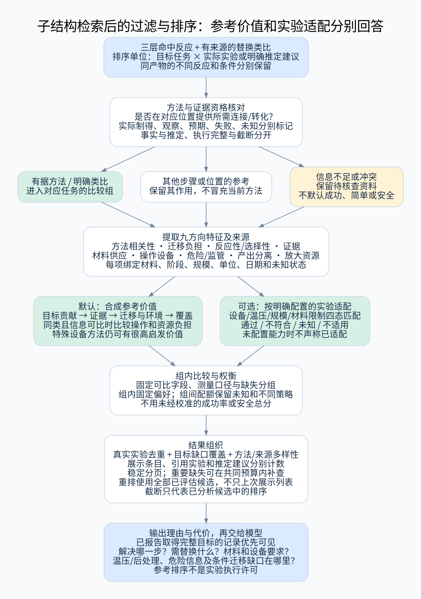

# 子结构检索后的过滤、排序与参考价值评估

日期：2026-10-25。独立设计模块，适用于 [三层前置检索](plan.md) 的全部结果，也适用于已有反应驱动的开闭环分析和单反应物替换类比。本文是待实施规范，没有真实排序质量或实验安全验证结果。

## 1. 先明确排序到底选什么

目标是选出“最能帮助合成当前目标、证据说得清楚、实际执行负担可理解”的参考实例。排序单位是：**某个目标任务下的一条实际反应/获得记录，或依附该记录的一条明确类比建议**。

同一个分子可以对应不同反应；同一反应可以有不同条件、规模和结果；它们的参考价值不同。不能先只保留最相似的几个产物，再随意给每个产物挑一条反应。

系统分别输出两个视角：

- **合成参考价值**：是否解决目标相关的连接、基团转化、成环、拆分等问题；类比差距和依据是什么。
- **实验适配度**：在给定设备、规模、材料可获得性和限制下，操作负担与已知危险信息如何。资料不完整时显示未知，不能宣称可直接执行。

默认首先展示参考价值。用户可切换实验适配或工艺比较偏好；仍不需要手工选骨架或指定反应中心。缺少实验条件偏好时，系统正常检索，仅不给出未经依据的本实验室可执行结论。

全局目标与局部连接任务分开组织：资料包先保留“已报告取得完整目标”的可核验记录，再组织各连接/修饰任务的方法参考，最后是其他结构线索。直接目标记录必须满足具体身份、目标立体/材料要求及实际结果证据；只有产物字段相同或去盐/互变视图相近还不够。它仍需说明原底物要求，不等于提供了完整合成路线。

例如从保护前体脱保护得到完整目标，该记录在“目标已有取得方法”中优先可见；它未形成的母核—支链键仍不能算成本步连接先例。另一个类似物的偶联记录可以在该局部连接任务中优先，不能用局部任务排序把完整目标的已有取得记录挤出全局摘要。若存在合格直接目标记录，展示上限内至少保留一条；同一记录跨区展示保留标签但不增加独立实验计数。

## 2. 九个评估方向

| 方向 | 要回答的问题 | 主要字段与证据 | 不采用的捷径 |
|---|---|---|---|
| 1. 目标方法相关性 | 本步是否形成目标对应连接，或提供所需转化/获得方式？ | 目标位点、反应类别、两侧变化、来源角色、方向、核心/支链覆盖、局部映射支持 | 产物最像就最好；开环/闭环天然优先 |
| 2. 类比迁移负担 | 从先例到目标要改几处、改几个反应物，是否改变原方法？ | 单/多来源差异、反应端保持、完整目标回放、位点/立体/保护差异、未解决前体 | 只差一个基团就一定简单 |
| 3. 基团反应性与选择性 | 目标与原底物的反应环境是否可比较？ | 核心附近电子/位阻、共轭与杂原子位置、竞争位点、配位/定向线索、相容性证据 | 统一的“基团活性分”；含同基团就可迁移 |
| 4. 证据质量与可重复性 | 实际观察到什么，证据支持到哪一步？ | 报告制得/分析/预期、分离/表征、来源、独立实验、失败与冲突、模板/映射确定性 | 缺失填零；重复专利当多次复现 |
| 5. 原料与供应负担 | 具体底物、催化剂和其他关键组分能否得到？ | 实际结构/盐形、已知制备、供应与日期、规格纯度、价格单位、提前步骤与保护成本 | 分子量小就便宜；有结构条目就能买 |
| 6. 操作与设备要求 | 需要怎样的设备、温压程序和人工操作？ | 各阶段温压/时间、干燥惰性、加料/淬灭、光电/气体/专用装置、隔离操作与人员占用 | 只看最高温度或箭头上的反应时间 |
| 7. 危险性、过程风险信息与监管 | 已知物质危害是什么，哪些过程条件或限制需要考虑？ | 具体材料 SDS/GHS、浓度/物态、投料/规模、放热/气体等原文信息、适用地区名录与版本 | “未查到危化品”就安全；室温反应就低风险 |
| 8. 产出与分离负担 | 能得到多少目标形式，纯化是否困难？ | 目标产物收率类型、转化率、选择性、纯度、回收率、柱/制备色谱/重结晶、后处理阶段 | 所有百分比一起比较；高收率抵消无关反应或严重缺口 |
| 9. 放大、资源与废物 | 在需要的规模是否有依据，材料和能耗负担怎样？ | 已报道规模、传热/传质相关说明、溶剂/水和洗脱用量、催化剂负载、PMI 等可核算指标 | 从毫克高收率直接外推公斤；只按反应式计算实际废物 |

分子量属于第 2、5、9 方向的辅助特征，温度属于第 6 方向并与第 7、9 方向关联。它们不单独决定化学方法的价值。

## 3. 总体过滤与重排流程



[高清 SVG](diagrams/result-ranking.svg) · [九方向评估图](diagrams/ranking-dimensions.svg)

```text
三层召回的实际记录与来源约束类比
    → 目标对应、实验结果和事实/推定核对
    → 按“当前任务可支持什么”分组
    → 提取九方向特征，保存来源、阶段、尺度和未知
    → 分别生成参考价值排序与实验适配视角
    → 去重、策略多样性、目标缺口覆盖与稳定分页
    → 逐条展示推荐理由、代价、风险信息和适用边界
    → 交给模型；不是实验执行许可
```

开闭环等变化来自已召回的反应分析；本模块不因为某种方法得分高，就在无来源时替目标猜一个环变化位置。

## 4. 分子量怎么用才不误导

### 4.1 先说明算的是谁

分别保存目标、参考产物、各实际底物、关键试剂/催化剂的平均摩尔质量，单位 g/mol。质谱精确质量不是该字段；盐、溶剂化物、水合物、同位素和溶液浓度说明必须保留。

为比较骨架可另外计算统一定义的母体结构描述符，但实际投料质量使用真实材料形式。不能用虚拟去保护或去盐的母体质量估计真实用料成本。

### 4.2 在排序中的三个用途

- **结构差异提示**：参考产物与目标的质量差结合原子对应，说明额外保护/侧链或标记；同时显示目标覆盖与额外重原子数。质量接近不保证结构接近，更不保证反应性接近。
- **材料负担**：当真实用量与当量已知时，结合分子量计算相同比较基准下的投料质量。没有用量时不从分子量反推出实际成本或废物。
- **大分子/长链任务分组**：对同类目标可分层展示同尺寸附近的先例，避免大量很小的普通片段占据排序；这不是禁止更大或更小的有用来源。

所有候选面对同一个目标时，目标自身分子量是常量，不能反复给它加分。重卤素、保护基或盐形可能显著改变分子量，需在差异解释中标出，而不是机械惩罚质量较高者。

### 4.3 默认先找体量接近的参考

分子量差距也用于检索前的候选优先选择。系统的默认任务是找有用的反应先例，整体/核心层先取得与目标体量接近、相似度较高的候选，再核验子结构与实际反应；不必先枚举所有含小片段的大分子。该策略缩小优先搜索范围，既服务参考价值，也减少宽查询的执行量。

比较实际选中的具体产物；用于结构优先选择的目标和参考采用同一版本的组分/母体表示规则。记录 `MW_reference / MW_target`、重原子数比例，以及匹配后得到的目标覆盖、参考结构覆盖和额外重原子数。分子量与重原子数联合考虑，避免 Br/I、盐或保护形式导致单一指标误导；真实投料形式仍完整保留。

分子量、重原子数、用于相似排序的指纹须绑定同一个 `structure_id + representation_id` 和计算版本。不能用盐去除后的质量配上原盐/多产物聚合图指纹，也不能拿分片质量和整目标指纹混称同一比较。目标覆盖与额外结构只在匹配后计算；候选预选时缺失这些值是尚未评估，不是零覆盖。

来源目前只能提供整侧聚合指纹时，将其明确标为初始候选线索；对有界候选拆到已确定的实际产物表示再计算比较，不能宣称已经取得“具体分子在指定体量窗口内的精确 Top-K”。具体产物身份未知时保留未知，不按最大图组分自动决定真实产物。

| 层级 | 优先比较范围 | 放宽条件 |
|---|---|---|
| 整体结构 | 完整目标与具体参考产物的体量、相似度和整体覆盖 | 近体量候选没有足够有据反应或方法多样性时扩大窗口 |
| 核心/连接 | 目标与参考整体体量，结合共同核心、支链差异和额外结构 | 单底物替换、必要保护形式或不同构筑方法有来源线索时继续补查 |
| 局部/分片 | 当前片段及其连接环境的覆盖，参考分子其余部分的规模，实际变化与该位置的关系 | 保留大分子上的相关局部方法，不套用完整目标的统一质量窗口 |

体量窗口和相似候选数属于可配置的选择偏好，分层校准。每个阶段记录选择窗口和放宽原因；“近体量范围内未找到足够参考”触发下一阶段，不表示全库没有子结构命中。来源已证明相关方法时，较大质量差可以解释为迁移负担，不能覆盖其真实贡献。最终排序仍先确认目标相关转化与证据，再比较候选之间的差距。

“足够参考”按已核验的目标贡献、独立来源/构筑方式和待覆盖任务判断，不能仅看原始行数。100 条同产物的重复来源、100 条只在远端修饰的反应或100条未知映射，不自动满足当前连接方法的参考需求；预算耗尽时仍可返回这些资料及明确缺口。

## 5. “基团活性”应改成转化相关环境比较

第一步确认真实记录是什么反应、变化在哪，再比较目标对应位置或拟替代底物。

1. 反应端和角色：实际发生变化的原子、活化形式、离去部分、核/亲电角色的来源依据。
2. 电子环境：芳/杂环类型、共轭路径、取代基相对位置、电荷/质子化状态。酸碱性等数值记录溶剂和来源，不跨介质直接套用。
3. 空间环境：邻位拥挤、局部支化、环刚性、连接端可接近性线索；二维规则不直接输出三维反应速率。
4. 竞争与相容：其他反应位点、保护状态、易受原条件影响的结构，以及同一实例中“存在/引入/保留”的证据。
5. 选择性：区域、化学、立体和多次反应可能性；高 ee 产物是否继承底物、拆分富集或本步建立。

输出“环境已被相近先例覆盖/存在已知差异/条件或证据缺失”。不提供跨所有反应通用的活性排行榜，也不把警示基团存在直接当作失败判据。

单反应物替换候选必须使用**拟替代底物**重算这些差异；不能沿用来源底物的相容性结论。图回放成功与原条件可沿用是两个独立字段。

## 6. 操作难度与高低温

### 6.1 将操作拆成事实向量

按来源阶段记录：准备、活化、反应、淬灭/后处理、分离、分析。每阶段保留：

- 温度最小/最大值、范围、时长、升降温次数及是内温、浴温还是未知；
- 压力与单位、绝压/表压、开口/密闭及记录的气氛；
- 惰性气氛、无水要求、气体供给、加料方式与次数、监控或端点判断；
- 光照、电化学、微波、流动、压力装置等明确设备要求；
- 转移/隔离次数、人工值守与总历时，能否并行仅在有来源支持时描述。

记录室温、回流或“过夜”时保留原词和已知环境，不强行赋为 25°C、某个沸点或 12 小时。未说明不默认为空气、常压、无需值守。设备未记录但有必要条件线索时标需要核实。

“按例 N/通法 A”的条件须附具体引用和本例改动，未解析引用不当作已知操作。即使通法步骤可明确沿用，示例的收率、纯度、选择性及产物身份仍属于示例实验，不能作为当前实例的排序数值。

### 6.2 温度是多条件下的负担，不是单调风险分

高温和低温均可能增加设备、能耗与控制要求；同一最高温度的短时加热和长时保温负担不同。低温反应后高温处理要完整显示，不能只展示最便利阶段。

比较温度与材料的沸点、闪点、已知热稳定性等信息时要核对物态、混合物和适用条件；不从单个物性数值计算通用“安全裕度”。室温下也可能存在放热、气体或压力问题。过程风险信息的判断需同时考虑组成、规模和装置。[HSE 原则来源](https://www.hse.gov.uk/comah/sragtech/techmeasreaction.htm)

用户给出设备温度/压力边界时，作为实验适配约束；未给出时仅显示需求。原型不设“超过某温度必然不值得参考”的默认化学阈值。

## 7. 危险化学品与过程风险信息

### 7.1 分开三个问题

| 信息层 | 内容 | 处理 |
|---|---|---|
| 材料危险性 | 易燃、氧化性、自燃/遇水反应、腐蚀、急慢性健康危害、热不稳定等来源分类 | 绑定具体化学品/材料、物态、浓度、SDS 及日期；保留不同来源冲突 |
| 过程风险信息 | 混合/加料放热、气体产生、压力、淬灭、浓缩/干燥和规模相关问题 | 来自实际操作说明、试验或经验证的提示规则，区分实测、来源陈述、结构提示和未知 |
| 监管与使用限制 | 适用地区的危化品/其他管控名录、有效版本及机构明确限制 | 给出匹配依据与当前核对范围；列入状态不等于风险等级，未知不等于未列入 |

不能把“有危险标签”直接变成“文献无参考价值”，也不能把“目录未查到”变成“低风险”。目录更新要有版本和核对日期，不能将旧列表永远当作当前状态；中国主管部门存在目录调整通知，说明此字段需动态维护。[官方示例](https://www.mem.gov.cn/gk/zfxxgkpt/fdzdgknr/202604/t20260430_602306.shtml)

### 7.2 覆盖整个实验过程

材料评估覆盖底物、溶剂、催化剂、添加剂、来源已说明的中间体/副产物、淬灭与纯化试剂。新增替代底物需另查资料；不能直接继承原底物的 SDS。

通过具体名称、结构、CAS/材料形式等核对身份，CAS 单独不能消除混合物和规格差异。供应商具体产品 SDS、权威分类和汇总来源分层保存；分类冲突、物态/浓度不符或查不到时标未知，不通过多个不兼容来源相加制造一个风险分。

规则可提示需要核查的反应性结构，但不输出确定的爆炸概率、事故概率或“安全反应”结论。温度低、量小、原文未提事故或已发表，都不能作为无风险证据。[材料信息来源示例](https://pubchem.ncbi.nlm.nih.gov/docs/lcss)

### 7.3 怎样参与过滤与排序

- 用户或机构明确排除某材料/设备/操作：在实验适配列表中按可核实身份和范围判定不符合，并说明原因；仍可在参考资料视角保留其化学贡献。
- 明确要求“只看经核实不含某类材料”的筛选：未知不能当通过，应单列待核查。
- 一般危险标签：保留可见标签与来源，参与同等化学参考下的负担比较，不由高收率或低价格抵消关键限制。
- 没有实验规模、组成、设备等信息：输出过程风险未评估，不将单体危害分当作实际操作风险。

本模块提供参考资料和限制匹配，不替代具体实验风险评估，也不设计新的审批流程。

## 8. 证据、产率、分离与可获得性

### 8.1 证据先限定比较范围

明确制得、分析观察、拆分富集、仅预期、失败和未知分别呈现。映射/类型/来源有争议时，只限制相应结论，不将整条有据结构资料丢弃。

同一论文一系列类似物体现适用范围，与独立实验复现分别标记。重复公开记录不增加独立支持。旧文献不自动低分，新文献不自动高分；只有更正、撤回或具体来源问题有依据时才改变相应可信状态。

### 8.2 百分比必须绑定产品和类型

分离收率、分析收率、转化率、基于回收原料的收率、回收率、ee/dr 及混合物比例不跨类型直接排序。没有相同基准时，显示原始值与类别，不伪造一个统一收率。

目标局部相似不等于目标可达同收率。推定反应、单底物替换和虚拟回放不继承原实验的数值；只能显示“来源实例报告值”。

分离负担包含后处理、溶剂切换、柱/制备 HPLC、拆分、重复结晶、分离多个异构体、纯度或稳定性问题等记录。结晶也不必然比柱简单，应考虑次数、收率、溶剂、晶型和来源说明；缺失后处理不被当作无操作。

### 8.3 原料与资源

实际前体是否有制备/使用/采购资料分开。采购信息带日期、地区、供应商、规格、纯度、包装量和价格单位；未查询不假定不存在或廉价。推定替代物即使结构小，也不能自动标可购买。

对同一任务报告额外保护步骤、活化、底物预制和原位步骤的来源，防止“主反应只有一步”掩盖准备负担。零散参考步骤不自动成为完整路线，不能直接相乘计算总收率或承诺总成本。

PMI、溶剂量或其他材料指标需有已声明的输入范围、产品量和单位，纳入后处理/纯化范围后才可比；资料缺失则标未计算。原子经济性需有相应配平与定义，不能用它代替实际材料消耗。[ACS 工具依据](https://acsgcipr.org/tools/)

## 9. 过滤：区分方法资格、明确限制和信息未知

过滤结果使用四个状态：`通过 / 不符合 / 未知 / 不适用`，并记录来源与原因。

| 过滤类型 | 例子 | 结果处理 |
|---|---|---|
| 结构和任务资格 | 位点错、方向反、支链边界本来就有 | 不进入当前“对应连接方法”区；可转其他相关任务或线索区 |
| 证据资格 | 仅预期产物、同事实未解冲突、来源错配 | 不计正向制备/方法见证；保留线索和原因 |
| 明确任务要求 | 指定立体/同位素、禁止的结构或允许的结果形式 | 按严格语义分组，类似物仍可单列但不冒充通过 |
| 明确实验约束 | 缺少必需装置、超出用户给定温压范围、明确排除的材料 | 只影响该实验适配视角，仍可作方法参考 |
| 偏好 | 倾向常规设备、低操作负担、可获得原料 | 在同类参考中排序，不冒充硬性无效 |

用户只给目标结构时，使用参考价值默认模式，不假设其设备、尺度和允许材料。操作相关条件无法判断时保留未知；不靠多轮提问阻塞前置检索。

搜索筛选支持：连接/转化贡献、实际/类比、反应类别、目标位置、核心/支链覆盖、单反应物替换、分子量对象及范围、真实底物、立体状态、实验规模、各阶段温压时间、设备、后处理、产率类型、材料危险标签、监管核对状态、证据来源和缺失字段。每个筛选必须允许明确选择是否保留未知。

## 10. 排序算法：先资格和证据，再比较负担

### 10.1 两套列表共享事实，但排序目的不同

**参考价值列表（默认）**：先按目标任务贡献分组，再比较真实支持、迁移差距、环境和目标缺口覆盖，最后在可比候选中比较操作/材料等负担。需要专用设备的高价值先例仍保留，并显示需求。

**实验适配列表**：以用户提供的能力和限制为条件，先区分明确符合、待核查和明确不符合，再在各组内比较参考价值与执行负担。未知不进入“已确认符合”组。无能力配置时只能提供需求比较，不显示本实验室已适配。

用户可选“方法探索、常规实验便利、工艺放大参考”等配置；它们改变偏好顺序和配额，不改变事实、方法资格或实验结果等级。不同配置使用版本标识；初始顺序见 [未校准配置](design/ranking_profiles.json)，其中没有数值成功率或安全总分。

### 10.2 可实现的顺序

```text
for 每个目标任务:
    核对结构、反应贡献、实际结果、推定来源及执行范围
    将对应方法、方法类比、替换建议、其他参考和未知分别组织
    提取九方向特征；每项带证据、适用材料/阶段/规模和缺失状态
    参考视角：按任务相关性与证据组织候选
    实验视角：再按明确能力约束形成通过/待核查/不符合组
    在可比组中减少明显被全面优于的展示选择，保留不同策略与完整候选事实
    按配置的有序偏好、目标新增覆盖、来源多样性选择代表实例
    用唯一稳定的 candidate_key 固定剩余展示次序；输出理由及未完成范围
```

“全面优于”只在同一任务、同等比较基准、所选重要维度都有可比信息且无关键冲突时成立：某候选各项均不更差，至少一项更好。未知不能当最佳值或最差值，不能被当作已知优势来建立支配关系。不同策略或不完整候选可并列保留。

原型的有序偏好采用可解释字段，例如：方法贡献 → 来源支持 → 迁移/环境差距 → 指定操作偏好 → 资源负担。未知重要字段进入待核查组或保留配额，不参与假精确小数排序。不按每次候选集合 min-max 归一化，以免增加一条极端记录就大幅改变原有排序。

不能在每一对候选之间临时跳过不同的缺失字段，再使用普通比较器排序。例如三个越小越好的属性，甲=(0,未知,2)、乙=(1,0,未知)、丙=(未知,1,1)：按每对首个共同已知属性会产生甲优于乙、乙优于丙、丙又优于甲的循环。稳定 ID 无法修复这种非传递关系。

首版先固定任务、事实/推定组、已声明的已知字段集合及测量对象/阶段/口径，形成可比组。同组使用固定优先顺序；区间重叠或没有可靠偏好时保留并列，不用临时换字段制造胜负。不同缺失模式或测量口径的组按明确的组配额组织，不自动将更完整或更缺失解释为更安全。输出 `comparison_group`、`priority_band` 与唯一的展示序号；代表选择中的新增覆盖可以随已选集合变化，但固定输入、配置和候选池时选择过程必须可重复。

标量和固定有序类别可形成稳定的排序元组；包含区间或其他部分序时，只在固定全维度支配关系上构建无环图、逐层取未被支配候选，再按固定策略和键选择。不能把“两两区间重叠”当成可传递的相等关系交给普通排序比较器；否则即使没有缺失值仍可能得到不一致次序。

`candidate_key` 至少区分结果种类、来源命名空间与记录、来源版本、目标任务、匹配见证及推定 ID。同一源反应的两个替换建议不能共用一个排序键；无来源记录 ID 的推定使用固定结构、规则及来源派生的 ID。键用于展示与游标稳定性，不代表化学优先级。

任务内候选合并为展示卡片后，卡片使用快照内稳定的 `display_item_id`，保存全部 member_candidate_keys 和任务标签。来源卡片按有据来源关系聚合，推定卡片按具体 Proposal 区分；分页使用卡片序号/ID，不拿重复出现的源反应 ID 充当唯一游标。

卡片合并不合并化学结论：它对目标位点甲的成键支持、对位点乙的仅结构匹配分别显示，不能把最强贡献标签传播到所有关联任务。

首版不输出一个未经校准的“综合可合成率/安全分”。未来若引入学习排序，用专家成对比较和固定测试集训练，仍需保留上述硬边界、证据标签和原因解释。文献已有 EcoScale 等多参数方法可作为维度参考，但不能未经校准把其分数等同于本任务价值。[EcoScale 原始研究](https://www.beilstein-journals.org/bjoc/articles/2/3)

### 10.3 缺失信息与重复惩罚

每个特征记录：值/区间、单位、对象、实验阶段、来源、日期、提取或计算方式、确定性及可比范围。

原文完整性差不是化学失败，也不能成为低操作负担优势。改变推定底物后，原实验的收率、风险和条件数据不得静默沿用。新产生的电子环境差异可能同时影响迁移和选择性，但不能因为多个标签相关就机械重复扣分；关联特征在同一解释组内展示。

展示配额、支配筛选和去重视图不删除已评估候选的事实及来源关联。重排读取完整的冻结候选池，重新应用偏好与展示选择，不能只重排上次展示的 18 条；候选池本身因召回/计算预算不完整时继续报告其范围。原先被省略的候选可在新偏好下出现，这不等于补查新来源。

## 11. 排序后的补查与多样性

在预算内优先补齐**可能改变前列选择**的关键缺失：实际连接变化、产物身份、完整条件、关键材料身份或具体前体信息。优先读取原记录及可信关联来源；不为全体结果无界抓取资料。每次补查保留版本和来源。

一个产物关联大量脱保护反应时，应继续有预算地分析其他反应；不能让最早返回的记录决定最终方法集。尚未分析的反应不视为差或无用，统计分析覆盖率和截断原因。

去重按真实实验/来源关系，而非仅按反应 SMILES。不同条件下的不同选择性结果保留；相同实例跨层展示不增加独立支持。最终结果兼顾不同构筑方式、目标位点、关键未覆盖片段及证据来源，不因一次高分把结果全塞成同一种偶联或同一篇文献。

整体相似度集中在某一侧支链时，可通过受控定向家族补另一个目标位点的参考；补回的结构仍需核验实际反应贡献。展示去重按“来源记录卡片或具体 Proposal”计项，实验与分子计数另报。同一源反应的两个不同替换建议占两个建议名额，但不变成两个新实验，也不用于补足某层的有据方法数量。

## 12. 几个必须符合的比较结果

以下是假想决策场景，只有比较原则，没有实际实验推荐：

| 比较场景 | 应有行为 |
|---|---|
| 产物完全相同但只脱保护，另一个较近产物实际形成目标连接 | 当前连接方法区优先后者；前者仍可作为末端步骤参考 |
| 对应方法需要低温/专用设备，普通条件记录却不支持目标变化 | 参考价值不因设备简单而反转；实验视角显示能力差异 |
| 室温记录温压/危险资料缺失，另一记录完整写明加热与控制要求 | 缺失者不能获“更安全/更简单”优势，标待核查 |
| 单底物替换后新增游离胺，而原反应产物高度相似 | 保留单槽位建议，但选择性和条件沿用不能默认成立 |
| 95% 分析收率与 75% 分离收率 | 分类型展示，不机械选 95% |
| 参考产物因重卤素分子量大，另一个较轻却需改变更多连接 | 分子量只解释差异，不覆盖更重要的结构迁移负担 |
| 没查到名录或 SDS | 标未知/查无匹配范围，不能当作无危害材料 |
| 明确列入某监管范围但结构方法很有价值 | 保留参考，显示状态；是否排出实验适配列表取决于明确限制 |
| 两反应温度相同，一个简单后处理，一个需多次分离/拆分 | 操作和分离负担分别体现，不只比较温度 |
| 小规模成功但目标要求更大规模 | 标规模证据缺口，不直接承诺放大 |
| 原型预算内只分析少部分候选 | 说明是已分析集合中的排序，不宣称全局 Top-K |
| 两种方法都有不同优缺点 | 保留可解释的权衡/并列，不强迫伪精确总分 |

## 12.1 默认 Markush 结果如何排序

按 [家族规范](design/markush_queries.md)宽召回后，先核验必要功能单元与联合 R 关系，再比较目标位点实际 R 的一致/相关/不同，以及差异是否由一个来源底物解释。固定核心相同不保证反应活性相同；未被首轮限制的外围结构，其竞争、电子/位阻和条件差异继续进入九方向解释。

保留 R 组合和实际构筑方法的多样性。各位点独立出现的取值不能自动形成共存证据；全 R 放宽的家族命中率也不能与更严格查询的命中率混称精确目标覆盖。物性与危险资料绑定实际具体分子，不从一个 Markush 类别继承统一材料属性。

## 13. 返回对象与解释

```text
排序结果
  target_task_id / source_experiment_id / proposal_id_if_any
  contribution_group / evidence_group / actual_or_inferred
  reference_rank + profile/version + scope
  comparison_group / priority_band / display_position / candidate_key
  display_item_id / member_candidate_keys[] / source_or_proposal
  lab_fit_state + explicit_constraints + unresolved_requirements
  features[]: value, unit, entity, stage, scale, source, date, known/unknown
  reaction_material_hazards[] + regulatory_lookup_scope
  reaction_process_information[] + assessment_limitations
  reasons_for_priority[] / tradeoffs[] / missing_information[]
  alternative_method_group / dedup_sources / completeness
```

示例解释格式：“在对应位点形成所需连接；目标差异可归到一个底物；来源报告分离产物；需要低温和惰性条件；替代底物有新增胺位点，条件迁移未验证。”不能缩成“综合 92 分，安全可靠”。

## 14. 实施与验收

1. **规则基础**：明确任务资格、实际/推定、证据结果、字段单位和四态筛选；先实现参考价值列表。
2. **操作与材料特征**：按阶段抽取温压/设备/后处理，绑定实际材料身份；未知与冲突可见。
3. **双视角排序**：加入能力配置、有序偏好、可比组权衡和策略配额；与已有三层任务预算统一。
4. **来源补齐**：对高价值前列的关键缺失做受控补查，记录排名变化原因。
5. **校准**：在真实目标和反应记录上做人类专家成对比较，再评估模型使用效果。

离线评测需同时包含直接目标、单底物替换、无环/有环、开闭环、竞争位点、稀疏条件、冲突/失败和专用设备例子。标注当前任务的相关性、可迁移性依据、实验负担及明确限制，不能用最终收率充当唯一真值。

至少验证：任务无关反应不能被温和条件顶成有据方法；缺失风险信息不产生低风险优势；调整用户偏好不改变事实分类；违反明确设备限制不会显示已适配；危害名录与材料身份有版本；新增无关候选不任意改变已有比较；推定不继承原实验数值；截断和重复来源如实计数。

当前提供 [人工排序场景](reviews/ranking_contract_cases.json)及其说明用于实现验收。尚无真实排序器、危害资料匹配服务或实验评测；不得将场景格式检查称作排序算法已验证。

## 15. 资料依据及使用范围

- [EcoScale 原始研究](https://www.beilstein-journals.org/bjoc/articles/2/3)：支持同时考虑收率、成本、条件、安全及后处理等维度；本文的目标任务分组、双视角和规则是本项目设计。
- [ACS GCI 工具](https://acsgcipr.org/tools/)：提供溶剂/试剂比较与材料强度指标参考，实际使用须符合指标定义和数据范围。
- [HSE 反应危害说明](https://www.hse.gov.uk/comah/sragtech/techmeasreaction.htm)：区分组成、温度、热移除、压力等过程信息与单一材料属性；不是给具体反应背书。
- [PubChem LCSS](https://pubchem.ncbi.nlm.nih.gov/docs/lcss)：危害信息发现与来源入口，不能替代具体材料/浓度的 SDS 或实际过程评估。
- [OSHA SDS 内容框架](https://www.osha.gov/hazcom/appendix-d)：可用于字段设计，使用时核对适用地区；本次使用可访问检索摘要，页面直接访问受限。
- [中国主管部门的目录调整示例](https://www.mem.gov.cn/gk/zfxxgkpt/fdzdgknr/202604/t20260430_602306.shtml)：监管状态需版本化，本文不提供穷尽名录或法律合规判定。

核对日期为 2026-10-25。资料支持维度设计，不证明本系统的过滤、风险比较或排序效果已经实现。
