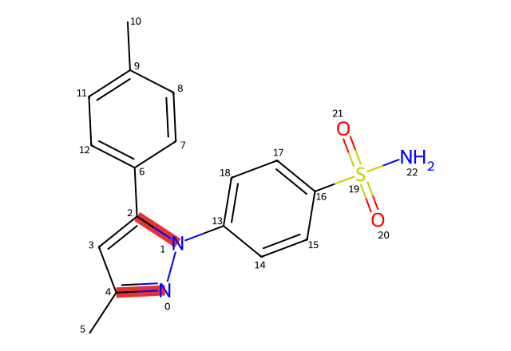

# 第三轮：盐组分不能使整条反应分析失效

## 修复与实际作用

U04的真实成环先例2223370使用芳基肼盐酸盐，材料SMILES为`Cl.NNc1ccc(S(N)(=O)=O)cc1`。此前反应分析复用了只允许单连通材料的校验，因盐的多组分表示直接返回`invalid_declared_material_structure`。这使已经召回的实际成环反应无法解释对应的目标成键。

现改为仅在**映射端点身份核对**时展开材料的全部连通组分，并按身份与份数核对。电荷、同位素、立体信息和反离子均保留；缺反离子或组分份数不足仍失败。虚原子、增强立体组仍按未支持语义拒绝。不修改材料实例、不做去盐/中和，也不从组分拆分推断实际投料。

最终真实复测中，2223370恢复为`partial`，识别出映射号(6,14)、(8,13)两根新C—N键及闭环，并投影到原始目标编号(0,4)、(1,2)。这些对应芳基肼与炔酮形成吡唑环的两处连接，与前轮核对的原文相符。

红色只表示来源反应的新键在目标中的对应位置。先例CF3与目标CH3的替换仍需验证反应性及区域选择性；图不是目标已制得的证明。来源映射不完整、步骤范围未知的限制均保留，`obtainment_hit`和`preparation_hit`仍为false。相同盐表示问题还影响了2144174的二羰基成环等记录，详见[实际分析变化](analysis_changes.json)。

恢复图分析也会让脏记录产生更多图变化线索，例如9033888仍有前轮指出的侧链变化疑点；本修复不验证原文与抽取的一致性，更不会将这些线索自动计为化学有效。

## 桥环缺口的定向诊断

对U01、U03分别取实际目标桥环，再一次加入一个完整目标支链，其余位点保持可变，执行有时间上限的只读子结构查询。另用原始索引`LIMIT 1`复核，排除了材料解析后过滤导致的假空结果。

| 目标 | 固定组合 | 分数≥12的产物结构索引结果 |
|---|---|---|
| U01 | 氮桥环＋带乙酯的环外双键支链 | 无命中，正常结束 |
| U01 | 氮桥环＋目标位置的直接乙酯 | 无命中，正常结束 |
| U01 | 氮桥环＋目标位置的酰基吡唑 | 无命中，正常结束 |
| U01 | 氮桥环＋苯基 | 有命中，主要为相关桥环酰亚胺 |
| U03 | 氧桥环＋目标位置的酰基吡唑 | 无命中，正常结束 |
| U03 | 氧桥环＋第一处苯基 | 无命中，正常结束 |
| U03 | 氧桥环＋第二处苯基 | 无命中，正常结束 |

[SMARTS、实际来源与原始索引复核](core_branch_probe.json)保存具体查询范围。这说明提高相似度或扩大当前预算，未必能补齐这些特定组合。结论只涉及该索引、分数门槛和固定表示；不证明全库不存在其他中间体、不同表示或可迁移的反应方法。

## 验证与剩余工作

新增11项回归：合法盐、缺反离子、电荷差异、同位素差异、组分份数、虚原子、产物盐，以及真实炔酮成环的目标成键投影。完整自检498项通过、无跳过，含61项私有临时PostgreSQL测试；中文说明、静态检查、类型、契约与构建通过。固定样本12目标/24任务重新评测。

四目标最终默认预算复测耗时分别为2.74、2.33、2.21、3.00秒，保留材料分别8、10、8、12条，仍因任务预算结束。本轮修复分析能力，没有新增召回方法，也不宣称检索精度整体提高。最终代码指纹为`1b78d073cbaed49e5307188a9006412e5dd3e20bc006393d90c9a2c046aedfc5`。

完整包在本机`.cache/core-iteration-2026-11-01/salt-endpoint-final/`。默认展示的分层配额、重要骨架与普通片段的优先级仍需继续评价；U02肼基安装直接证据及U01/U03更贴近目标布局的骨架方法仍未解决。
