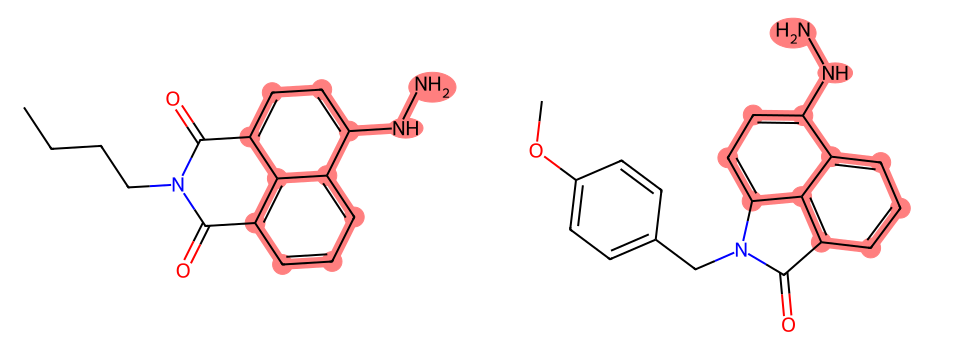
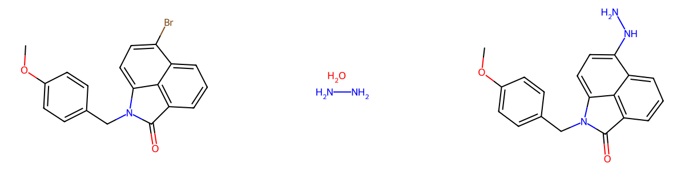

# 第四轮：保留芳香区域，找回肼基安装先例

## 新增的实际参考

U02现在能在默认10秒/40任务预算内返回`epo:1969751`，两次复测均位于展示第4位。实际合格来源为`EP22915126A1`的`p0122`，分数19。

原文明确记载：6-溴代、N-对甲氧苄基取代的苯并[cd]吲哚酮与水合肼反应，使用钯催化剂、膦配体和叔丁醇钠，生成对应芳位的肼基产物，报告产率93%。这是实际的芳基—NH—NH2安装，原文支持内酰胺羰基在该例中保留，不是仅从两个氮或子结构相似推断有用。

**它的参考价值**是提供“相近萘芳香部分上的芳基卤化物，通过钯催化接入肼”的具体方法。与原有同萘酰亚胺母核的其他胺取代例并列，可以分别参考肼的成键方式与目标母核的取代反应。

**它的限制**是先例为单羰基内酰胺，目标为双羰基酰亚胺；N取代及稠合杂环连接也不同。不能据此保证目标酰亚胺能耐受相同条件，更不能把93%当成目标的预期产率。当前仍未找到同一目标酰亚胺母核直接引入肼的库内实验。

结构化催化剂列表为空，但原文有明确钯/配体信息；空字段不等于无催化剂。新增先例没有被升级成已报告的完整目标制备，程序只投影已识别的芳基C—N成键到目标原子(18,19)。见[实际资料包中的参考](new_reference.json)。

## 为什么此前会漏掉

原先官能团邻域一旦碰到环，就补齐整个相连稠合环系。对U02而言，肼基邻域被强制附带酰亚胺环；另一个极小查询只剩N—N，又失去了萘芳香背景。因此实际安装肼的相近母核方法没有进入默认预算下的前排候选。

现增加通用的`aromatic_domain_functional_neighborhood`查询：环外官能团邻域连接到含非芳香环的混合稠合体系时，可以保留由芳香键连接的完整芳香区域及官能团连接，而不强制保留相邻非芳香环。原完整环系查询仍存在，其他支链仍按Markush方式变化。它不指定目标要断哪根键，不预测开环/闭环，也没有写入四个目标或先例ID。

单芳环、全芳香稠环、无环和全饱和环不为此增加重复查询。规则清单登记新家族，版本为`organic-reference-1.1`。

## 诊断范围和真实结果

前置只读诊断分别查询“萘芳香部分＋肼基＋两个原位置羰基”和“萘芳香部分＋肼基”。前者正常结束、无合格命中，放宽形式电荷亦无命中；后者返回实际候选，随后通过正式来源选择与完整匹配进入检索。诊断原始行只是候选，不能代替实际合格来源，也没有全部判为有用。详见[定向查询记录](u2_precursor_probe.json)。

| 目标 | 第一轮秒 | 第二轮秒 | 每轮保留材料数 | 本轮变化 |
|---|---:|---:|---:|---|
| U01 | 2.66 | 2.77 | 8 | 未新增关键方法 |
| U02 | 2.38 | 2.38 | 8 | 新增原文支持的肼基安装方法参考 |
| U03 | 2.27 | 2.31 | 8 | 未新增关键方法 |
| U04 | 3.15 | 3.22 | 12 | 保留此前实际成环参考 |

均因任务预算结束，不能据此声称全库穷尽。U02材料数从上一轮的10降为8，但新增内容解决了更相关的化学问题；不能以命中数增减代替参考价值评价。U01/U03与目标取代布局更接近的构建方法仍不足。

新增6项回归覆盖芳香区域与环外官能团连接、完整环系保留、不适用体系不扩展，以及真实肼基安装记录的端到端召回与目标成键投影。完整本地自检504项通过、无跳过，含61项私有临时PostgreSQL测试；中文说明、Ruff、mypy、契约和wheel构建通过。固定样本12目标/24任务重测完成。

八次在线结果均对应实现指纹`2297346789784d979e181e16fe344cdf3b198e8745d81a759b5b5020b7d5c792`。本目录保存计时与[展示来源](summary.json)，完整包在本机`.cache/core-iteration-2026-11-01/aromatic-domain-final/`。数据库只读，原始四目标文件未改动。
