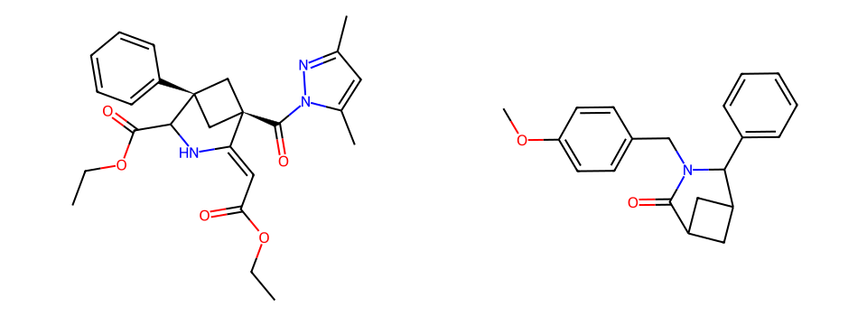
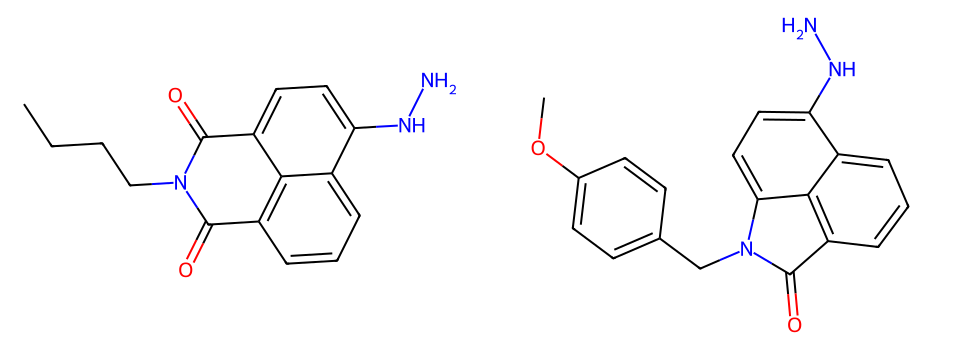
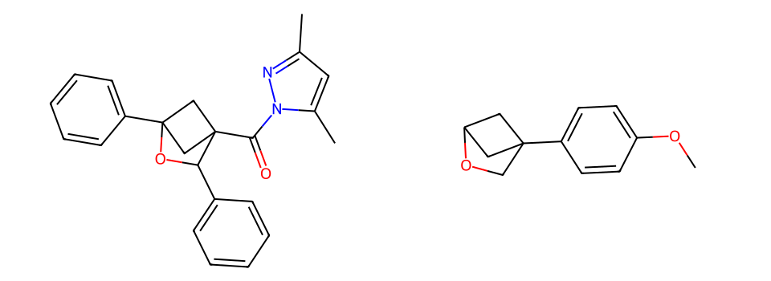
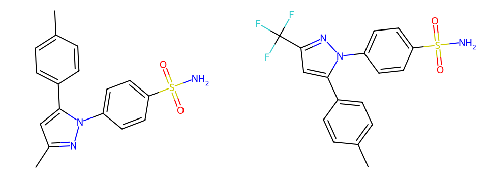

# 第六轮与四目标最终验收：实际合成方法参考

本轮给近邻池完全缺失的初始核心增加有界探索机会，默认预算内补入了U01的含氮桥环闭环和U03的含芳基氧桥环闭环先例。结合此前U02的肼基安装与U04的吡唑成环，四个原始目标现均有经原文核查、能够明确说明合成作用的方法参考。

这里验收的是用户要求的“有参考价值的合成先例”，具体作用和迁移限制逐条列出。四个完整目标的可执行路线、立体选择性和实验成功率均未得到验证，不能把来源产率套用于目标。

## 四个目标的实际参考价值

| 目标 | 本次实际来源 | 分数 | 两次展示位次 | 可供参考的化学问题 |
|---|---|---:|---:|---|
| U01 | uspto:6766761 | 22 | 7 / 7 | 带溴甲基的哌啶酮怎样经分子内C—C闭环构建3-氮杂双环[3.1.1]骨架 |
| U02 | epo:1969751 | 19 | 4 / 4 | 相近芳香母核怎样通过钯催化引入NH—NH2，且在该例中保留内酰胺羰基 |
| U03 | uspto:10255161 | 12 | 2 / 2 | 羟基环丁基甲基磺酸酯怎样经分子内C—O闭环构建带芳基的2-氧杂双环[2.1.1]骨架 |
| U04 | uspto:2223370 | 15 | 1 / 1 | 芳基肼与炔酮怎样形成所需连接类型的N-芳基、5-芳基吡唑并保留磺酰胺 |

分数均为正式适配器绑定的实际来源分数，不借用低分代表记录或其他实验的字段。每个目标的[实际参考资料](summary.json)及[人工化学判断](chemical_review.json)均已保存。

### U01：提供不同于桥环二酮光反应的构建方向

`US20160304517A1 p-0591`明确使用5-(溴甲基)-1-(对甲氧苄基)-6-苯基哌啶-2-酮及强碱，报告获得桥环产物80%。原文标题`h-0237`与下一段使用的产物名称，均确认是相应3-氮杂双环[3.1.1]庚酮；下一段还记录脱除N保护基的操作。对底物和产物的比较支持分子内C—C闭环，能够为目标氮桥环的战略切断提供具体参照。

目标的苯基位置、双酯、环外双键及指定立体关系不同；该例没有证明这些取代组合能按相同方式构建，也不证明其桥环羰基能直接变成目标环外双键。其价值是提供真实骨架构建方法与前体类型。

### U02：实际肼基安装

`EP22915126A1 p0122`以水合肼参与芳基溴的钯催化转换，原文报告93%，实际得到芳基—NH—NH2并保留该例的内酰胺羰基。它与此前同萘酰亚胺母核的其他胺取代例提供互补参照。

先例是单羰基内酰胺，目标是双羰基酰亚胺，且N取代和稠合连接不同；目标对肼及条件的耐受性仍须验证。结构化催化剂字段为空的缺陷不能抹掉原文明示的钯/配体要求。

### U03：带芳基的氧桥环闭合

`US20250304535A1 p-0642/p-0643`先把羟甲基转成磺酸酯，再以NaH处理并闭环；原文标题`h-0242`确认产物为4-(对甲氧基苯基)-2-氧杂双环[2.1.1]己烷，报告19%。这提供羟基环丁烷与离去基布置的具体参照，补充此前碘促闭环的另一类构建方法。

目标的两个苯基和酰基吡唑分布与该例不同，待闭环碳的取代和位阻也不同。不能据此保证目标闭环、酰基吡唑相容性或选择性。另一条`10143190`原文把磺酰化和闭环合在同一段，属于同类路线，不作为第二种独立方法计数。

### U04：保留连接关系的吡唑成环

`US20030096853A1 P-0049`明确芳基肼盐酸盐与芳基炔酮成环，形成相应N-芳基、5-对甲苯基吡唑并保留磺酰胺。它与此前二羰基缩合先例共同提供前体选择参考。

来源3位为CF3，目标为CH3；改变底物会影响电子效应与区域选择性，不能把这一差别自动视为已经验证的简单替换。

## 通用代码改动

对初始核心，若有界近邻池没有该核心，池外“产物有核心、已知输入无核心”的候选上限从2增加到8，并最多允许两次优先续页，随后恢复普通轮转。默认小页为2，因此前段最多连续处理三页。整体查询、定向查询和已有核心近邻的查询仍最多补两条，避免扩大无益成本。

来源提示与编排器均有上限；固定样本穷尽模式不接受优先提示。不同扩展资格使用独立缓存键，避免同SMARTS调用顺序改变候选上限。所有操作仍受原任务、反应数、时间及SQL超时预算限制，没有增加目标专用规则或来源ID白名单。

图上的核心出现不证明实际成环。扩大诊断的该固定谓词范围返回U01共39组、U03共9组，均少于40组上限；其中含漏抽底物和引用替换错误，不能将这些数量当作有效方法数量。详见[诊断候选](bridge_method_expansion.json)。

## 未被掩盖的结果质量问题

- U01前排7837882的原文包含2-苯基丙烯酸相关输入，但结构化反应物未完整记录，不能仅凭该反应式解释来源原子和过程；本次人工验收选用身份、原文和成键过程更明确的6766761。
- 9392974原文产率为116.66%，不能作为可靠产率优势。
- 2030567/2030568是使用预制氧桥环胺的引用替换，底物漏抽造成图上假成环，仍不计为骨架构建正例。
- 结果排序仍会受脏结构、缺失来源内容和结构覆盖指标影响。此次已找到具体方法参考，不等于全部返回结果均有效或前排都已清洗。

## 最终复测与验收范围

| 目标 | 第一次秒 | 第二次秒 | 每轮材料数 |
|---|---:|---:|---:|
| U01 | 2.74 | 2.96 | 11 |
| U02 | 2.43 | 2.41 | 8 |
| U03 | 2.32 | 2.60 | 9 |
| U04 | 3.24 | 3.22 | 12 |

全部按默认10秒/40任务预算运行，均因任务预算结束；不是全库穷尽，也没有验证并发性能。八次均保留上表经人工核查的方法来源。实际来源分数门槛始终≥12，查询条件没有温度、产率或危险品预过滤。

新增5项回归验证有限连续分页、其他家族仍能执行、固定样本模式、初始/定向/整体资格隔离，以及同核心缓存不串策略。完整本地检查512项通过、无跳过，含64项私有临时PostgreSQL测试；中文说明、静态检查、类型、接口/浏览器、契约与构建通过。固定样本12目标/24任务重新评测。

最终代码指纹为`6b15d6da97c7bab0c360857e2bbb5cc770b2b6a44a6beea9b83ad858b0534395`，完整包位于本机`.cache/core-iteration-2026-11-01/core-pages-accepted/`。本目录保存计时、实际来源资料、结构对照和[原文标题核验](bridge_heading_verification.json)。四个原始SMILES与最初快照逐字一致，数据库只读。

本次“迭代核心代码并为四目标寻找有化学参考价值的先例”的验收依据，是八次正式检索结果、逐来源原文核查及上述具体化学作用，而不是测试通过数、相似分数或预设方法标签。完整目标合成验证、未知迁移步骤、进一步数据清洗与全库召回率不作完成声明。
