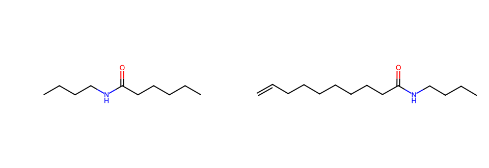

# 第十一轮：默认预算找回实际无环酰胺方法

本轮针对上轮发现的V06缺口定位原因，不增加目标或来源ID白名单。已核实的9289982在整体查询候选第6位，默认小页及多个相似家族反复处理前缀，使它只在扩展预算中出现。[原前八项候选](before_first_candidates.json)还包含环状胺/内酰胺：完整无环查询的图路径能够嵌入环中，这些记录占用了候选机会。

## 通用修正

1. 完整无环框架要求匹配原子不在环内；内部连接及杂原子保留H/X，防止仲酰胺整体框架被叔酰胺替代。末端碳仍允许链延长类比，严格完整目标身份由原严格查询核验。
2. PostgreSQL完整无环框架的产品通道每页最多6组，其余默认小页策略保留；仍取用户页上限与来源偏好的较小值。没有提高总任务、时间或反应预算。固定样本穷尽模式不使用该来源偏好。
3. 统计回归改用真正共同的乙基片段，不再依赖将伯胺和酰胺当作同一完整框架的旧假设；原跨来源命名空间计数要求全部保留。

## 实际化学收益

V06的`uspto:9289982`现在在两次默认40任务检索中都位于第2位，实际来源分数19，定位`US20230039502A1 p-0156`。原文明确9-癸烯酸与丁胺在PyBOP/Hunig碱条件下形成N-丁基酰胺，结构与文字支持目标所需的酰胺C—N连接，程序也将该键投影到目标原子(4,5)。

该例比默认旧前排的长链胶束缩合更直接提供普通酰胺化方法参照。目标链更短且无末端双键，不能把来源产率、条件或纯化效果当作目标已经验证；这仍是方法参考，不是已完成目标路线。

当前第1位3172265仍缺原文核实且结构关系有疑点，说明排序与来源一致性问题没有解决。图上成键更多或结构覆盖更高不等于方法更可靠。

## 验收结果

| 范围 | 实际结果 |
|---|---|
| V06默认预算第一次 | 3.71秒，11项材料；9289982第2位 |
| V06默认预算第二次 | 3.82秒，11项材料；9289982第2位 |
| 原四目标U01–U04 | 约1.81–2.68秒；此前人工核查的四条方法均保留 |
| 其余新目标V01–V05 | 约2.21–7.06秒；V02仍有SQL失败/超时，V05的身份错误问题仍在 |

本轮共11次只读验收：六个新目标、V06重复一次、原四目标。均受预算限制，不是全库穷尽。延迟与上轮不作受控性能对比，服务器缓存及负载未固定。[计时及实际来源](summary.json)完整保存。

新增2项回归验证大内酰胺虽然含无环酰胺路径却不能匹配完整无环框架、叔酰胺角色区别、较长开链仍可参考，以及同预算下有界六条页能处理更多不同记录并尊重用户较小页上限。原计数测试保持检查全部三层的实验、制备与使用计数。

规则版本`organic-reference-1.10`，代码指纹`a68a004bcd4de187f5e4cff39cc6596df0573e86a910e79b7c3dc56c355b58d6`。完整包位于本机`.cache/expert-query-2026-11-01/acyclic-budget-final/`和`acyclic-budget-originals/`。数据库只读，用户四个原始分子未改动。

这次有一项可验证的默认预算方法召回改善，但不足以证明专家能力。V05来源身份错误、V02矛盾精确产物，以及V06未核实记录排在可靠方法之前，仍是下一步需要处理的具体缺口。

完整本地检查570项通过、无跳过，含66项私有临时PostgreSQL测试；中文说明、静态检查、类型、契约、浏览器与wheel构建通过。固定样本12目标/24任务重新评测；用户页上限追加检查也单独通过。
