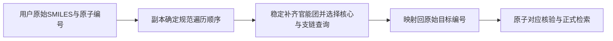

# 第七轮：同一分子的不同SMILES不应改变检索重点

本轮先做原子反转对照，发现四目标的默认非精确查询序列都会随输入遍历顺序改变。U02的整体骨架固定原子数甚至由17变为16，原因之一是官能团补齐仅遍历一次，末端肼氮是否被带入取决于两个胺匹配的先后。[修复前对照](before_queries.json)保留实际查询原子集合。

## 改动

规划前用去掉临时原子映射号的分子副本确定规范原子遍历，按该顺序选择家族，然后把全部查询原子对应映射回用户原始输入编号。目标电荷、同位素、立体信息和互变形式不改变，也不去盐。输出的目标原子编号仍属于用户输入，不能把规范编号当作原编号。

官能团补齐反复到稳定，避免规则命中顺序导致缺失。完整环系先按独立环连接数、杂原子数和大小排序，再用规范索引固定并列；这只是查询机会分配，不是合成难度评分。规则版本为`organic-reference-1.7`。

## 八次真实查询结果

| 目标 | 原始写法秒 | 等价反转写法秒 | 两者材料数 | 查询序列/来源材料集合 |
|---|---:|---:|---:|---|
| U01 | 2.19 | 2.20 | 8 / 8 | 一致 / 一致 |
| U02 | 1.70 | 1.79 | 4 / 4 | 一致 / 一致 |
| U03 | 2.01 | 1.80 | 6 / 6 | 一致 / 一致 |
| U04 | 2.71 | 2.74 | 14 / 14 | 一致 / 一致 |

查询序列比较去掉仅用于定位的原子映射号，排除原始完整目标的表达式书写差异；保留层级、规则、SMARTS谓词和选择顺序。来源比较同时包含命名空间、来源ID及实际材料SMILES，不只比较数量。[实际对照资料](summary.json)与八个计时文件可复核。

此前四个目标已核查的方法参考保留。U04比前轮多了3814593和272703的普通局部片段命中，没有解决其关键吡唑构建问题，不计为化学质量提升。本轮收益是等价输入的规划与召回更稳定，不代表所有环境、负载和数据库变更下都能得到相同结果；八次仍因任务预算结束。

## 验证与限制

新增7项回归：六类分子各做原子反转与三次固定随机重排，覆盖同位素、手性、桥环、对称芳环和无环多官能团；检查非精确查询序列一致、原始编号对应正确、自匹配成立、目标结构身份不变。另一项核对肼基官能团闭包与枚举顺序无关。

对称等价位点可以有不同但等价的对应，不把测试中的一致性推广为所有分子完全相同的原子编号。RDKit版本变化可能改变规范遍历和环感知，运行版本与实现指纹仍需记录。

复测脚本[run_representation_check.py](run_representation_check.py)使用正式v3适配器；连接从`RR_BENCH_DSN`读取，输出目录从`RR_BENCH_OUTPUT`读取，不改用户四个原始SMILES。完整包位于本机`.cache/expert-query-2026-11-01/representation-final/`，数据库只读。

最终实现指纹`f5792e2a21a118b6966369493d39863b77d636bea3d3cf6b3ec13bc3a0674792`。专家能力仍未证明；下一步应补充独立检索任务评价与查询信息收益，而不是以更多规则和测试数替代化学效果。

完整本地检查557项通过、无跳过，含66项私有临时PostgreSQL测试；中文说明、静态检查、类型、契约、浏览器与wheel构建通过。固定样本12目标/24任务重新评测。
