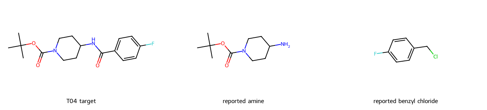

# 新反应表的检索性能与化学参考价值实测

日期：2026-10-31。结论：**当前有限预算下的响应速度可交互，但对没有精确产物先例的目标，类比方法召回和前排质量还不够。** 不能用“有结构命中”或“几秒返回18条”代替已经找到有用的合成先例集合。

[打开逐例分子图与化学判断](index.html) · [完整计时CSV](timings.csv) · [80个结果位置的审阅标签](chemical_review.json) · [目标结构](targets.json) · [原文定位及材料结构](source_records.json)

## 测试边界

- 实际查询 `reaction.reaction_v2`，构建记录为10,682,666条。所有检索沿用 `final_score >= 12`，未按温度、压力、产率、危险物或设备预先排除。
- 测试当前应用层检索、Markush核验、反应分析及排序。当前生产适配器仍写死旧表，因此测试连接只把来源表与索引目录里的表名改为新表；其他算法和SQL逻辑不改。这不是正式新表接入或性能优化后的成绩。
- 默认预算：10秒、40个任务、60个反应分析、2000个材料处理次数、12个家族、18个展示条目。SQL超时1.5秒，顺序执行、并发为1。
- 11个目标各运行两次，共22次默认查询。另选5个问题目标，将时间/任务/反应分析额度改成30秒/160/120，运行5次对照。总计27次应用检索。
- 计时包括测试子进程启动、连接、业务检索和结果序列化；不包含浏览器渲染，不是HTTP并发/QPS测试。没有清除服务器缓存，首次/重复不能称作严格冷缓存/热缓存实验。
- T05、T07是前次抽样时已知存在的目标，作为阳性检查；其他目标事先按结构类型指定。初轮发现多个目标有精确先例后，追加T09–T11作为困难类比集：各自规范SMILES的限定GIN查询确认没有12分及以上的精确产物记录。没有按返回排名挑选它们。
- 新分子量数组、重原子数组和DRFP尚未被当前检索代码消费；本测试不证明新增字段的加速收益。反应式DRFP也不参与默认目标分子检索。
- 数据库全程只读，未扫描全库计数、未建索引、未修改记录。生产检索代码保持提交 `27510e9` 不变。

## 速度与范围

22次默认查询：**中位数3.07秒，P95 5.01秒，范围1.53–5.66秒**。本次没有观察到SQL超时或查询错误；两轮各目标的前五名集合相同。

但22次全部因 `task_budget` 提前停止。通常只分析了24–31条反应，保留24–32条材料参考，就用完任务额度。多数目标尚未展开所有核心/分片家族；这不是相关反应已找完的延迟。

首次查询中，详情加载累计约0.60–2.32秒，是数据库时间的重要部分。当前一条命中反应一次详情加载会消耗任务预算；读取完整详情JSON也使缓存状态影响明显。不能简单把40个任务理解为40次不同骨架查询。

| 目标 | 结构类型 | 首次/重复秒 | 默认保留材料数 | 明确有用@5 | 前五名中的有用方法种类 |
|---|---|---:|---:|---:|---:|
| T01 | 乙酰苯胺：小分子酰胺 | 4.26 / 2.07 | 30 | 2/5 | 2 |
| T02 | β-丙氨酸乙酯：无环目标 | 4.84 / 2.30 | 26 | 3/5 | 2 |
| T03 | 甲氧基苯基–吡啶：联芳基 | 4.91 / 2.50 | 27 | 5/5 | 2 |
| T04 | Boc哌啶–氟苯甲酰胺：支链接母核 | 5.66 / 2.91 | 29 | 4/5 | 1 |
| T05 | Boc哌啶β-酮酯：库内阳性 | 4.39 / 1.61 | 32 | 3/5 | 1 |
| T06 | Boc脯氨酸甲酯：手性目标 | 4.39 / 1.87 | 29 | 5/5 | 2 |
| T07 | Boc哌啶酰化Meldrum酸：库内阳性 | 4.53 / 2.62 | 27 | 5/5 | 1 |
| T08 | 2-吡咯烷酮：小环内酰胺 | 2.34 / 1.53 | 29 | 3/5 | 2 |
| T09 | 多取代苯甲酰胺：无精确先例目标 | 5.01 / 3.24 | 24 | 0/5 | 0 |
| T10 | 氟代联芳基羟乙基酰胺：无精确先例目标 | 4.53 / 2.65 | 27 | 0/5 | 0 |
| T11 | 氟代支化氨基酯：无精确先例目标 | 4.07 / 2.66 | 26 | 0/5 | 0 |

“保留材料数”可能大于已分析反应数，因为同一反应可以命中多个具体材料。方法种类按本次化学审阅归组，既不是数据库标签数量，也不是独立实验数量。

## 如何判断参考价值

我逐一查看了第一轮每个目标的前五名：目标、具体命中产物、实际底物、反应变化、原始材料名称，以及能定位的原文段落。共55个默认结果位置；扩大预算另审25个位置。它们涉及63条不同反应，其中60条找到了原文。14条需要为原文定位补齐文献种类码，这仅用于审核，不修改来源记录。

- **A（16/55）**：原文支持的直接目标方法。仍不是我独立做过实验，也不等于可复现成功率。
- **B（14/55）**：化学联系明确的可迁移方法，或有明确目标转化关系的通用方法。逐条说明需要替换的底物、步骤/盐形/立体限制；不把类比写成已实验验证。
- **C（10/55）**：有线索但证据或方法对应不足，例如缺原文、引用未展开、只有很弱的局部类比。保留而不是判定化学上绝对无用。
- **D（13/55）**：变化不支持该目标需要的连接或转换，主要是结构噪声。
- **E（2/55）**：明确低转化/失败方向，或来源内部存在重要矛盾。不作为成功正例；负结果仍有避免失败的参考作用。

以A+B为“有明确化学参考价值”的口径，**默认前五名为30/55，即54.5%**。这是这组目标的逐条审阅结果，不是全库准确率、路线成功率或召回率，也未经独立双人盲评。T09–T11的默认前五名为**0/15**；其他8个常见/阳性目标为30/40。多个有效记录属于同一方法，30个有效位置仅覆盖13个按目标分别计算的方法族。

## 化学上看到了什么

### 能找到正确方法：联芳基与酸胺连接

T03的前排确实提供目标的芳基—吡啶连接：记录5784198使用3-溴吡啶和对甲氧基苯硼酸，原文报告目标及58%；1360583改用3-碘吡啶，报告67%。4447900给出经锌盐转金属的另一交叉偶联路径。但其溴代/氯代吡啶是替代实验，不能像抽取列表那样视为同时投入的两种底物。

T04的4372752、4624174、8682986、1348632用相同的N-Boc-4-氨基哌啶和不同芳酸构建外侧酰胺。换成目标4-氟苯甲酸是明确的单底物替换候选；保留Boc并核对酰化位点是关键。4372752的原文包含后续脱保护，目标需要Boc，不能把整段操作原样照搬。

### 精确产物第一名也可能不可信

T04第一名3892443（分数13）给出目标酰胺和97%产率，但原文写的是4-氟苄氯，与胺在DCM反应。苄氯和苯甲酰氯差一个羰基，通常导致不同成键结果；当前记录没有解释羰基来源。可能是原文命名错误，但不能擅自修正后当作可靠正例。



### 12分门槛不能识别失败记录

T01第二名4788454（分数13）在结构上是苯乙酮肟到乙酰苯胺的Beckmann方向，但原文明确写“unsatisfactory conversion to acetanilide was observed”。它可以帮助识别不佳操作条件，不能被排名为成功合成正例。其余前排还有专利背景综述和通用路线，不能都算独立实际实验。

### 引用实例被误当成底物

T05的2554809和4237376说目标由N-Boc哌啶甲酸按另一实例的方法制备。抽取却把被参照实例的吡啶β-酮酯列为共反应物，得到误导的净反应。1319410、7326284、6801271才提供清楚的酸酯与乙酸乙酯Claisen方法，原文47%；其中多项为同一实验的重复公布。

### 手性与方法多样性没有充分体现在前排

T06第一名2803860的O-甲基化方法有参考价值，但来源未指定目标构型。第二名1745008反而明确使用对应(S)构型前体得到目标。二者相似度都为1，不能用这个数替代立体要求满足程度。

T07五条前排均围绕哌啶羧酸与Meldrum酸的C-酰化。环已经在原料中存在，并非五条成环路线；有的记录仅报告粗品。应展示一个方法组及不同证据/条件，而不是五个重复卡片挤满结果。

T08的GABA环合和γ-丁内酯氨解都与目标有关，但前排也混入发酵液脱色段落、回收率表及一般性高产率主张。必须区分前处理、成环操作与结果陈述。

### 没有精确先例时，共享片段经常压过正确方法

T09需要的是哌啶-NH-C(O)-芳基连接。前排却是烷基Suzuki、Mitsunobu芳醚化、杂芳胺化等；共享Boc哌啶或卤代芳环不代表能构建同一连接。扩大预算后仍没有前五名明确有用记录。

针对T09做了一个有限正对照：T04检索到的4372752是可考虑替换芳酸的酰胺化先例。它能够通过T09多个现有核心/分片家族的离线匹配，但不在当前整侧指纹前512池中，两档预算也没有返回该记录。这证明至少存在一个“库中有合格相关先例、规则允许匹配、实际检索却没带回来”的例子；不等于测出了全库召回率。

T10目标需要联芳键和羟乙基酰胺。默认前排包括喹唑啉酮成环、羟乙基芳醚、氟乙基芳醚和MOM保护。它们的片段重合不足以支持两项关键连接。扩大预算才出现901859/5595859这类烟酸酯与氨基醇酰胺化方法，能为目标的局部酰胺构建提供类比，但尚未解决联芳键的另一段构建。

T11前五名是同一个大分子氨基酯芳酰化的多份公布，既没有解决目标的α-F，也没有解决目标支化链与末端伯胺；产物图中的氮去向还值得核查。扩大预算仍未在前五名找到明确有用的方法。不能由本次失败推断库中不存在相关反应。

## 扩大预算对照

只增加时间、任务数和允许分析的反应数，不改查询语义或排序算法。

| 目标 | 默认有用@5 | 扩大后有用@5 | 扩大后耗时秒 | 保留材料数 |
|---|---:|---:|---:|---:|
| T02 | 3/5 | 3/5 | 11.34 | 120 |
| T04 | 4/5 | 3/5 | 12.33 | 125 |
| T09 | 0/5 | 0/5 | 12.33 | 120 |
| T10 | 0/5 | 2/5 | 11.87 | 120 |
| T11 | 0/5 | 0/5 | 8.01 | 120 |

这5次均因120条反应分析上限结束。更多候选不是自动更高质量：T04前五名还被一个不适用的还原胺化记录占位，T09/T11仍然没有合格前五名。

## 改进顺序建议

1. **先识别反应结果和来源语义**：低转化/失败、通用说明、替代底物、引用实例、前后处理要分开。对原文与结构明显不相称的记录降级或标疑点。不能只继续抬高AAM分数；本次20分记录也有无关或可疑结果。
2. **给不同目标连接和家族留出实际分析机会**：当前每条详情读取都吃任务额度，精确/早期宽家族很容易先耗尽预算。已知可用对照被KNN池与后续预算漏掉，需检查候选选择与家族调度，而不是仅把超时调长。
3. **按目标所需的成键环境排序**：酰基C-N、芳基C-N和普通C-N应区分；局部映射到某根键不等于该方法适用于目标。给立体要求满足、同一母核反应端保持、只需更换一个明确底物的候选更合理的位置。高温/低温不是这里的主要排除依据。
4. **先例集合去重与方法分组**：同源公布和相同实验压缩展示；保留不同构建方法及其多份证据，避免五个记录其实只有一种方法。
5. **再减少详情读取开销并接入预计算属性**：按需读取/批量加载真正需要的详情；分子量与重原子数是辅助候选选择，不会自动修复反应语义或位点错误。

所有27次都没有产生单反应物替换建议，返回原因包含 `source_step_not_assigned`。这表示当前来源接入没有满足该功能所需的明确步骤条件，不是证明数据库没有可替换底物的方法。反应物使用通道在这些运行中也未实际展开；既有部分GiST兼容问题仍需正式接入时处理，不能把本测试当作该通道验收。

## 复核文件与复现

- `index.html`：11个目标及默认/扩大预算的80个审阅位置，每条附真实产物、底物图和具体判断。
- `chemical_review.json`：逐条标签、方法族和中文化学理由；标签由我填写，不从系统的contribution或相似度自动生成。
- `source_records.json`：63条有限先例的主键、分数、结构、来源段落和原文定位状态；不包含数据库凭据。
- `timings.csv` / `summary.json`：27次计时、范围和聚合结果。
- `benchmark.py`：本次基准的可复用脚本，只读连接、固定目标、表名重定向与计时包装。来源连接使用环境变量 `RR_BENCH_DSN`，不写在文件里。
- 完整阶段包、原文缓存、精确查询探针和T09正对照保存在本机 `.cache/live-benchmark-2026-10-31/`，未将大段专利原文归档到公开报告中。

复跑时使用独立输出目录，以免复用本次缓存结果：

```bash
# 事先通过安全环境配置设置RR_BENCH_DSN；不要把密码写入命令文档或提交文件。
RR_BENCH_OUTPUT=/tmp/rr-live-repeat \
  implementation/.venv/bin/python reviews/live_benchmark_2026_10_31/benchmark.py --repeats 2
```

本报告提供问题定位和这组分子的实际结果，不给出全库精确率、全库召回率、并发容量或目标合成成功率。后续修改后应对同一组目标、相同预算重测，再比较速度和化学质量。
